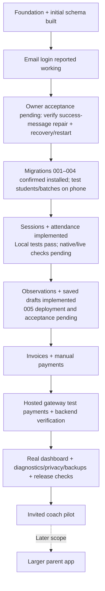

# Parent Plus Coach — development checkpoint

## Module 6 build — 14 November 2026

Development is active at the owner's request. Candidate **0.5.0** (Android versionCode 8) adds monthly invoices and manual payment records under FEE-01. [Fees workflow and setup](docs/FEES.md) covers immutable fee/name snapshots, full-month enrolment eligibility without automatic proration, due dates, derived unpaid/partial/paid/overdue states, manual receipts, attributed reversal/void history and replacement invoices. Unknown write outcomes retain one exact request in account/academy-scoped device storage for retry; failed storage prevents the write. Test gateway totals stay separate from real balances. No online collection, links, refunds, parent delivery or phone-control automation is enabled.

TypeScript and **111 automated tests across 14 files pass**, including ten new PostgreSQL integrity/access checks and six model/device-recovery checks. The full **47 browser flows pass** with one worker, including eight fee flows. Web (308 modules) and Android/Hermes (699 modules) exports, ten build-tool checks, generated SQL integrity and ten Mermaid render checks pass. The fictional 412×915 paid-invoice screenshot is saved in the fees guide. Native APK and hosted Vercel verification now pass; the final result below supersedes earlier pending/cancelled attempts. Agent review then found and drove repairs for memory-only recovery navigation and legacy test-payment labelling; TypeScript and all nine focused fee browser flows pass after those repairs. Migration **006 is prepared, not deployed**. The owner now reports005 success; the live API independently confirms observation history exists and rejects anonymous reads. Internal metadata verification is pending; see the latest follow-up below. Existing 001–004 must not be repeated. The latest verified APK is now0.5.0 from cdd321e; the0.4.0 result below is historical.

Daily product review: FEE-01 and coach-first scope remain unchanged. Next development module is gateway **test-mode** integration (Module 7), followed by release/recovery gates. Real Supabase/API, native storage, observations and billing acceptance remain separate from fixture tests. The owner asked how Supabase is used: GitHub stores source/tests/build instructions, Vercel builds the web app, and Supabase provides authentication and private academy records/access rules. No database deployment was made during this build.

The owner subsequently requested Vercel installation and testing there by an agent. A hosted-app testing agent is assigned to verify the actual deployment, public behavior and browser flows, with real-backend checks distinguished from fictional transport tests. The owner supplied an authorized Share link and the agent reached the hosted app; the share token is not saved in source. No real test-account login is available yet; do not invent live persistence acceptance.

## Vercel deployment investigation — 14 November 2026

Resolved deployment blocker for `appsworld2027/parent-plus-varcel` at app version 0.4.0. Workspace commands and repository clone work. Inspected source `f791a32`, its GitHub author mapping and Vercel status before changes. GitHub returned `author: null` for the commit's configured author email; Vercel reported **Deployment was blocked** ([failed attempt](https://vercel.com/appsworld2027/parent-plus-varcel/EQ19jEQgtihu9Mcb2we86FW3WBwX)). The workspace inherited the same unmapped Git identity, explaining the author-identification failure.

Authenticated GitHub account is `appsworld2027`, numeric ID `352282836`. Repository-local Git identity now uses its GitHub private address, `352282836+appsworld2027@users.noreply.github.com`. Forward commit `90688bb06d476c83350aa139b87592f33e29e6c9` retried the existing Vercel integration without rewriting history. GitHub maps both author and committer to `appsworld2027`; Vercel reports **Deployment has completed**, state **success**, for [deployment 2qcFrsP4bB7m7sZ137S5AJuU9EtS](https://vercel.com/appsworld2027/parent-plus-varcel/2qcFrsP4bB7m7sZ137S5AJuU9EtS). No account action was required. This confirms deployment, not real-user web acceptance. No product requirements changed in today's review; Module 5 acceptance gaps below remain open.

Pre-commit checks: TypeScript and all 95 tests pass; web export passes (304 modules); generated SQL bundle matches its sources; `git diff --check` passes. The first sandboxed test run hit a subprocess `EPERM` on the bundle check (94 others passed); the full rerun outside that restriction passed all 95. Only Markdown handover files changed; app version, runtime code and database migrations are unchanged.

Historical Module 5 checkpoint, 12 November 2026. **Feature development resumed at the owner's explicit request.** Current milestone: Module 5 private observations and durable drafts, candidate 0.4.0 (Android versionCode 7). The owner will set up the Windows emulator later. Physical-phone control/automation stays on hold. The parent app and live payment collection remain deferred.

At that checkpoint, branch: `codex/coach-foundation`. Verified APK: **0.4.0**, source `f8eb60a886d3ac6bcb8ea059cf6a5467232e4994`, containing ARM64 and x86_64. [Download APK](https://github.com/appsworld2027/Parent-plus-/actions/runs/43225589808/artifacts/13948107259); [successful native build](https://github.com/appsworld2027/Parent-plus-/actions/runs/43225589808). Source and documentation are saved on GitHub. Native installation and live observation operations are not yet accepted. No PR/merge to main is recorded.

## Module 5 implementation checkpoint

Private individual/batch notes, explicit recipient snapshots, optional linked classes, device autosave, workspace drafts, recording, text-only corrections with fixed recorded scope, recent versions, history pagination, lost-response retries, conflict comparison and sign-out draft warnings are implemented. See [the owner/developer guide and flow](docs/OBSERVATIONS.md). Local TypeScript, 95 automated tests, 39 browser flows, web/Android bundle exports and ten build-tool regression checks pass. The final native APK build/signature/ABI checks also pass. These results do not constitute native or live API acceptance.

Migration **005 is prepared, not deployed**. Versions 001–004 remain owner-confirmed installed. Only the new 005 update is needed for observations; do not repeat initial setup. Without it, Post shows a clear update-needed error. No owner task is needed during this development stage; the short one-time setup and acceptance steps are saved for when the owner returns.

At that checkpoint, owner steps were 005 and observation/device acceptance; Module 6 was next. Module 6 has since been implemented above; both missing updates 005 and 006 now precede real observation/fee acceptance. Existing login recovery/attendance/feedback native acceptance remains open. No unattended service or permanent monitor is created by this work.

## Verified 0.4.0 build

[Run 43225589808](https://github.com/appsworld2027/Parent-plus-/actions/runs/43225589808) succeeded at 13:22:26 UTC on 12 November (18:52:26 India time), approximately 6m42s after its start. Package `com.parentplus.coach.preview`, versionCode 7, development signing, 43,567,642 bytes. Both `arm64-v8a` and `x86_64` contain 17 native libraries verified by ELF machine type. SHA-256: `d3faf689030bfa7f0732f33dbd6c1cd94189d8ba66acfa3be8f5adea25bd5737`. Settings-only Supabase checks passed; this is not a real user-login/observation test. Monitoring ended on terminal success. Installed apps require a manual update. No paid service or live payment was activated.

## Laptop compatibility request — historical verified build 0.3.2

Owner supplied Windows with Intel Core Ultra 7 after requesting APK/emulator links. Standard Windows Intel Android emulators need x86_64; the verified 0.3.1 phone APK is ARM64-only. The scoped 0.3.2 packaging change adds both architectures to the same APK, with native ELF/header verification and four regression checks. App features/API/schema behavior are unchanged. That packaging checkpoint preceded the current feature-development resume; phone automation remains on hold. See [Windows emulator steps](docs/WINDOWS_EMULATOR.md). Native compilation, signature and actual APK ABI/ELF checks passed in [run 43186145925](https://github.com/appsworld2027/Parent-plus-/actions/runs/43186145925); 17 libraries per architecture verified. [Download 0.3.2](https://github.com/appsworld2027/Parent-plus-/actions/runs/43186145925/artifacts/13928512623). Actual Windows-emulator installation/UI behavior remains pending.

## Stop / cloud-sync handover

Historical checkpoint: the owner previously paused feature work and requested a cloud sync. This was superseded by the latest explicit development resume. Physical-phone automation remains paused.

- App source and documentation are saved on `codex/coach-foundation`; no merge to `main` is recorded.
- The prior feedback APK is 0.3.1, source 73805fa, run 43176931524; the later scoped compatibility build is 0.3.2 as recorded above. Native build/signature checks passed; installation and visible-notification acceptance on the phone are not confirmed.
- Database versions 001–004 are owner-confirmed installed. Do not repeat SQL setup.
- Last local evidence: 79 automated checks, a full 30 browser flows and 21 focused checks after final wording changes. No new tests/builds were started for this sync.
- Phone-control automation is **on hold**. The QA agent completed a read-only capability audit: no physical-phone connection exists. It did not pair with, control or modify the owner's phone. No test-phone purchase or debugging setup is required while paused.
- No build monitor, active QA worker or unattended job is being maintained by this session. A repo sync does not create a background development service.
- Next product module proposed: observations and durable drafts, followed by invoices/manual payments, gateway integration and release gates. These are pending; the recommendation is not a claim that they were implemented.
- On an explicitly requested resume, first review pending 0.3.1 feedback and attendance acceptance. Keep the parent app deferred and phone-control automation on hold unless separately resumed.

## Current phone evidence and feedback repair

The owner’s screenshots confirm 0.3.0/80bf1e7 installed, an owned workspace and saved roster/class data visible, and an unsent device attendance draft. A server attendance save/restart has not yet been confirmed. The owner reported unclear success/failure; 0.3.1 adds a fixed notification row, explicit local-vs-server state and result details. See [feedback design/evidence](docs/ACTION_FEEDBACK.md). No database update is needed. Code fix is browser-tested and native-build verified; phone verification remains pending.

## Actual position

A standalone native Android preview has been built successfully. The owner installed the earlier 0.2.0 APK and reported receiving the confirmation email and logging in. The owner also reported the app closing after the in-app account-creation email request. An unsupported Android accessibility prop was found on that success screen and roster-save notices. Version 0.2.1 repairs both. Its build and signature verification passed, but installation and confirmation of that repair on the owner's phone are still pending. Do not describe the crash as device-verified resolved.

Students, guardian contacts and batches are implemented and tested locally/browser-side. Migration 002 installation is confirmed by the owner’s filtered four-row version result; live phone persistence tests remain pending. Classes, attendance and a real-record Today summary are now implemented and locally tested; migrations 003/004 are confirmed installed, while app/API and phone acceptance remain pending. The observation implementation is in the current candidate; the complete fee/payment journey is not yet available. No percentage is assigned: modules differ substantially in size, and implemented is distinct from accepted.

## Module status and next gates

| Original build-plan module | Built / verified | Remaining before acceptance |
| --- | --- | --- |
| 0 — Foundation, testing, diagnostics | Native shell, GitHub source/CI, recovery boundary, validated device-persisted safe reports with best-effort storage and sign-out clearing; prior APK builds/device launch | Native persistence/sharing and controlled recovery checks; remote/native crash monitoring remains unimplemented |
| 1 — Database and access protection | Migrations 001–004 confirmed installed; local PostgreSQL isolation/constraint tests | real two-account isolation tests; backup/export/restore validation |
| 2 — Authentication and academy onboarding | Email signup/login/recovery, secure storage and academy setup implemented; owner reports actual email and login | Verify 0.2.1 success-message repair; real academy setup, cold restart, refresh/logout, recovery/password update, invalid/expired links; production email delivery setup/limits |
| 3 — Students, contacts, batches | Add/edit/archive, guardian contact, batch create/edit, additive enrolment, search/filter, retry/navigation guards; SQL/browser checks pass | Live save/reopen/restart/edit/archive and offline/retry checks. Ending/moving/restoring enrolments remain deferred |
| 4 — Sessions and attendance | Dated session create/edit/cancel UI, present/late/absent and mark-all, one device attendance draft, complete-roster revision-checked atomic saves, lost-response reconciliation, real-record Today summary; SQL/model/browser checks | Android/native storage, actual API isolation, timezone, restart/offline/conflict acceptance |
| 5 — Observations and drafts | Candidate 0.4.0 editor, device/workspace drafts, immutable recorded recipients, text revision history, conflict comparison and retries; local tests | Migration 005 deployment; real app/API/device acceptance; photos/rich fields optional later |
| 6 — Invoices and manual payments | Candidate 0.5.0 invoice/manual-receipt screens, trusted snapshots and balance calculations, attributed reversal/void corrections, exact-request device recovery | Migration 006 deployment after 005; real API/device acceptance |
| 7 — Payment gateway | No gateway integration or collection enabled | Confirm provider/test eligibility; server-only credentials and link creation; webhook verification/reconciliation; duplicate/failure/delay/mismatch/refund/excess-payment checks; separate approved live enablement |
| 8 — Release and recovery | Internal development-signed preview APK and build evidence | Whole coach journey on phone, remaining dashboard features as later modules ship, privacy/settings/deletion, native diagnostics coverage, backup/restore, release signing ownership and regression/security/payment acceptance. Play Store publication is separate |

The larger parent app is deferred. Phone/WhatsApp authentication, media/rich feedback and recurring schedule generation are not part of the current required email-first pilot.

## Journey

Diagnostics/recovery improvements and real-phone checks run alongside the modules; they must not be postponed entirely to the final stage. Each module needs meaningful automated checks, Android build regression and its own live/device acceptance before being called complete.

## Evidence

- Historical 0.3.1 local checks: TypeScript passed, **79 automated tests across 10 files**, **30 browser tests**, followed by 21 focused checks after final notification wording changes. Browser auth/roster tests use a fictional transport, not real project records.
- Native accessibility contract test failed at exactly the two invalid status props before the repair, then passed. It reads the installed Android implementation; it is not a device crash reproduction.
- Successful replacement build: [run 43176931524](https://github.com/appsworld2027/Parent-plus-/actions/runs/43176931524), source `73805fa2c5bb60d77095b7ad19dc5ded8a7b2b53`.
- [Download 0.3.1 artifact](https://github.com/appsworld2027/Parent-plus-/actions/runs/43176931524/artifacts/13924941624). GitHub ZIP contains `ParentPlus-Coach-Preview.apk`; artifacts retained 14 days.
- APK: `com.parentplus.coach.preview`, ARM64, development signed; 26,351,470 bytes. SHA-256 `6d359a7ec5edf9e04fecc58b41767388896d3c4bbddcfcb927b90f370cf34239`.
- Real settings-only auth probe passed: reachable, public key accepted, email enabled, confirmation required, anonymous profile records denied. This does not independently establish real-user session/recovery tests.
- Owner confirmed migration `202611110001`, email provider and redirect settings. A subsequent filtered version query returned all four expected rows, confirming 002–004 at `2026-11-12 06:57:00.026915+00`. Do not repeat those setup tasks.
- [Detailed validation](docs/VALIDATION.md), [issue history](docs/ISSUES.md), [roster deployment](docs/ROSTER_SETUP.md), [PRD](PRD.md), [build sequence](BUILD_PLAN.md).

## Right resume order

1. Follow [the current one-step owner handover](docs/OWNER_NEXT_STEP.md). Apply only missing 005 and 006 in order; do not repeat 001–004. The hosted app and database are separate deployments.
2. With fictional records and a secure test-login route, verify actual Supabase persistence and two-account isolation for observations and fees, plus the remaining roster/classes/attendance checks. Hosted fixtures and anonymous denial do not replace this gate.
3. Install the latest verified Android APK from the current build result above, preserving app data. Complete native SecureStore, restart/recovery, sign-out, financial pending-request and Windows-emulator acceptance when convenient. Phone-control automation remains paused.
4. Continue Module 7 gateway test integration only with server-side secrets, verified events, test/live separation and a real provider sandbox gate. No real collection, refunds, purchases or parent delivery is enabled by this work.
5. Complete whole-journey release checks, backups/restore, privacy/deletion, production signing and support coverage before an invited live pilot or public launch.

## Documentation and product working agreement

Current-state flow diagrams are in [ARCHITECTURE.md](docs/ARCHITECTURE.md). The code map, comments policy, handover and product collaboration practices are in [DEVELOPER_GUIDE.md](docs/DEVELOPER_GUIDE.md).

Refresh affected technical docs after substantial changes. Make one consolidated PRD/progress review per active working day; update the PRD when requirements actually change and record unchanged reviews in progress. Report critical failures, blockers and material product decisions immediately. This is not an automated background schedule. Product discussions should bring recommendations, tradeoffs and acceptance criteria, not only implementation details.

Daily product review on 12 November 2026: coach-first scope and PRD requirements are unchanged. Documentation/readability review adds current flow diagrams, source comments, a developer handover and a product decision record; the owner subsequently resumed feature development. The new source milestone is 0.3.0; existing live/device acceptance gaps remain open.

## Ownership and constraints

- Codex handles implementation, technical investigation, tests, build automation and instructions. Owner performs necessary account/dashboard tasks and short phone acceptance steps, not code debugging.
- No administrator/network-policy changes are available to the owner. Use GitHub-hosted builds and the existing Supabase dashboard route. Do not request new tokens or repeat known blocked access attempts.
- GitHub stores source, migrations and documentation. Supabase stores private app records/authentication. Public client connection settings are intentionally bundled; no privileged keys go in source or client code.
- Expo account authorization is unnecessary for the working GitHub preview route. Production signing/Play distribution remains separate.
- No approved merchant configuration, deployed gateway backend, live payments or production SMTP is confirmed. Backup/restore and native crash monitoring remain open.
- Use evidence-backed wording: distinguish source fixes, automated checks, CI success, owner reports and device verification. Check our code/configuration before attributing failures externally.

### 14 November hosted and security follow-up

The testing agent completed all **44 applicable browser flows on Vercel**, plus real production phone/desktop validation, JS loading, direct recovery-route and settings-only Supabase checks. Four deliberate development-only preview/error-injection flows are covered locally and correctly absent in hosted production. [Hosted report](docs/VERCEL_QA.md) records source/bundle identity and limits. The agent found and drove repairs for memory-only fee recovery, legacy TEST labels and a missing Vercel recovery-route fallback. Real API zero-row probes confirm all12 existing record tables deny anonymous access and005/006 relations are not available yet. Real authenticated writes and two-account acceptance remain open.

A scoped build-tool dependency security repair passes TypeScript,111 tests, actual fingerprint generation and6,028 independent matcher comparisons; full npm audit now reports zero known vulnerabilities. See [security verification](docs/SECURITY_VALIDATION.md). Final CI/Vercel/native results for this dependency checkpoint will be recorded when terminal. No real records, emails or money were created by the hosted tests.

### Verified 0.5.0 native build — final checkpoint

[Run43625002448](https://github.com/appsworld2027/Parent-plus-/actions/runs/43625002448) completed successfully in about8m15s; status report18:17:12UTC on14November2026. Exact source `cdd321e95f6e5dee18b209c0fc3e87461d6a8ac1`. [Download verified APK](https://github.com/appsworld2027/Parent-plus-/actions/runs/43625002448/artifacts/14126395027). Package `com.parentplus.coach.preview`, version0.5.0, versionCode8, development signing,43,606,218bytes. Signature and native ELF/ABI checks pass:17 libraries each for arm64-v8a and x86_64. SHA256 `6cdfff1270888c77c8be757faf69a5124a2b88badd722c9faf4e28f6cb9ddd40`. GitHub's full check run also passed111 tests,48 browser flows and both exports. Vercel success and44 hosted flows are recorded in [the hosted report](docs/VERCEL_QA.md); full dependency audit is zero known vulnerabilities. Monitoring ended on terminal success; no background worker is retained.

The user opened the existing Supabase SQL editor and requested pasteable005 SQL. The exact immutable005 source was supplied; execution is not yet confirmed. Provide it in a main-reply code box with Copy support. Next verify005 deployment, then guide006 separately, one step at a time. Do not assume either update ran. Actual authenticated persistence/two-account isolation and native device acceptance remain open. No real money or parent notifications were enabled. APK artifact download from this workspace was blocked by the artifact storage host; native verification evidence is from the successful CI job, not an independent local APK inspection.

### Owner observation update follow-up

The first editor attempt returned42601 near the opening schema-version guard at line91; the exact original migration passed all8 observation database checks again, and the live history endpoint still returned404. Pasted/modified editor content was suspected; the cause was not proven. The owner subsequently reports Success, no rows returned. Live zero-row probes now return401/42501 for observation_versions and observation new-column selection (previously404), confirming API availability and denied anonymous access. The fee balance relation remains404/PGRST205, so006 must still be treated as pending.

Do not repeat001–004 or rerun005 merely for verification. A [tested read-only metadata verifier](docs/VERIFY_OBSERVATIONS.md) is prepared to check005 registration, required columns, all three RLS flags, exact owner policies with no extra permissive policy, table/function grants, definer/search_path settings and the normalized installed save-function body. It passes8/8 on the correct disposable schema and detects all5 deliberately unsafe fixture changes. Await its live output before claiming full internal005 verification. Registered-user save/reopen and two-account real API acceptance remain separate.
