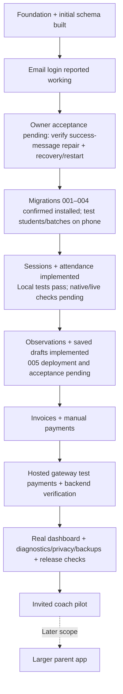

# Parent Plus Coach — development checkpoint

Date: 12 November 2026. **Feature development resumed at the owner's explicit request.** Current milestone: Module 5 private observations and durable drafts, candidate 0.4.0 (Android versionCode 7). The owner will set up the Windows emulator later. Physical-phone control/automation stays on hold. The parent app and live payment collection remain deferred.

Branch: `codex/coach-foundation`. Latest verified APK: **0.4.0**, source `f8eb60a886d3ac6bcb8ea059cf6a5467232e4994`, containing ARM64 and x86_64. [Download APK](https://github.com/appsworld2027/Parent-plus-/actions/runs/43225589808/artifacts/13948107259); [successful native build](https://github.com/appsworld2027/Parent-plus-/actions/runs/43225589808). Source and documentation are saved on GitHub. Native installation and live observation operations are not yet accepted. No PR/merge to main is recorded.

## Module 5 implementation checkpoint

Private individual/batch notes, explicit recipient snapshots, optional linked classes, device autosave, workspace drafts, recording, text-only corrections with fixed recorded scope, recent versions, history pagination, lost-response retries, conflict comparison and sign-out draft warnings are implemented. See [the owner/developer guide and flow](docs/OBSERVATIONS.md). Local TypeScript, 95 automated tests, 39 browser flows, web/Android bundle exports and ten build-tool regression checks pass. The final native APK build/signature/ABI checks also pass. These results do not constitute native or live API acceptance.

Migration **005 is prepared, not deployed**. Versions 001–004 remain owner-confirmed installed. Only the new 005 update is needed for observations; do not repeat initial setup. Without it, Post shows a clear update-needed error. No owner task is needed during this development stage; the short one-time setup and acceptance steps are saved for when the owner returns.

Next owner steps, when convenient: apply only 005 and run the short observation/device acceptance check using the new APK. Next development module: invoices/manual payments (Module 6), followed by gateway test integration and release gates. Existing login recovery/attendance/feedback native acceptance remains open. No unattended service or permanent monitor is created by this work.

## Verified 0.4.0 build

[Run 43225589808](https://github.com/appsworld2027/Parent-plus-/actions/runs/43225589808) succeeded at 13:22:26 UTC on 12 November (18:52:26 India time), approximately 6m42s after its start. Package `com.parentplus.coach.preview`, versionCode 7, development signing, 43,567,642 bytes. Both `arm64-v8a` and `x86_64` contain 17 native libraries verified by ELF machine type. SHA-256: `d3faf689030bfa7f0732f33dbd6c1cd94189d8ba66acfa3be8f5adea25bd5737`. Settings-only Supabase checks passed; this is not a real user-login/observation test. Monitoring ended on terminal success. Installed apps require a manual update. No paid service or live payment was activated.

## Laptop compatibility request — historical verified build 0.3.2

Owner supplied Windows with Intel Core Ultra 7 after requesting APK/emulator links. Standard Windows Intel Android emulators need x86_64; the verified 0.3.1 phone APK is ARM64-only. The scoped 0.3.2 packaging change adds both architectures to the same APK, with native ELF/header verification and four regression checks. App features/API/schema behavior are unchanged. That packaging checkpoint preceded the current feature-development resume; phone automation remains on hold. See [Windows emulator steps](docs/WINDOWS_EMULATOR.md). Native compilation, signature and actual APK ABI/ELF checks passed in [run 43186145925](https://github.com/appsworld2027/Parent-plus-/actions/runs/43186145925); 17 libraries per architecture verified. [Download 0.3.2](https://github.com/appsworld2027/Parent-plus-/actions/runs/43186145925/artifacts/13928512623). Actual Windows-emulator installation/UI behavior remains pending.

## Stop / cloud-sync handover

Historical checkpoint: the owner previously paused feature work and requested a cloud sync. This was superseded by the latest explicit development resume. Physical-phone automation remains paused.

- App source and documentation are saved on `codex/coach-foundation`; no merge to `main` is recorded.
- The prior feedback APK is 0.3.1, source 73805fa, run 43176931524; the later scoped compatibility build is 0.3.2 as recorded above. Native build/signature checks passed; installation and visible-notification acceptance on the phone are not confirmed.
- Database versions 001–004 are owner-confirmed installed. Do not repeat SQL setup.
- Last local evidence: 79 automated checks, a full 30 browser flows and 21 focused checks after final wording changes. No new tests/builds were started for this sync.
- Phone-control automation is **on hold**. The QA agent completed a read-only capability audit: no physical-phone connection exists. It did not pair with, control or modify the owner's phone. No test-phone purchase or debugging setup is required while paused.
- No build monitor, active QA worker or unattended job is being maintained by this session. A repo sync does not create a background development service.
- Next product module proposed: observations and durable drafts, followed by invoices/manual payments, gateway integration and release gates. These are pending; the recommendation is not a claim that they were implemented.
- On an explicitly requested resume, first review pending 0.3.1 feedback and attendance acceptance. Keep the parent app deferred and phone-control automation on hold unless separately resumed.

## Current phone evidence and feedback repair

The owner’s screenshots confirm 0.3.0/80bf1e7 installed, an owned workspace and saved roster/class data visible, and an unsent device attendance draft. A server attendance save/restart has not yet been confirmed. The owner reported unclear success/failure; 0.3.1 adds a fixed notification row, explicit local-vs-server state and result details. See [feedback design/evidence](docs/ACTION_FEEDBACK.md). No database update is needed. Code fix is browser-tested and native-build verified; phone verification remains pending.

## Actual position

A standalone native Android preview has been built successfully. The owner installed the earlier 0.2.0 APK and reported receiving the confirmation email and logging in. The owner also reported the app closing after the in-app account-creation email request. An unsupported Android accessibility prop was found on that success screen and roster-save notices. Version 0.2.1 repairs both. Its build and signature verification passed, but installation and confirmation of that repair on the owner's phone are still pending. Do not describe the crash as device-verified resolved.

Students, guardian contacts and batches are implemented and tested locally/browser-side. Migration 002 installation is confirmed by the owner’s filtered four-row version result; live phone persistence tests remain pending. Classes, attendance and a real-record Today summary are now implemented and locally tested; migrations 003/004 are confirmed installed, while app/API and phone acceptance remain pending. The observation implementation is in the current candidate; the complete fee/payment journey is not yet available. No percentage is assigned: modules differ substantially in size, and implemented is distinct from accepted.

## Module status and next gates

| Original build-plan module | Built / verified | Remaining before acceptance |
| --- | --- | --- |
| 0 — Foundation, testing, diagnostics | Native shell, GitHub source/CI, recovery boundary, validated device-persisted safe reports with best-effort storage and sign-out clearing; prior APK builds/device launch | Native persistence/sharing and controlled recovery checks; remote/native crash monitoring remains unimplemented |
| 1 — Database and access protection | Migrations 001–004 confirmed installed; local PostgreSQL isolation/constraint tests | real two-account isolation tests; backup/export/restore validation |
| 2 — Authentication and academy onboarding | Email signup/login/recovery, secure storage and academy setup implemented; owner reports actual email and login | Verify 0.2.1 success-message repair; real academy setup, cold restart, refresh/logout, recovery/password update, invalid/expired links; production email delivery setup/limits |
| 3 — Students, contacts, batches | Add/edit/archive, guardian contact, batch create/edit, additive enrolment, search/filter, retry/navigation guards; SQL/browser checks pass | Live save/reopen/restart/edit/archive and offline/retry checks. Ending/moving/restoring enrolments remain deferred |
| 4 — Sessions and attendance | Dated session create/edit/cancel UI, present/late/absent and mark-all, one device attendance draft, complete-roster revision-checked atomic saves, lost-response reconciliation, real-record Today summary; SQL/model/browser checks | Android/native storage, actual API isolation, timezone, restart/offline/conflict acceptance |
| 5 — Observations and drafts | Candidate 0.4.0 editor, device/workspace drafts, immutable recorded recipients, text revision history, conflict comparison and retries; local tests | Migration 005 deployment; real app/API/device acceptance; photos/rich fields optional later |
| 6 — Invoices and manual payments | Protected schema and some integrity tests | Trusted invoice/manual-payment operations, fee snapshots, due dates, partial/paid/overdue balances, correction trail and screens |
| 7 — Payment gateway | No gateway integration or collection enabled | Confirm provider/test eligibility; server-only credentials and link creation; webhook verification/reconciliation; duplicate/failure/delay/mismatch/refund/excess-payment checks; separate approved live enablement |
| 8 — Release and recovery | Internal development-signed preview APK and build evidence | Whole coach journey on phone, remaining dashboard features as later modules ship, privacy/settings/deletion, native diagnostics coverage, backup/restore, release signing ownership and regression/security/payment acceptance. Play Store publication is separate |

The larger parent app is deferred. Phone/WhatsApp authentication, media/rich feedback and recurring schedule generation are not part of the current required email-first pilot.

## Journey

Diagnostics/recovery improvements and real-phone checks run alongside the modules; they must not be postponed entirely to the final stage. Each module needs meaningful automated checks, Android build regression and its own live/device acceptance before being called complete.

## Evidence

- Latest local checks: TypeScript passed, **79 automated tests across 10 files**, **30 browser tests**, followed by 21 focused checks after final notification wording changes. Browser auth/roster tests use a fictional transport, not real project records.
- Native accessibility contract test failed at exactly the two invalid status props before the repair, then passed. It reads the installed Android implementation; it is not a device crash reproduction.
- Successful replacement build: [run 43176931524](https://github.com/appsworld2027/Parent-plus-/actions/runs/43176931524), source `73805fa2c5bb60d77095b7ad19dc5ded8a7b2b53`.
- [Download 0.3.1 artifact](https://github.com/appsworld2027/Parent-plus-/actions/runs/43176931524/artifacts/13924941624). GitHub ZIP contains `ParentPlus-Coach-Preview.apk`; artifacts retained 14 days.
- APK: `com.parentplus.coach.preview`, ARM64, development signed; 26,351,470 bytes. SHA-256 `6d359a7ec5edf9e04fecc58b41767388896d3c4bbddcfcb927b90f370cf34239`.
- Real settings-only auth probe passed: reachable, public key accepted, email enabled, confirmation required, anonymous profile records denied. This does not independently establish real-user session/recovery tests.
- Owner confirmed migration `202611110001`, email provider and redirect settings. A subsequent filtered version query returned all four expected rows, confirming 002–004 at `2026-11-12 06:57:00.026915+00`. Do not repeat those setup tasks.
- [Detailed validation](docs/VALIDATION.md), [issue history](docs/ISSUES.md), [roster deployment](docs/ROSTER_SETUP.md), [PRD](PRD.md), [build sequence](BUILD_PLAN.md).

## Right resume order

1. Install a verified APK update, preserving existing app data. Use the final 0.3.1 link above; it includes the earlier email success-message repair. With the existing account, request a recovery email once and confirm its success message stays visible. Then separately complete link/password-update, login, academy and restart/sign-out tests. Investigate failures before claiming acceptance.
2. Verify the new best-effort persisted diagnostics on Android. Continue assessing native crash reporting through a supported integration; no remote/native monitoring exists yet. Any external setup must be concrete and minimal.
3. Database updates are installed. Use the [classes setup guide](docs/CLASS_SETUP.md) for acceptance, then complete students/batches/classes device/API and real two-account isolation tests. Use fictional records for acceptance.
4. Finish module 4 device/live acceptance, then build modules 5, 6 and 7 with a test gate each. Begin payment-provider onboarding/test-access confirmation early while independent coding proceeds; no real collection or purchase without owner authorization.
5. Connect the Today dashboard to saved records, finish privacy/deletion/settings/backups, and run whole-journey Android/security/payment/recovery acceptance. Establish production signing and provider/email configuration before a production release. Keep the larger parent app deferred.

## Documentation and product working agreement

Current-state flow diagrams are in [ARCHITECTURE.md](docs/ARCHITECTURE.md). The code map, comments policy, handover and product collaboration practices are in [DEVELOPER_GUIDE.md](docs/DEVELOPER_GUIDE.md).

Refresh affected technical docs after substantial changes. Make one consolidated PRD/progress review per active working day; update the PRD when requirements actually change and record unchanged reviews in progress. Report critical failures, blockers and material product decisions immediately. This is not an automated background schedule. Product discussions should bring recommendations, tradeoffs and acceptance criteria, not only implementation details.

Daily product review on 12 November 2026: coach-first scope and PRD requirements are unchanged. Documentation/readability review adds current flow diagrams, source comments, a developer handover and a product decision record; the owner subsequently resumed feature development. The new source milestone is 0.3.0; existing live/device acceptance gaps remain open.

## Ownership and constraints

- Codex handles implementation, technical investigation, tests, build automation and instructions. Owner performs necessary account/dashboard tasks and short phone acceptance steps, not code debugging.
- No administrator/network-policy changes are available to the owner. Use GitHub-hosted builds and the existing Supabase dashboard route. Do not request new tokens or repeat known blocked access attempts.
- GitHub stores source, migrations and documentation. Supabase stores private app records/authentication. Public client connection settings are intentionally bundled; no privileged keys go in source or client code.
- Expo account authorization is unnecessary for the working GitHub preview route. Production signing/Play distribution remains separate.
- No approved merchant configuration, deployed gateway backend, live payments or production SMTP is confirmed. Backup/restore and native crash monitoring remain open.
- Use evidence-backed wording: distinguish source fixes, automated checks, CI success, owner reports and device verification. Check our code/configuration before attributing failures externally.
