# Parent Plus Coach — paused checkpoint

Checkpoint date: 12 November 2026 (Asia/Kolkata).
Status: paused at the owner's request. Do not resume implementation without a new instruction.
Repository branch: `codex/coach-foundation`.
Application-code baseline: `f2f393798c5366996210ab92478cc54ab2c60c48`.

## Where we are

The foundation, initial database schema, and email login/academy onboarding have been implemented. The owner installed the schema in Supabase and supplied its migration-version result. Automated local checks pass.

The coach app is not ready for a real teaching pilot yet. Core teaching screens are placeholders, payment integration has not started, and no APK or real Android/email journey has been verified. A database table being present does not mean its product feature is complete.

## Journey chart

```mermaid
flowchart TD
    A["PRD and coach-first scope<br/>Documented"] --> B["Native app foundation<br/>Built; local checks pass"]
    B --> C["Supabase schema and access rules<br/>Installed; local PostgreSQL tests pass"]
    C --> D["Email login and academy setup<br/>Built; simulated-backend tests pass"]
    D --> E["CURRENT CHECKPOINT: PAUSED<br/>Live email and Android verification pending"]
    E --> F["Students, guardian contacts, batches<br/>Schema exists; app workflows pending"]
    F --> G["Dated classes and attendance<br/>Schema/save function exists; app workflows pending"]
    G --> H["Observations and saved drafts<br/>Schema exists; editor/publication pending"]
    H --> I["Invoices, balances, manual payments<br/>Schema exists; financial workflows pending"]
    I --> J["Gateway links and verified payments<br/>Not implemented"]
    J --> K["Android device testing and release gates<br/>APK, privacy/deletion, real integration checks pending"]
    K --> L["Invited coach pilot"]
    L -. "Separate later product" .-> M["Larger parent app<br/>Reference reviewed; not being built now"]
    classDef implemented fill:#dcefea,stroke:#1f6f6b,color:#22303a;
    classDef checkpoint fill:#f8ebc6,stroke:#9b741e,color:#22303a;
    classDef pending fill:#f0f2f4,stroke:#8a979d,color:#22303a;
    class A,B,C,D implemented;
    class E checkpoint;
    class F,G,H,I,J,K,L,M pending;
```

Implemented nodes still have the verification limits stated in their labels. This chart is a product journey, not a claim that live-auth/device checks depend on finishing every teaching feature; those checks should be arranged early when work resumes.

## PRD requirement tracker

Source: [PRD functional requirements](PRD.md#5-functional-requirements).

| PRD ID | Requirement | Implemented now | Still needed before acceptance |
| --- | --- | --- | --- |
| AUTH-01 | Email registration, verification, login, recovery, logout | Screens, SDK calls, owned email routes, safe failures; simulated flows pass | Real confirmation/recovery emails and Android flow, including invalid/expired links |
| AUTH-02 | Secure session restoration and onboarding | Chunked session adapter, reload/logout browser checks, onboarding flow | Native SecureStore/device restart and real refresh/sign-out checks |
| ORG-01 | Owner academy setup | Academy/profile tables, ownership rules, retry-safe creation function, setup screen | Real authenticated API test; current UI defaults to INR and Asia/Kolkata |
| STU-01 | Student/guardian management | Protected schema | Add/edit/archive screens and real persistence/history checks |
| BAT-01 | Batches and enrolments | Protected schema and relationship/uniqueness tests | Batch/enrolment screens and end-to-end checks |
| SCH-01 | Dated sessions | Schema, time/status constraints | Create/edit/cancel UI and timezone/device checks |
| ATT-01 | Attendance | Schema and atomic save function; duplicate/rollback/cancellation tests | Attendance UI, local drafts, network/restart recovery in the app |
| OBS-01 | Text observations and drafts | Schema and recipient relationships | Editor, durable app drafts, safe publication function, history/retry checks |
| FEE-01 | Invoices and manual payments | Protected schema, uniqueness and write-protection tests | Trusted financial operations, screens, balances, payment/correction rules and tests |
| PAY-01 | Hosted payment links | No integration | Provider test account/configuration, authorized server link creation, explicit sharing |
| PAY-02 | Verified payment updates/reconciliation | Client writes to payment records blocked | Webhooks, signature/amount/state checks, deduplication and reconciliation |
| PAY-03 | Test/live/manual/verified distinctions | Schema fields only | Implemented payment states, safe UI, refund/excess-payment visibility and tests |
| HOME-01 | Dashboard from actual records | Navigation and honest empty/placeholder screens | Actual saved-record queries, figures and meaningful actions |
| SUP-01 | Diagnostics and recovery | Safe references, bounded in-memory reports, browser export, error boundary/recovery | Native sharing checks; wider PRD requires remote diagnostic controls/retention and crash coverage assessment |
| ACC-01 | Account/privacy/deletion | Sign-out only | Privacy content, tested deletion/retention process, settings and release validation |
| MED-01 (P1) | Photo observations | Not built | Private uploads, authorized viewing, limits/cleanup/retry tests |
| OBS-02 (P1) | Rich feedback/milestones/home suggestions | Not built | Fields, persistence and tests |
| SCH-02 (P1) | Recurring schedule generation | Not built | Bounded generation, preview, duplicate checks and occurrence editing |

No entire P0 user requirement is being marked fully accepted solely on simulated/local evidence. No percentage is assigned: the remaining teaching/payment/release work is substantially larger than the completed setup steps.

## Evidence saved

- TypeScript checks passed.
- 38 automated tests passed across 5 files, including PostgreSQL constraints/access rules and session/crypto checks.
- 11 browser tests passed using the real client SDK with a fictional in-browser backend transport; they do not contact the real project or send emails.
- Android Metro/Hermes bundle and web export passed. Neither is an APK installation.
- Owner screenshot confirmed migration `202611110001` in Supabase with applied timestamp `2026-11-11 19:12:57.461+00`.
- Owner reported saving the Android callback/recovery redirect URLs.
- Owner screenshot confirmed Email provider enabled, Confirm email enabled, anonymous sign-in disabled, and manual linking disabled.
- Expo username `appsworld2027` is configured in app metadata. This is not Expo authorization/project linking/signing.
- Source, plans, migrations, tests, and screenshots are committed on the development branch. Check GitHub Actions for actual remote run outcomes; they have not been inspected here.
- More detail: [validation record](docs/VALIDATION.md), [issue record](docs/ISSUES.md), [login screenshot](docs/images/authentication.png).

## Open prerequisites and limitations

- Cloud-to-project HTTPS requests are blocked by the coding environment's network policy. No Supabase plugin is needed by the app; dashboard setup remains the approved manual deployment route used so far.
- Live SDK/key validity and provider email delivery remain unverified despite successful database installation/settings.
- Production SMTP has not been configured or validated. Supabase test-mail restrictions and actual pricing must be checked before production delivery.
- Expo authorization, project ID/linking, signing, build submission, APK installation and actual Android behavior remain pending.
- Gateway account/test access, merchant verification, current fees, server secrets, webhook endpoint, and test/live rollout remain pending. No real collection is enabled.
- Native crash monitoring, remote diagnostic ingestion/retention, live-data backups/restore, privacy/deletion and public-release checks remain pending.
- The branch has not been merged into `main`; no PR is recorded. Local changes do not automatically appear in a computer checkout until fetched/synced.
- Local public configuration is ignored by Git. Future checkouts must restore public project settings through approved configuration. No server secrets have been committed.

## Resume instructions

1. Start from this branch and read PRD.md plus this checkpoint. Preserve the deployed migration; use a new migration for database changes.
2. Verify the settings already confirmed rather than asking the owner to repeat them. Give direct dashboard links for new owner tasks.
3. Arrange an approved Android build path and real email/auth tests early; do not treat an Expo username as build authorization.
4. Continue students/batches, scheduling/attendance, observations, financial operations, and gateway integration in that order, with a test gate at each module.
5. Finish native/security/payment/privacy/recovery gates before claiming pilot readiness. Keep the parent app deferred.
6. Send progress updates roughly once a minute during sustained work. Report permission/external-service blockers promptly; do not loop unchanged retries.

No new setup action is required from the owner while paused.
