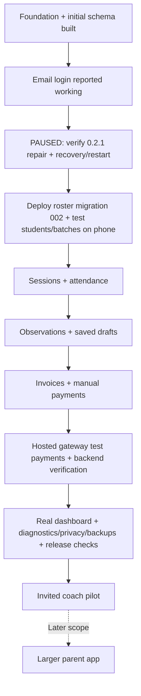

# Parent Plus Coach — paused development checkpoint

Date: 12 November 2026. Status: **paused at the owner's request**. No build monitor is active. Resume implementation only when requested.

Branch: `codex/coach-foundation`. Latest app source: `5c4c53be82e492b3faa3ec831376de57f720b7b6`. Version: **0.2.1**, Android versionCode 3. Changes are saved to GitHub; no PR/merge to main is recorded.

## Actual position

A standalone native Android preview has been built successfully. The owner installed the earlier 0.2.0 APK and reported receiving the confirmation email and logging in. The owner also reported the app closing after the in-app account-creation email request. An unsupported Android accessibility prop was found on that success screen and roster-save notices. Version 0.2.1 repairs both. Its build and signature verification passed, but installation and confirmation of that repair on the owner's phone are still pending. Do not describe the crash as device-verified resolved.

Students, guardian contacts and batches are implemented and tested locally/browser-side. Migration 002 deployment and live phone persistence tests are not confirmed. The full teaching and payment journey is not yet available. No percentage is assigned: modules differ substantially in size, and implemented is distinct from accepted.

## Module status and next gates

| Original build-plan module | Built / verified | Remaining before acceptance |
| --- | --- | --- |
| 0 — Foundation, testing, diagnostics | Native shell, GitHub source/CI, recovery boundary, sanitized in-memory reports; APK builds and initial device launch | Native report sharing and controlled recovery checks; persistent/remote diagnostics and tested native crash coverage are not implemented |
| 1 — Database and access protection | Migration 001 confirmed installed; schemas and local PostgreSQL isolation/constraint tests | Deploy migration 002; real two-account isolation tests; backup/export/restore validation |
| 2 — Authentication and academy onboarding | Email signup/login/recovery, secure storage and academy setup implemented; owner reports actual email and login | Verify 0.2.1 success-message repair; real academy setup, cold restart, refresh/logout, recovery/password update, invalid/expired links; production email delivery setup/limits |
| 3 — Students, contacts, batches | Add/edit/archive, guardian contact, batch create/edit, additive enrolment, search/filter, retry/navigation guards; SQL/browser checks pass | Migration 002, live save/reopen/restart/edit/archive and offline/retry checks. Ending/moving/restoring enrolments remain deferred |
| 4 — Sessions and attendance | Schema and atomic attendance-save function; database checks | Dated session create/edit/cancel UI, attendance UI, drafts and restart/network recovery; timezone and duplicate-save checks |
| 5 — Observations and drafts | Schema/recipient relationships | Editor, durable drafts, explicit recipient snapshots, record/edit/history and safe retry behavior; photos/rich fields optional later |
| 6 — Invoices and manual payments | Protected schema and some integrity tests | Trusted invoice/manual-payment operations, fee snapshots, due dates, partial/paid/overdue balances, correction trail and screens |
| 7 — Payment gateway | No gateway integration or collection enabled | Confirm provider/test eligibility; server-only credentials and link creation; webhook verification/reconciliation; duplicate/failure/delay/mismatch/refund/excess-payment checks; separate approved live enablement |
| 8 — Release and recovery | Internal development-signed preview APK and build evidence | Whole coach journey on phone, real dashboard queries, privacy/settings/deletion, diagnostics coverage, backup/restore, release signing ownership and regression/security/payment acceptance. Play Store publication is separate |

The larger parent app is deferred. Phone/WhatsApp authentication, media/rich feedback and recurring schedule generation are not part of the current required email-first pilot.

## Journey

Diagnostics/recovery improvements and real-phone checks run alongside the modules; they must not be postponed entirely to the final stage. Each module needs meaningful automated checks, Android build regression and its own live/device acceptance before being called complete.

## Evidence

- Latest local checks: TypeScript passed, **51 automated tests across 7 files**, **16 browser tests**. Browser auth/roster tests use a fictional transport, not real project records.
- Native accessibility contract test failed at exactly the two invalid status props before the repair, then passed. It reads the installed Android implementation; it is not a device crash reproduction.
- Successful replacement build: [run 43145465149](https://github.com/appsworld2027/Parent-plus-/actions/runs/43145465149), source `5c4c53be82e492b3faa3ec831376de57f720b7b6`.
- [Download 0.2.1 artifact](https://github.com/appsworld2027/Parent-plus-/actions/runs/43145465149/artifacts/13911472972). GitHub ZIP contains `ParentPlus-Coach-Preview.apk`; artifacts retained 14 days.
- APK: `com.parentplus.coach.preview`, ARM64, development signed; 26,298,214 bytes. SHA-256 `a8960174c6a0c9b228a100f1387297d25306898f04f07b5a7d29a5a3d59cdcc1`.
- Real settings-only auth probe passed: reachable, public key accepted, email enabled, confirmation required, anonymous profile records denied. This does not independently establish real-user session/recovery tests.
- Owner confirmed migration `202611110001`, email provider and redirect settings. Do not repeat those setup tasks.
- [Detailed validation](docs/VALIDATION.md), [issue history](docs/ISSUES.md), [roster deployment](docs/ROSTER_SETUP.md), [PRD](PRD.md), [build sequence](BUILD_PLAN.md).

## Right resume order

1. Install 0.2.1 as an update, preserving existing app data. With the existing account, request a recovery email once and confirm its success message stays visible. Then separately complete link/password-update, login, academy and restart/sign-out tests. Investigate failures before claiming acceptance.
2. Prioritize recoverable, privacy-safe diagnostics that survive the failures we need to investigate, plus tested native crash reporting through a supported integration. No remote monitoring exists yet; do not imply otherwise. Any external setup must be concrete and minimal.
3. Apply migration 002 using the supplied dashboard instructions, then complete students/batches device/API and real two-account isolation tests. Use fictional records for acceptance.
4. Build modules 4, 5, 6 and 7 in order, with a test gate each. Begin payment-provider onboarding/test-access confirmation early while independent coding proceeds; no real collection or purchase without owner authorization.
5. Connect the Today dashboard to saved records, finish privacy/deletion/settings/backups, and run whole-journey Android/security/payment/recovery acceptance. Establish production signing and provider/email configuration before a production release. Keep the larger parent app deferred.

## Ownership and constraints

- Codex handles implementation, technical investigation, tests, build automation and instructions. Owner performs necessary account/dashboard tasks and short phone acceptance steps, not code debugging.
- No administrator/network-policy changes are available to the owner. Use GitHub-hosted builds and the existing Supabase dashboard route. Do not request new tokens or repeat known blocked access attempts.
- GitHub stores source, migrations and documentation. Supabase stores private app records/authentication. Public client connection settings are intentionally bundled; no privileged keys go in source or client code.
- Expo account authorization is unnecessary for the working GitHub preview route. Production signing/Play distribution remains separate.
- No approved merchant configuration, deployed gateway backend, live payments or production SMTP is confirmed. Backup/restore and native crash monitoring remain open.
- Use evidence-backed wording: distinguish source fixes, automated checks, CI success, owner reports and device verification. Check our code/configuration before attributing failures externally.
