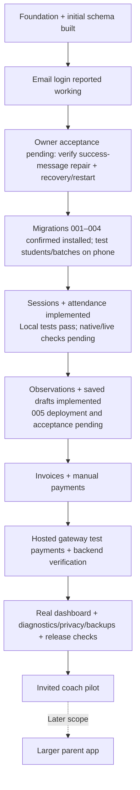

# Parent Plus Coach — development checkpoint

## Reported roster and Parent-flow repairs —19November2026

Owner supplies five broken-flow observations. Investigation and bug repair resume on canonicalMM/development only; new feature work and main promotion remain paused. User explicitly retains separate Coach approval. Owner is unsure whose child appears in unexpected feedback, so existing live mapping remains a possible unverified identity mismatch; no private account records or live invitations are accessed/sent and no automatic reassignment is attempted.

Source investigation confirms paginated roster loading already requests all saved batches for one academy, but archived rows are hidden and normalized name checks are absent. Parent connect silently defaults to the selected/first family child; profiles are not automatically created from Coach student records. A second confirmed UI bug replaces already-approved updates when any connection for that child is pending. [Defect/coverage ledger](docs/BROKEN_FLOW_QA.md) tracks each note, confirmed cause, regression and remaining live-account/provider boundary. CandidateCoach0.13.3/Parent0.3.1 fixes these UI paths without SQL/role/grant changes; focused browser25/25and strengthened2/2cases pass; fresh full TypeScript/472automated tests across38files pass79.80seconds. Exact commit review and full canonical CI evidence follow separately. Existing001–014/candidates015–021 stay unchanged.

## MM branch consolidation —18November2026

Owner paused feature development, then explicitly authorized consolidating all MM branches, retesting the complete existing app and deleting only the old merged MM refs. The latest instruction supersedes17November main-promotion authorization: future MM work stays on one `MM/development` branch; no main commits or release without a new explicit instruction. AM/codex/build-status and live Supabase/provider/production settings are outside this cleanup.

Initial audit found8remote MM names and10local MM names (two local-only),18refs total. Every exact tip is an ancestor of main`f858aad85577c1e49ae24f06ba260778ecb83ddd`, with0unmerged commits. Created `MM/development` from that saved baseline; explicit integration reports Already up to date, with no content conflict or app/source change. A verified standalone Git bundle preserves all original refs; inventory and SHA256 are in [the consolidation report](docs/MM_BRANCH_CONSOLIDATION.md). Current instructions/navigation and the existing check workflow now name the canonical MM branch. No app files are deleted or modified by branch cleanup. Fresh canonical CI44238197529at2dc9835passes471automated/95browser/29PostgreSQL cases and both exports. Independent agent passes91/91hosted production-compatible cases308.687seconds, mobile/desktop entry/recovery smoke,0real backend/provider attempts and0page/console errors; all91guard records were read back. Production0.13.2bundle hash remains unchanged. Reviewer restored all18backuprefs and fsckpassed; exact scope/containment reviewed. Remote backup tag`backup/mm-consolidation-20261118` preserves tested2dc9835. Final fresh SHA/ancestry/lease checks and independent docs/script review passed. Atomic expected-SHA update advanced canonical to evidence commit524ae75and retired8old remote MM refs;10old local branches were then safely deleted. Post-check confirms exactly one local/remoteMMbranch and no protected-ref changes: main remainsf858aad, AM/codex/build-status unchanged. All original commits remain in canonical history and backup. The report records exact protected tips, test identities and recovery evidence; this final record changes Markdown only. Feature development stays paused.

## Curriculum-aware feedback foundation —18November2026

Owner requests real learning context for spoken/typed feedback: coach curriculum, per-child stages, class content/plans, evidenced milestones and a Parent-visible journey. This changes product requirements: PRD1.10LRN-01–06 and ParentPAR-09. Began private021after015–020, preserving the existing public001–014 app and guardian review. No owner SQL or provider setup action is ready; no live database, email/message, account, audio or AI request was used.

Implemented immutable curriculum versions/stages/objectives, individual dated placements, mixed-stage class plan revisions, exact single-child recorded-feedback evidence and scoped latest-assessment context. Stage changes never award learning goals; curriculum upgrades require explicit mapping. New assessments cannot impersonate the author of a manager-corrected revision; only the original current source author can withdraw its assessment. Completed-class feedback remains supported. A pure TypeScript request builder separates planned goals, prior assessments and the current Coach observation; it retains internal source references and returns no action authority. Source text is untrusted and not automatically anonymized.

Initial independent risk review and subsequent code review by `/root/vercel_testing` found exact-revision authorship, colleague withdrawal, structural workspace/version references and completed-class gaps. Regression-first fixes cover the material behavior findings; relational mismatch tests cover structural guarantees. Initial test setup had a filename typo and omitted historical fixture revisions; fixtures were corrected without relaxing production checks. One chronology assertion was corrected to query before the assessment occurred. Targeted51/51checks and independent PostgreSQL29/29transaction cases pass. Fresh full TypeScript/471tests across38files pass80.75seconds after two existing child-process checks required sandbox execution access. Independent exact-code review of`c72c0e6` finds no material remaining blocker; reviewer reran51/51focused checks successfully. [PR17](https://github.com/appsworld2027/Parent-plus-/pull/17) records hosted CI/merge identity; [QA ledger](docs/LEARNING_CONTEXT_QA.md) records scope and actual evidence.

This is learning-context backend development, not live conversational feedback or a finished Parent journey. Remaining: Coach curriculum/plan/placement screens, secure context snapshot/save-time revalidation, speech/provider integration and model-quality evaluation, separately reviewed immutable Parent learning projection/UI, dated corrections/delegation, staging/restore and load/capacity evidence. Existing authentication recovery remains owner-incomplete: owner reports a private administrator reset generated a password, then closed the result without copying; rerun guidance was given. No successful sign-in or working real recovery-email journey has been confirmed. Do not ask for passwords or trigger more reset emails while rate-limited.

## Password recovery repair —17November2026

Owner reported a real reset email reaching localhost:3000. Read-only probes using an invalid non-user token independently confirmed Supabase's development Site URL fallback for default and explicit public auth destinations. Owner changed Site URL to https://parent-plus-varcel.vercel.app; subsequent probes confirm correct public root and `/auth/recovery`. No further Redirect URLs change was needed, and the unnecessary field search was stopped. No password was changed, no user credential was committed and no real reset email/provider request was sent by this environment. The owner must complete the fresh email flow privately; the app's10-character new-password minimum remains.

Candidate0.13.2 / Android20 fixes separately reproduced browser failures: new-tab recovery proof, preserved exact SDK flow ID before URL scrub, direct recovery request entry, Parent/Coach callback intent, SDK cross-tab session broadcast mixing, and logout cleanup erasing another tab's pending proof. Only per-flow proofs are shared with one-hour local expiry; tokens stay per-tab. SDK channel namespaces are per document while stored session keys retain their previous project mapping. Cleanup indexes stay per document, including cloned storage; legacy fallback stays local. Native SecureStore and database authority are unchanged. [Auth setup, privacy and remaining real-email acceptance](docs/AUTH_SETUP.md); [stable AUTH-01/02 scenario/review evidence](docs/AUTH_RECOVERY_QA.md).

Observed missing behavior in browser/unit regressions before repairs, including fresh-tab proof, Parent return route, direct entry, cross-account notification, overlapping module intent, unrelated-tab logout and cloned cleanup ownership. Final fixed-source TypeScript/full420tests36files pass152.05seconds; all15auth browser cases pass1.7minutes; web and Android exports pass exit0. Earlier integration runs also passed24then25focused Coach→Parent/Parent workspace/auth cases while review tightened cleanup ownership; final GitHub whole-suite and public Vercel results belong to the PR. Read-only close-out found no remaining material issue within the reviewed findings. No SQL update is part of this release; private015–020 remain inactive.

## Normal Vercel address restored in guidance —17November2026

Owner could not open the supplied PR11 preview and questioned hosted verification. Inspected deployment status and both URL types before changing anything: public production https://parent-plus-varcel.vercel.app returns200 ParentPlus directly; branch/PR previews redirect to Vercel sign-in. The issue was sharing the protected developer preview. Gave the normal link immediately; no protection/auth/account/database settings needed changing. Confirmed0.13.1/Parent0.3.0 and byte-for-byte equality between served production JavaScript and the tested local export. [Current hosted QA and exact asset evidence](docs/VERCEL_QA.md). README/developer guide now identify the canonical public address and require checking it before offering preview/account instructions.

Testing agent independently verified mobile/desktop login/recovery smoke with no overflow/errors/backend requests, then all84production-compatible fixture cases passed against the actual public Vercel bundle in283.739seconds,0failures/skips/flaky outcomes. Independently read back summary and84guard records:0real Supabase/external/provider network attempts,0page errors and0console errors. Four development-only foundation checks remain local/CI coverage. Existing411unit/integration,88CIbrowser and25PostgreSQL cases belong to the unchanged runtime source; this follow-up changes documentation only. No real records, credentials, emails, OCR/provider calls or live Supabase changes are used.

## One-press private feedback save —17November2026

Acted on the owner's earlier concern about excessive feedback approvals while continuing the robust backend build. Candidate0.13.1 / Android versionCode19 removes the extra Confirm save dialog for initial recording and text updates. Selected students stay visible inline, with an explanation that saving fixes class/recipients. Save still persists the device copy before the guarded workspace write; failures retain recovery and exact retries. Parent review/approval, WhatsApp confirmation, audience-widening confirmation and device-draft discard confirmation remain. Saving alone does not publish or send. PRD1.8 and the feedback-reset flow now reflect this distinction; corrected the stale PRD statement that the already-built Parent connection/module did not exist.

New browser regression was observed failing because one click only opened the old modal. Final15focused observation/Coach→Parent browser cases pass1.2m, including restart, lost-response retry, save failure, audience change, retained versions and same-login Parent connection. Fresh TypeScript/full411tests36files pass145.94s; web and Android bundle exports pass exit0. Updated only obsolete browser clicks; all no-extra-dialog, recipient/privacy, failure/recovery and separate approval assertions remain. Full hosted browser/transaction/export results and merge identity belong in the PR. No database update is required for this UI simplification. Physical Android/real-provider acceptance is not claimed.

During verification, exec-server transport disconnected briefly. Reported immediately, checked Cloud Environment status and retried commands successfully; local edits remained intact and were then prepared for GitHub. Previously committed staff/attendance/feedback backend work was already pushed. The disconnect's underlying cause was not established; no reset or history rewrite occurred.

## Staff-aware feedback authoring and correction —17November2026

Continued the approved build through staff018 and attendance019 into candidate020: actual assigned-instructor class drafts/recording/edits, explicit reasoned owner/capability correction and whitelisted detail/history. Typed immutable submissions preserve original author/membership/name, actual editor, reason, before/after content and fixed request receipts. Recorded class/audience/recipients/time remain; already-reviewed Parent snapshots are not rewritten. Admin-only management cannot impersonate a teacher, and rehire cannot adopt old feedback. [Feedback QA, evidence and remaining limits](docs/WORKSPACE_FEEDBACK_QA.md); [plan](docs/superpowers/plans/2026-11-17-workspace-feedback.md).

Observed missing-operation RED and failing-before-fix draft-move immediate-FK, NULL correction-reason CHECK and absent historical teacher-name cases. Repaired transaction ordering, structural reason/preimage checks and saved original/editor display names. Scoped historical readers/branch managers/authors get the current revision only until old versions can prove their original scope; global owner/admin get up to five. Targeted staff+feedback57cases pass20.21s. Final fresh TypeScript/full411tests36files pass118.53s. Real PostgreSQL25/25cases pass, adding four actual feedback concurrency cases. Corrected malformed-role parameterized test shape and a timestamp-sampling fixture defect without relaxing production rules. Hosted browser/export and exact merge evidence are recorded in the PR after completion.

Attendance PR9 sourcec211b72 passed hosted CI44071678183 and merged normally to main1ff501af74df6be1e9c1d42fee1424016b7b9f63. Staff main6adde0b passed its own follow-up CI44071033728. No production SQL, real records/messages, provider changes or UI activation occurred. Owner confirmed no staging project; asked to open the new-project page for a separate test environment, leaving parentplus-dev unchanged. Candidates015–020 remain private and must not be pasted into the live editor. Remaining release gates are explicit in the linked QA; this is infrastructure progress, not completion of all58features.

## Staff-aware attendance transactions —17November2026

Continued from tested staff PR8 without waiting for another product prompt. Candidate019 adds a minimum class attendance projection and actual assigned-instructor save with full dated roster/context/revision validation, fixed request receipts and immutable teacher/account/membership/display/marks snapshots. Owner/admin-only management does not become teaching authorship. New tables/functions stay private; existing attendance, old migrations and live accounts remain. [Attendance QA and limits](docs/WORKSPACE_ATTENDANCE_QA.md); [plan](docs/superpowers/plans/2026-11-17-workspace-attendance.md).

Observed missing-operation RED. First targeted24integration cases pass7.45s; fresh TypeScript/full388tests35files pass100.73s. Real PostgreSQL21/21cases pass, including four new actual attendance races: assignment removal before save, stale competing instructors, identical concurrent requests and write-before-revoke with later replay denial. Read-only review found no additional concrete issue. No new public/client grant, live SQL, real records/messages or UI activation. Owner confirms there is no separate staging project; do not test candidates on live Supabase.

Staff PR8 sourceff799057 passed hosted CI44070115347 (foundation/browser/exports and17PostgreSQL cases) and was normally merged into main6adde0b513b5f1f8f82e128bce9337aaff8579ab, preserving history. During follow-up, main's earlier post-PR7 run44063069293 was found to have86/87browser passes: the WhatsApp confirmation case did not find its link after clicking the checkbox. Newer identical-runtime staff CI passed, but this historical failure is being investigated rather than hidden. Its exact cause/repair and final019CI evidence belong in the follow-up PR.

## Private staff onboarding and teaching assignments —17November2026

Continued directly from main162fe27 under the owner's instruction to build carefully and keep moving. New private018 implements owner-issued email-bound offers, current verified recipient preview/acceptance, explicit staff/optional Coach profiles, separate mutually accepted ownership handoff and bounded batch/class assignments. Joining grants no teaching roster until an explicit assignment. Workspace-local staff projection omits Auth IDs/emails, other employment and family data. No live SQL, provider settings, real records or messages changed. [Staff behavior/QA and activation gates](docs/WORKSPACE_STAFF_QA.md); [plan](docs/superpowers/plans/2026-11-17-workspace-staff-lifecycle.md).

Observed missing-operation RED, then fixed four concrete permission failures with failing-before-fix regressions: bounded non-instructors incorrectly passed a NULL-ignoring assignment ceiling; pending offers revived after ownership loss/regain; permanent handoff reused a temporary owner grant; and temporary owners delegated assignment access beyond their own expiry. Offers now pin the exact issuing ownership grant; handoff rejects unresolved temporary target ownership; assignment ceilings include issuer authority. Accepted retries never restore removed roles or assignments. Fresh targeted34cases pass6.11s. Fresh TypeScript/full364tests34files pass122.66s. Final real PostgreSQL17/17transaction cases pass exit0, including five new actual staff/accept/revoke/transfer cases and joined-instructor roster access/removal. No UI changed; hosted CI covers browser/export regressions on the PR head.

Private015–018 remain outside deployed migrations and inaccessible to app/service roles. Ownership handoff changes candidate grants only: legacy academies.owner_id is deliberately unchanged, so all old owner/public/direct/storage paths must be converted and gated before activation. Existing-member role management, remaining attendance/feedback/guardian/media/OCR conversion, independent resource constraints, workspace UI, separate authorized Supabase staging and backup/restore rehearsal remain. Asked whether a separate staging project exists; no account keys requested. Continuing attendance permission integration next rather than treating this backend checkpoint as product completion.

## Workspace roster/class transaction slice —17November2026

Owner authorized continued careful module implementation and one-at-a-time Supabase steps when needed. Implemented private candidate017 after015/016: real owner/admin student/contact/additive-enrolment saves, branch-scoped batch/class saves, protected full student-profile reads and minimum instructor class rosters. Typed same-workspace version/receipt tables provide optimistic edits and membership-period/request/payload-bound retries. Existing fees, ended enrolments, approved Parent links and historical class/media/feedback contexts are preserved. No fake independent academy, teaching identity, public/client grant or production schema marker is created. [Detailed QA](docs/WORKSPACE_ROSTER_QA.md); [implementation plan](docs/superpowers/plans/2026-11-17-workspace-roster-transactions.md).

Review caught three defects before release: unchanged primary contacts differing from the approved Parent could block profile edits; timestamp serialization could break class retries across session timezones; and roster authorization/projection could race with a class move. Contact/timezone regressions were observed failing and repaired. Reads now hold academy→workspace→actor anchors through projection; real PostgreSQL verifies a competing move waits and an instructor is denied after the transfer. Global profile reads whitelist fields; teaching rosters omit contacts, finance and family records. Read-only re-review found no additional material issue.

Fresh TypeScript and330tests/33files pass146.84s, including31new transaction cases. Final12/12independent PostgreSQL17 transaction tests pass with exit0, extending the earlier eight with actual batch-write revocation, concurrent stale edits, identical-request replay and roster/class-transfer cases. Candidate reapplies without resetting versions/receipts. Ten functions are covered by namespace preflight/private revokes; both tables have RLS. Affected document links, syntax and whitespace checks pass. No UI change or local browser/export rerun is claimed; existing hosted CI verifies regression/export coverage on the PR head. Temporary databases are removed after tests.

Still gated: all remaining public/RLS/storage/attendance/feedback/guardian/OCR conversions; staff lifecycle; independent resource constraints; workspace UI; real Supabase staging, backup restore and migration rehearsal. Legacy APIs do not maintain017versions and cannot coexist as enabled write paths at cutover. This is a completed private backend slice, not F2 completion or a new live app flow. No Supabase script is ready for the owner, and no live database, account, email or message was changed. Existing accounts and last-confirmed001–014 remain. Product requirements and the58-feature completion classification are unchanged by this infrastructure slice.

## Owner-authorized promotion to main —17November2026

Owner explicitly requests “Commit everything in the main branch.” Inspection confirms GitHub main at0db8f74 contains only its initial README/one commit; completed application work was saved on codex/coach-foundation and reviewed MM branches. Earlier branch-specific work and the explicit-review rule explain why those commits were not yet on main. This instruction authorizes a normal merge to main, preserving source history; it does not authorize live Supabase SQL or changing provider settings.

Integration branch MM/promote-all-work-to-main-20261117 combines all current product work: codex base d3b1d68, PR3head c8d488a (58-requirement roadmap, metadata snapshots, skills and private eligibility tests), PR4head4769d00 (F1/F2 kernel, permission/history/finance rules, transaction runner and retained CI evidence), and PR5head2d7bb93 (skills/guidance). Skill resources/license are byte/mode identical between3and5; both owners' AGENTS instructions are preserved. The full Coach/Parent app and installed001–014 migration sources remain. main becomes the documented shared integration base; legacy branches are preserved.

Found a real candidate integration hazard: PR3's older standalone file redefined workspace_actor_eligible and could overwrite016's stronger guard. A new regression first failed because an anonymous account was accepted. Retired that standalone definition to a compatibility sentinel requiring the canonical F1/F2 kernel; it cannot replace functions or grants. All original account/role tests now exercise the canonical implementation. Read-only review finds no unsafe semantic loss; this sentinel is compatibility detection, not a full function-body attestation.

Fresh local npm run check passes TypeScript and299tests/32files in65.75s. Four metadata snapshots parse and all58catalogue IDs are unique. The main consolidation PR records hosted CI/merge evidence after verification. Source files/candidates being on main do not mean unbuilt roadmap features are complete or SQL015/016 is active; live Supabase remains001–014. No real records/messages/provider actions occur in this promotion. Future feature PRs target main.

Promotion [PR6](https://github.com/appsworld2027/Parent-plus-/pull/6) includes360tracked files and all pending product heads; the latest codex skills merge b6c9006 is preserved through an ancestry-only merge with the exact tested file tree. First hosted run44025172332 passed unit/JUnit and8PostgreSQL checks, then85/87browser cases: two assertions matched temporary duplicate Coach text or overlapping dialog/notification alerts. Corrected test synchronization to await the Parent heading and actual dialog closure, and scoped the failure notification by its existing test ID/alert role. No runtime code, retry count or timeout changes. Five Parent journey cases pass locally; all4notification cases pass in21.9s after the repair. Latest head CI and final main SHA are recorded in PR6.

## F2 permission kernel executed and tested —17November2026

Owner asked “Please test and execute.” Commands and saved branch were verified after a tool-runtime restart, reported immediately; no work was lost. Implemented private `supabase/candidates/202611170016_workspace_authorization.sql`, after F1only. [Kernel QA/runbook](docs/WORKSPACE_AUTHORIZATION_QA.md) documents current verified/enabled actor checks, scoped role/capability decisions, exact branch/class assignment windows, own current feedback versus bounded recorded history, finance separation, private own-context projection and owner-only membership/assignment revocation. Legacy authorship stays known-account/unknown-membership; no teaching identity is invented. All new table/function access stays denied to clients/service; public001–014 behavior and app0.13.0/Parent0.3.0 remain unchanged.

Protected candidate writes/revocations serialize on the workspace anchor and recheck the actor account. Higher-isolation transactions fail closed; supported READ COMMITTED decisions use wall-clock expiry. New recorded-feedback correction authority cannot touch other teachers' drafts. Own working-note access ends with its class assignment/access window; after that only an explicit recorded-history grant may restore read access, never ordinary editing. Rehire does not inherit the previous membership's notes/grants. Owner-only revocation retries append no duplicate events and preserve the last accepted current eligible owner.

Final TypeScript and **288tests/31files pass in60.30s**, including **43new kernel cases** and the existing20F1cases. **8/8 independent real PostgreSQL17 transaction tests pass with exit0**: revoke-before-write, write-before-revoke, assignment revocation, concurrent owner removals/departures, expiry after transaction start, ban while waiting and unsupported snapshot isolation. Real lock contention is verified using pg_blocking_pids. The first seven-case run exposed a process-cleanup error after assertions; the runner was fixed and the final fresh-database run passed cleanly. Read-only review found the draft-correction gap and an expiry-test startup timing issue; both corrected. Shared fictional fixtures, a guarded disposable runner and a separate PG17 CI job make these checks repeatable. Temporary databases/containers were removed. Affected document links, namespace inventory and diff whitespace checks pass. No browser rerun is claimed for unchanged app/UI.

This completes the isolated kernel checkpoint, not F2 or the platform release. All36public RPC/direct-grant/view/storage conversions, independent resource constraints, staff invitation/delegation/transfer, audited corrections, onboarding/picker, context-aware caches and014 cross-protocol races remain. Real Supabase Auth/API/Storage/email staging, backup/restore and migration rehearsal need authorised access; no Supabase admin connection is configured. No production candidate SQL was run, no real accounts/records/emails/messages/OCR were created, and no owner SQL action is ready. Existing001–014/Google setup must not repeat. Daily product review: requirements unchanged; implementation/evidence advanced within the existing contract.

Publish integration: first push to the legacy development branch stopped because GitHub had newer owner commits2febefe/d3b1d68. Inspected their new AGENTS/shared-workflow guidance and preserved both commits via a forward merge on `MM/workspace-authorization-kernel-20261117`. No force push, rebase or owner-branch overwrite. The combined CI retains least-privilege permissions/JUnit validation and the new PG17 job. Exact JUnit command passes288/288 in56.92s; XML validates with zero failures/errors/skips and workflow YAML parses. This work goes through a review PR into codex/coach-foundation; no PR merge is authorised by the new guidance. Hosted CI results follow separately.

Review [PR4](https://github.com/appsworld2027/Parent-plus-/pull/4) is open as a draft. Its first GitHub PostgreSQL job passes in21seconds and the unit/JUnit stages pass. A final test-only improvement checks history's exact inclusive-start/exclusive-end timestamp using the record itself, avoiding dependence on fixture speed; all43focused cases pass4.91s. Latest head CI evidence is tracked in the PR body. No implementation/runtime SQL changed in that follow-up and no PR was merged.

CI integration found that Playwright clears the unit JUnit file from its default test-results directory before the job's final upload. Moved the existing unit-evidence upload immediately after validation, before Playwright startup, preserving the shared quality-evidence practice. YAML/order checks pass; final hosted completion/artifact evidence is recorded in PR4. Superseded runs are cancelled to avoid duplicate CI use.

## Robust multi-workspace foundation — F0/F1 checkpoint17November2026

Owner asked how to establish a robust multi-academy/independent/admin-only/Parent model. Clarified that Supabase changes ARE required: no owner action during preparation, disposable SQL first, then real Supabase staging Auth/Storage/email/API validation and authorised production activation. Owner replied “Yes…robust…Continue.” Current production project/logins and001–014 remain. No production SQL or app UI change in this milestone.

[Foundation contract](docs/MULTI_WORKSPACE_FOUNDATION.md) and [45-scenario release matrix](docs/MULTI_WORKSPACE_VALIDATION.md) cover separate account/Coach/workspace/family identities, branches/group boundaries, scoped memberships, role/assignment/history permissions, employment privacy, staff/owner lifecycle, guardian consent expansion, migrations, legacy compatibility, concurrency and measured scale. Optional preference question for separate-private vs explicitly shared guardian spaces is pending; private spaces are the proposed default and the existing one-family constraint stays until authority/consent/delivery work is ready.

Implemented supabase/candidates/202611170015_workspace_foundation.sql ONLY as a private F1candidate, outside active migrations. New structures/mappings have deny-all client/service access and RLS; no public APIs/production015 marker, no owner uniqueness removal. Preserves public IDs, existing014approved Parent links and known authors; maps legacy owners to management memberships without creating Coach profiles/teaching assignments or inventing historical teachers. Workspace/role/assignment/resource/invite/history/audit references use same-workspace constraints. Backfill reruns cannot revive revoked staged authority and stop on ownership/ID drift/untracked namespace objects. This is storage structure, not a working membership permission engine.

All20new isolated SQL cases pass10.99s. Independent read-only review found polymorphic audit subjects and incomplete untracked-object preflight; both fixed, covered and re-reviewed. Mechanical inventory confirms all36public RPC names in the conversion checklist and45unique acceptance IDs with valid links. Final TypeScript and all245tests/30files pass in54.47seconds before commit. No browser rerun is claimed for this non-UI candidate. Real concurrent-session tests, staging, UI and capacity claims remain future release gates. Next implementation is F2server eligibility/permissions and complete scoped API/storage coverage, then F3onboarding/picker, F4staging/rehearsal and F5controlled live acceptance. Do not ask owner to run this candidate or repeat SQL014/Google setup. Owner elected a colleague live feedback test; no backend test records were created for their account.

## Live014 activation confirmed — 17 November 2026

After the discrepancy below, owner ran the three-column diagnostic and reported ALL FALSE (ledger/table/function absent). They were directed to copy and run the entire update014 file in a blank query with no selection. Owner now reports exact202611160014 installed. Fresh public-key/anonymous checks find the new parent_connection_requests table and both get_parent_connection_requests/get_coach_parent_requests RPCs: all return401/PostgreSQL42501 permission denied, replacing their former404 missing-object responses. This resolves API visibility and corroborates owner installation; no records were read or written and no authenticated session/email/message was used. Do NOT ask to rerun014, earlier migrations or Google setup.

Source0791763 App checks43859794515 and Android43859794507 succeeded; hosted identity fixtures4/4passed. Next acceptance is owner-signed-in real class→feedback→review/share→same-login Parent request→Coach explicit approval→Parent update/reopen. Live account pairing, wrong-account rejection and inbox receipt are not proved by anonymous API checks. No private owner session/admin connection is available here. Workspace commands are responsive.

## Update014 owner report — 17 November 2026; API discrepancy unresolved

Owner first reported “Success no rows returned”, then after a requested read-only version check reported “Update14 installed”. Treat installation as owner-reported, not independently confirmed. Fresh public-key/anonymous checks find parent_connection_requests404/PGRST205 and both new request RPCs404/PGRST202; existing parent_families and get_parent_coach_connections return401/42501 as expected. One bounded control retry reproduces the new-table absence. Email confirmation remains required (mailer_autoconfirm=false). No private rows, authenticated session, mail, or writes were used. Do NOT call live014 ready and do NOT ask to blindly rerun the long migration. Next owner query should check version ledger AND to_regclass(public.parent_connection_requests) AND to_regprocedure(public.get_parent_connection_requests()) in their SQL editor to distinguish incomplete installation from API schema-cache visibility.

Both source0791763 App checks43859794515 and Android43859794507 are now confirmed SUCCESS. Hosted fixture evidence remains4/4, not live Supabase acceptance. Current workspace commands work after environment startup.

## Published guardian/child approval0.13.0 / Parent0.3.0 — live014 activation pending

Published source **0791763ca15888024eb888689b21c0b0213c6472**, Vercel deployment8ntkcG7wDtxTYTbAqEQKmH94Nhka succeeded. [Hosted identity QA](docs/PARENT_IDENTITY_HOSTED_QA.md) passes4/4 in41.577s: no feedback while pending, explicit Coach approval then Parent update/reload, wrong-email refusal without student details, rejection, and missing014 warning/private records. Fictional transport only; temporary access state removed. GitHub43859794515 has completed its TypeScript/automated step successfully; full browser/export run and Android43859794507 were still running at this checkpoint. The protection is NOT live in Supabase until the owner runs only supabase/update_014.sql. Give one action at a time: Copy raw file from GitHub, then paste whole file in existing SQL editor and Run; expect202611160014. Do not repeat001–013 or Google setup.

Owner said “Close the Gap.” New forward update014 binds each invitation to the Coach-confirmed intended guardian email. Preview/claim read verified email from auth.users; wrong-email forwarding and unverified accounts are denied. Claim creates an immutable pending request and releases no link, media authority or feedback. Coach Today/student profile shows the verified email, Parent name and child name/optional DOB for an explicit approve/reject action. Approval rechecks current email/identity snapshot under child/academy locks, writes the approval audit, activates the link and releases reviewed held snapshots. Same-login testing uses the same separate Coach approval; it does not auto-approve.

[PARENT_IDENTITY.md](docs/PARENT_IDENTITY.md) records exact behavior and limitations. Update014 revokes legacy unbound invitations, disconnects old unapproved links and cancels their shared copies in retained history; original teaching/family records remain. Reconnect/reapprove/re-share originals when needed. A rerun preserves newly approved links. The only new owner SQL is supabase/update_014.sql, identical to migration014, after installed001–013. No live014 installation has occurred from this workspace; do not claim it is active until owner runs it. Current frontend pauses linking/feed if014 API is absent and preserves private family records. No Google/oldSQL setup repeat is needed.

Read-only agent review caught a group-consent viewer-dependency bug and NULL-as-approval fallthrough; both were fixed and regression-covered. No additional material issue found in final review. All14new identity/database cases pass. The full suite passed224/225 before correcting one Android-only status role; final focused security/native checks pass15/15 in9.83seconds. Final TypeScript and web export pass. Initial13flow/browser checks passed11with2assertion issues (modal alert scoping and Home-tab pending banner), both corrected. The follow-up14auth/navigation/identity cases passed13; the remaining wrong-email case exhausted the total30s budget under concurrent load and passes alone in31.2s including setup. The updated full same-login approval journey passes with no feedback before Coach approval. Final hosted/CI follows. A relevant live Auth settings GET confirms email provider enabled and mailer_autoconfirm=false; no email/user data was requested or sent. Production inbox/live account acceptance remains separate. This mechanism verifies email control plus Coach-reviewed match, not independent legal custody.

## Published same-login class-to-Parent journey0.12.0 / Parent0.2.0

Published final runtime **450fabb9bcda9c49b4144062e91c325e06232366**, successful Vercel deploymentF7RcvMFrmB7umpuKp7ctjSwSj7NK. [Independent hosted QA](docs/CLASS_PARENT_HOSTED_QA.md): baseline dd7f8bd5/5 in44.361s, final child-refresh/logout follow-up2/2 in17.039s. Temporary capabilities/state removed; no real data/emails/providers/messages. Full baseline App checks43842252539 passed211automated checks and84browser cases plus exports; final450checks43843050202/native43843050176 were still running when recorded. No native result is claimed. No new database activation is needed. Owner live save/reopen remains pending.

**Authentication identity limit clarified to owner:** current account verification + student-specific bearer invitation + Parent self-confirmed child selection does not establish intended/legal guardian identity. Invitations are not bound to the saved guardian email/phone; forwarding could permit an unintended account to claim. Before real-parent rollout, implement verified-contact-bound invitations and Coach approval of child match before feedback release. These restrictions are not built, and same-login tests do not prove real-world guardian identity. Do not describe the current invitation as guardian identity verification.

Owner explicitly requests one end-to-end class feedback → Coach review/share → authorised Parent child update, using the same login for now. The installed001–013 database already supports one user owning academy and family; no new SQL/provider/credential is required. Added a guided per-child “Open [name]’s update in Parent” action in saved Parent reviews. It validates live links through RLS, uses the existing invitation RPC only for an unconnected student, preserves the verified session in the same web tab and refuses another parent's connection. Parent guides missing family/child setup, offers explicit child selection and confirmation, then selects/highlights the shared snapshot. Existing own connections open directly. Invitation intent stays out of URLs, is account/expiry scoped in sessionStorage, clears on successful link or sign-out, and never grants access itself.

Coach sharing copy is now Review and share to Parent → Share approved feedback to Parent. Private save is still separate from sharing. Existing class launch preselects batch/class/present students. WhatsApp remains an independent reviewed action; no automatic send/push is claimed. Parent same-login shortcut targets web; no separately packaged Parent native app is claimed. [Complete flow/auth rules](docs/SAME_LOGIN_FEEDBACK_FLOW.md).

Independent read-only review caught a sibling-action/cancellation race while opening a shortcut; a shared synchronous lock plus opening state now guards Open/Review/Approve/Cancel without resetting a saved review. A held-request browser regression covers the lock. No additional material issue was found by that review. Same-account PostgreSQL coverage proves explicit child claim and approved feed visibility while another account sees no snapshot. Unit tests cover expired/malformed/cross-account navigation intent. All13focused class/Parent/media browser checks pass in1.6minutes with fictional transport. Final TypeScript plus all211automated tests/28files pass in81.07seconds. Another12authentication/navigation cases pass57.7seconds, including sign-out clearing a pending invitation. Final web export passes. Initial published source dd7f8bd passes all5hosted journey checks in44.361seconds using fictional transport. A final sibling-refresh follow-up preserves selected child by account/family in this tab and clears that preference on sign-out; TypeScript and all5local journey cases pass42.9seconds, including the non-first sibling after reload. Final follow-up publication is confirmed above. Live records/emails/messages were not created by these automated checks; owner signed-in save/reopen remains separate.

## Live database activation confirmed — 16 November 2026

Owner screenshot confirms all three installed_update markers202611160011,202611160012 and202611160013 after the combined transaction. Do not request rerunning this update or001–010/Google/scan-roster. A fresh read-only API check with only the public publishable key and limit=0 against all nine new Parent/media tables returns401/PostgreSQL42501 permission denied for each, replacing the former parent_families404. No records were read or written. This confirms API-visible relations and blocked anonymous table access; it does not verify signed-in cross-account isolation or real save/reopen/delivery.

Next required acceptance: owner signs in to /parent with existing credentials, creates/reopens a family/child, then exercises explicit Coach invite and reviewed feedback with accounts under their control. Actual signup email receipt and WhatsApp Send remain separate live acceptance. No private owner session/admin connection is available in this workspace. App checks43837546001 and Android preview43837546056 for runtime91ea632 have both completed successfully. Existing hosted signup3/3 evidence remains valid.

## Published signup0.11.2 and database relationship review

Published runtime **91ea632fa0f193acbea5a4cd320f4e593df4b4ff**, Vercel deploymentKT6cTDLyHZ2TfmQjBXy7WtUnSHk4 succeeded. [Independent hosted signup QA](docs/SIGNUP_HOSTED_QA.md) passes3/3 in15.287seconds with clean mobile screens. No real writes/emails/OCR/messages; private test access state removed. App checks43837546001 and Android43837546056 were still running at this checkpoint; no native result is claimed. Only new live activation remaining for this supported single-household slice is the owner-run supabase/update_011_013.sql transaction. The review hold can be lifted for that package; multi-guardian expansion remains pending separate privacy decisions.

Owner requires production signup choices leading to Coach/Parent profiles, plus a comprehensive review of Supabase relationships. Auth entry now says “Sign up as a Coach” / “Sign up as a Parent”, opening /coach/signup or /parent/signup directly in registration mode. Shared credentials, returning-user sign in, verified-email requirements and existing-profile routing remain. Signed-in switches remain navigation and never grant permissions. Busy/password-recovery navigation is disabled.

[Relationship review](docs/DATABASE_RELATIONSHIP_REVIEW.md) records supported combinations and explicit gaps. Siblings, multiple batches and independent academies are covered; multiple simultaneous guardian accounts, shared family membership, staff roles and duplicate-resolution UI are not yet implemented.013 prevents duplicate active child/student mapping within an academy and requires disconnect before Parent-child archive. Guardian privacy/consent preferences were asked and remain unanswered. Never call the whole production schema comprehensive from the first slice.

Forward migration013 closes the confirmed archived-student invitation gap: shared academy locking, unused-invite revocation, first-claim rejection, child-row locking/archive protection, canonical per-academy child-link uniqueness, preserved existing approved text history, and exact successful-claim retry. Existing011/012 migration sources are unchanged. New generated owner package is supabase/update_011_013.sql; it replaces the011/012-only package for this candidate. Live001–010/Google/scan-roster must not repeat. Live Parent activation remains unconfirmed; no production SQL/private records/provider calls occurred here. The owner has been told to hold new SQL during this review.

Verification: full TypeScript/automated suite passed206/206 in58.49seconds before the last duplicate/archive additions. Final exact-package Parent/media database checks pass19/19 in20.27seconds, including12Parent cases; all16focused signup/login/recovery/Parent browser journeys pass in47.9seconds. The long combined Parent journey has a60-second total budget after traces showed cumulative30-second exhaustion, with no new arbitrary sleeps. An independent read-only agent review found no material defect in final013; actual competing-transaction/live Storage acceptance is still separate. Final web export passes. Hosted publication is confirmed above. Workspace commands work; no disconnection observed.

## Parent entry repair — candidate0.11.1

The owner reports no Parent space/clickable entry/dashboard on the Vercel website and confirms no/not-sure installation of011/012. Inspection found Parent was only reachable by typing /parent or a student-specific invitation link; Coach login/dashboard lacked a visible module entry. Added visible Coach space / Parent space links on both login and signed-in web workspaces. Navigation stays in the same tab and uses the existing Auth session. Switching is disabled while an unsaved form/save is active; it grants no permissions and does not create an academy/family automatically.

A single relevant live metadata probe selected zero rows from parent_families and returned404/PGRST205: the Parent relation is not available through the current API. Combined with the owner's answer, new-schema activation remains the real-record blocker. No table/private records were read. Do not claim Parent data is usable until the owner runs the existing prepared011/012 transaction and completes actual save/reopen. Do not rerun001–010/Google/function setup.

Patch TypeScript passes;8focused browser checks pass in42.9seconds, covering visible entry, same-session switching, dirty-form guard and all5Parent journeys with fictional transport. No SQL changes or backend activation are included in this navigation patch. Publication/CI follow.

## Published workspaces0.11 / Parent0.1 — new database activation pending

Published runtime **b014c0a2f815bf38f4a493091879347ba6ed145b** is ready on Vercel deploymentHn8KZD6cmj98RG4Xe8T9j7MYLUWx; GitHub author maps toappsworld2027. [App checks43829864988](https://github.com/appsworld2027/Parent-plus-/actions/runs/43829864988) succeeded with201automated checks/27files,76browser cases and both exports(web369modules,Android741modules). [Focused hosted QA](docs/DUAL_WORKSPACE_HOSTED_QA.md) independently passes14/14in64.697seconds on the served0.11.0/Parent0.1.0 bundle. No real data writes/provider calls; temporary capabilities/state/config were removed with0remaining matches. Native Coach build43829864994 completed successfully, including APK signature/native ABI verification (artifact14208786600). No separate Parent APK is claimed. The only external activation remaining for new Parent/media data is one owner run ofsupabase/update_011_012.sql;001–010/Google/function must not repeat.

The owner supplied both actual prototypes and explicitly requested Parent from scratch on the existing Supabase/Auth project, separate from Coach. References are preserved in docs/prototypes/. Candidate0.11.0(Androidcode14) adds Parent0.1.0 at /parent with its own Aurora navigation/design, family setup, add/edit/switch child, private plans/reminders/memories and real together-time logs. Auth credentials are shared; Parent validates the session without academy onboarding. Explicit expiring coach invitations connect independent family child IDs to academy students. Coach-reviewed snapshots become visible in the authorised per-child Parent feed; guardian media choices are account-recorded and cannot be raised by a Coach attestation. No device push/read receipt or separate Parent APK is claimed.

Coach now uses the supplied Bricolage font, compact greeting/class agenda and direct Start class. Saved attendance can open a linked feedback draft for present/late students without replacing an existing device draft. Batch creation needs no fee, and class setup carries batch/location defaults with inline batch creation and compact date/time controls. Reviewed WhatsApp remains an explicit text handoff; no message is sent by automated tests. Fee collection is shelved. Full prototype coverage is not claimed; see docs/PARENT_MODULE.md and docs/COACH_FEEDBACK_RESET.md.

Existing001–010, Google and scan-roster must not be repeated. The only new activation is the prepared supabase/update_011_012.sql transaction. It is source-tested, not live-installed by this workspace. Parent tests run that exact delivered file twice and verify family RLS/composite keys, hashed invitation expiry/replay, reviewed feed/media, independent guardian decisions and safe replacement-family revocation. An independent read-only test-agent review found a stale-disconnect issue; fixed under the academy lock and regression-covered so an old family cannot cancel a replacement family's later approvals. No further material access/consent bypass was found in that review.

Latest full TypeScript/unit/database checks:201passed/27files in53.23seconds. Focused Coach/Parent browser flows9/9passed in55seconds (real SDK with fictional transport), including family reload/profile editing, plans/todos/time, invitation→coach approval→Parent feed and guardian choices. The final full browser suite passes76/76 in3.0minutes; web and Android JS exports pass. [QA detail](docs/DUAL_WORKSPACE_QA.md). Only subsequent copyright/licence UI and copy cleanup changed; final TypeScript/exports pass. Publication and CI are confirmed above; native compilation and actual owner/device acceptance remain separate. No real parent contacts, real DB writes, paid OCR or live new SQL occurred. Owner/device/live two-account acceptance remains separate; workspace commands continue to work.

## Feedback-first correction — candidate0.10.0,16November2026

The owner explicitly clarified that batch/class saves are cumbersome, with no reported error. They rejected the level of usability/prototype fidelity and identified parent feedback as the core feature. Fee collection is shelved. Selected channel: WhatsApp with coach review before sending. Additional requirement: save complete feedback and approved per-child snapshots for the future Parent module; collect class photos/videos only with guardian consent. This supersedes older payment-first release gates and no-parent-sharing product exclusions. The owner has now supplied the Coach and Aurora HTML references; both are preserved in docs/prototypes/. Prototype styling alignment and a separate Parent module are now explicitly authorised.

Candidate0.10.0 removes the batch fee prerequisite, adds direct Today/batch→class entry, inline batch creation in the class form, selected batch/location defaults and same-day web date/time controls with advanced settings secondary. Feedback is named in navigation. WhatsApp previews read saved fixed recipients, include one child's name, require an explicit international number and renewed confirmation after edits, and open only a coach-clicked link. No automatic WhatsApp send or claimed delivery exists.

New update011 prepares audit-backed guardian permissions, private class media and atomic per-child Parent snapshots held awaiting_parent_link. Built-in video/audio recording is not enabled; coaches choose existing clips. Media consent is coach-recorded evidence of guardian permission, not a verified parent consent form. All pictured subjects need capture permission, and sharing permission before queue attachments; revocation cancels pending media handoffs. Existing observation photos remain private/readable; new observation-media uploads move to the consented class path. SQL001–010, Google settings and scan-roster remain installed and must not be repeated.011 is new and is not deployed by this workspace. Build/tests/publication results follow below; no new capability is claimed live just from source.

## Coach-first roster setup correction — published0.9.0

The owner reports real scanning recognises names, but the onboarding/review/save flow is broken. Their requirement is first-step batch creation/choice → photo → automatically populated student list → batch/details dropdown review → confirmed save → actual batch roster and student profiles. Candidate0.9.0 (Android versionCode12) adds a prominent Today setup card with real roster counts, inline batch creation, a real dropdown shared across the review, automatic names-only candidates when structured fields are unavailable, always-visible age/proficiency inputs and a known-success screen with links to refreshed profiles/batch. Confirmed imports with failed refresh retry only the read; unknown write outcomes still lock the exact request for retry. Backend001–010, live function and Google secret are unchanged; do not ask the owner to repeat setup or deploy a new OCR reader for this frontend release.

The owner has reported names from a real scan; other-field extraction and real save/reopen acceptance remain unverified. The frontend preserves readable returned fields and leaves missing fields editable/blank. Local TypeScript and182automated checks/22files pass, including the conservative automatic-name review guard. The focused browser suite passes7/7 in33.3seconds: fresh Today→batch creation→photo→auto-filled review/dropdown→confirmation→success→batch/profile→reload/real counts, plus unknown-save retry, known-save refresh retry without re-import, cancelled/failed scan batch retention, existing-profile preservation, automatic raw names and quota refusal. Fictional success/profile screenshots are saved in docs/images/090-*.png. Published runtime ccb5d246a5a070ca007a64b64c80e6702df27ff6 is live on the coach-foundation Vercel branch URL. App checks43794966145 succeeded:182 automated checks,62 browser cases and both target exports. [Focused hosted QA](docs/COACH_SETUP_QA.md) passes7/7 against the served0.9.0 bundle; no real records or paid OCR requests were used. Android43794966062 is still building; physical-device acceptance remains separate. Next owner check: refresh the web app, Today → Create batch and scan students → photo → review/dropdown → confirm → reopen saved batch/profile. The workspace remains responsive.

## Live scanning-function checkpoint —16November2026

Fresh read-only checks against /functions/v1/scan-roster using the app's public connection key now return OPTIONS200{} and unsigned POST401{code:UNAUTHORIZED}, both Cache-Control:no-store. This matches the deployed custom scanning handler and replaces the previously observed default @supabase/server Hello response. Owner-side paste/deployment is therefore confirmed at the endpoint-response level; do not ask the owner to repeat code replacement or SQL setup. The owner also confirmed the legacy JWT setting saved OFF. No photo, bearer user session, provider key or real OCR request was used in these probes; Google credential validity and actual OCR/import behavior are still unverified. Existing001–010 are owner-confirmed installed and GOOGLE_CLOUD_VISION_API_KEY owner-confirmed saved. Next: one signed-in fictional register scan → coach review/confirmation → reopen the student, followed by remaining live/native/isolation acceptance.

## Activation database checkpoint

The owner confirmed both installed_update rows202611150009 and202611150010 after running the combined SQL. Updates001–010 are now owner-confirmed installed; do not repeat them. GOOGLE_CLOUD_VISION_API_KEY is owner-confirmed saved in Supabase Secrets; its value was never shared/read here. Remaining activation: deploy the tested single-file scan-roster Edge Function, configure its gateway verification to match the handler's own Auth/owner checks, then test a fictional image/review/import. Repository visibility is private, so an unauthenticated raw-GitHub import is not a valid deployment shortcut. No real provider call has been made by this checkpoint.

## Cloud Vision activation checkpoint

The owner reports creating/selecting the Google Cloud project, generating a credential through the Cloud Vision API-key flow, and saving GOOGLE_CLOUD_VISION_API_KEY in Supabase Edge Function Secrets. No key value was shared with or read by the coding workspace. This is owner-confirmed configuration, not a successful provider-call verification. Pending: apply only combined009/010, deploy the generated scan-roster function, then test a fictional register and confirmed import. Existing001–008 must not be repeated. No actual OCR call has been made by this checkpoint.

## Cloud Vision implementation — candidate0.8.0

The owner explicitly requested the Google Cloud Vision photo→fields→confirmation flow. Candidate0.8.0 (Android versionCode11) replaces the inactive OpenAI reader with one inline DOCUMENT_TEXT_DETECTION request behind verified Auth/academy ownership. The key stays in the server header, never URLs or app configuration. New deterministic mapping handles explicit labelled forms and word-position table headers; recognised text plus coach-selected names-only interpretation handles unclear layouts without a second Google call. Existing correction/skip/duplicate/confirmation/atomic import remains. No student records save from OCR alone.

New010 reserves an atomic shared900attempts/UTCmonth before Google, while retaining009's10/academy/UTCday and10second spacing. Failed/unknown provider attempts count conservatively. This caps app attempts, not all Google billing-account spend or free eligibility. Existing001–008 are installed; only [combined009/010](docs/UPDATE_009_010.md) is needed. The owner now confirms the Google key is saved in Supabase; updates009/010 and function deployment remain pending. No real OCR/paid calls have been made. [Current flow and activation](docs/PHOTO_ONBOARDING.md) supersedes OpenAI instructions below. PRD1.4 records the selected provider. Local TypeScript and181automated checks/22files pass, including12OCR-mapping cases,10HTTP-handler cases,8shared-quota database cases and5review-model cases. All5focused browser workflows pass with the new provider-aware marker (24.6seconds), including automatically populated age/guardian/contact fields, explicit confirmation, safe retry, raw-text fallback without another scan and quota refusal. Vercel0.8 deploymentBLC2ZUMFyAKkW59CxLKTX2pzGZy5 succeeds on runtime3f7d4fc. The agent passed5/5hosted scan cases in17.072seconds plus version/login/recovery/disclosure smoke; no real writes/provider calls. [Hosted report](docs/CLOUD_VISION_QA.md). GitHub App checks43673787137 succeeds with181automated checks,60browser flows, web323modules and Android710modules exports. Native0.8 [build43673787088](https://github.com/appsworld2027/Parent-plus-/actions/runs/43673787088) now completes successfully. Physical installation/camera/device acceptance remain separate. Independent review reproduced and drove fixes for unknown qualified labels, separate guardian/phone headers and changing section layouts. Real Cloud/account setup and OCR-quality acceptance remain pending.

## Dedicated OCR investigation —15November2026

The owner wants alternatives to paid chatbot image APIs for handwritten/printed register → student fields. [Research and official sources](docs/OCR_OPTIONS.md) identify Cloud Vision DOCUMENT_TEXT_DETECTION as a practical pilot candidate (published first1,000units/month free; billing required beyond free usage; no customer-content training/improvement under its data-use policy), Azure ReadF0 as an English-handwriting alternative, on-device ML Kit for appropriate printed/native cases, and self-hosted PaddleOCR/TrOCR with separate compute costs. No account, key or provider was activated. The language question (English/Hindi/both) is pending; printed Hindi support is not proof of handwriting quality. Reuse the built review/import flow; recognition replacement and monthly shared-quota enforcement are future implementation, not completed work. PRD1.3 records this provider-independent requirement. Do not ask the owner to enable paid AI or rerun installed001–008 merely because recognition code exists.

Native0.7 build43637366483 has now completed successfully on runtimea7c5170. Its earlier pending status below is historical. The website and full158automated/58browser checks already passed; actual scanner activation/recognition quality still remain unaccepted.

## Photo-assisted coach onboarding — candidate0.7.0

Owner requested register/admission-photo → student-list onboarding inside both student entry and batch management. Implementation adds capture/choose, explicit AI-processing disclosure, editable extracted suggestions, skips, target batch selection and existing-name linking. No records save before review/confirmation. New names are validated; existing profiles/contacts are retained. Unknown save outcomes freeze the review for exact retry; atomic import009 prevents partial saves and duplicate replays. Native camera permission is now requested only for register capture; microphone remains blocked. The previous0.6 permission guard is historical. See [photo onboarding](docs/PHOTO_ONBOARDING.md) and PRD1.2.

The secure Supabase Edge Function verifies Auth and academy ownership, bounds streamed image bytes/types, reserves a server-only quota (10attempts/academy/UTCday,10-second spacing), calls OpenAI with structured output/store:false, validates output and returns sanitized no-store responses. Photos/extracted content/keys are not logged or saved by that function; provider retention policies still apply. No API key or deployment token is present in this workspace. **Real scanning is not activated**: only009, function deployment and a private OpenAI API credential/billing setup are required. Do not repeat installed001–008. No paid AI calls were made during tests. The single dashboard function source and only009 script are prepared for guided activation.

Local verification: TypeScript and all158 automated tests across20 files pass, including18 independent handler/PostgreSQL cases and3 extraction/review model cases. Three new browser workflows pass (review/edit/link/save, unknown-outcome retry, missing-service/manual fallback); the final compact review rerun also passes3/3 in24.7seconds, including expandable age correction. Web/Android production exports pass before the final static-import/layout adjustment; CI will verify the final bundles. Parallel test/export load caused old PGlite setup timeouts; serial test initialization (one worker, no file parallelism) passes all158. No test assertions or timeout thresholds were weakened. Vercel0.7 deployment6h2gCYYxnd5JhMWiJdap7frSHBrY succeeds on final runtimea7c5170. The agent passed3/3 new hosted cases in10.373seconds plus minimal version/login/recovery smoke, no real writes/provider calls; no old51-case hosted rerun. [Focused hosted report](docs/ROSTER_SCAN_QA.md). GitHub App checks43637366494 succeeds:158 automated tests,58 browser flows, web323modules and Android710modules exports. Native43637366483 has since completed successfully (see15November checkpoint). Prior0.6 results below are historical. Existing live authenticated/Storage acceptance gaps remain separate.

## Coach workflow correction — candidate 0.6.0

The owner has superseded the invoice-first presentation with a teaching-group workflow. Candidate0.6.0 (Android versionCode9) adds clickable student profiles showing age, coach-assessed proficiency, guardian and batches; grouped/spaced entry forms; batch rosters; existing-student selection and new-student creation inside a batch; inline batch creation during student entry; and membership-only joins from either direction. Fees now opens with monthly distinct-student, collected, pending and expected totals, then batch/student drilldown and direct manual receipt recording. The existing immutable ledger and correction history remain secondary. Student profile and observation photos are both implemented with private Storage policies, short-lived previews and protected metadata. See [workflow review](docs/COACH_WORKFLOW_REVIEW.md), [PRD](PRD.md) and the three fictional screenshots in docs/images/*-060.png.

Local checks before publication: full earlier browser regression53/53, followed by the new direct-receipt restart/retry flow and12 focused roster/workflow flows including the latest profile changes. TypeScript and all136 automated tests across17 files pass. Database and export checks are recorded in [validation](docs/VALIDATION.md). Vercel0.6.0 deployment28Gt28KXoE2kCxkqiLWmzSpf2NyF succeeds on source00790839. The agent passed51/51 hosted fixture flows with exact bundle identity and real phone/desktop/recovery smoke, zero page errors/writes. [Hosted report](docs/VERCEL_QA.md). GitHub [App checks43633663774](https://github.com/appsworld2027/Parent-plus-/actions/runs/43633663774) succeeds:136 automated tests,55 browser flows and both exports. Native0.6.0 [build43633663760](https://github.com/appsworld2027/Parent-plus-/actions/runs/43633663760) succeeds; [APK](https://github.com/appsworld2027/Parent-plus-/actions/runs/43633663760/artifacts/14129157425), development signed,44,096,070bytes, ARM64+x86_64 with17libraries each, merged APK camera/microphone permissions absent. SHA256797c0cf36d3c33ba0ddf52d555db63129be644b9fe4aca9ee59f393fedd7ad88. The0.5.0 APK links below are historical. The owner screenshot confirms007/008 installed with both exact migration markers after the consolidated transaction. Existing001–008 must not be repeated. Focused live zero-row probes now return401/42501 for new photo metadata and profile-column reads, without missing-schema errors; no real records were read or written. This confirms API availability/access denial, not full authenticated/Storage acceptance. [One combined missing-updates script](docs/UPDATE_007_008.md) includes profile fields, membership/direct-fee operations and private photos in one transaction. Actual authenticated API/Storage byte operations and two-account acceptance remain separate from local emulation and hosted fixture tests.

The owner requests economical testing and immediate notification of an actual workspace disconnection. Commands are responding. A reported ChatGPT indicator fluctuation was checked against connected/running environment status; no runtime disconnection or cause was established.

## Module 6 build — 14 November 2026

Development is active at the owner's request. Candidate **0.5.0** (Android versionCode 8) adds monthly invoices and manual payment records under FEE-01. [Fees workflow and setup](docs/FEES.md) covers immutable fee/name snapshots, full-month enrolment eligibility without automatic proration, due dates, derived unpaid/partial/paid/overdue states, manual receipts, attributed reversal/void history and replacement invoices. Unknown write outcomes retain one exact request in account/academy-scoped device storage for retry; failed storage prevents the write. Test gateway totals stay separate from real balances. No online collection, links, refunds, parent delivery or phone-control automation is enabled.

TypeScript and **111 automated tests across 14 files pass**, including ten new PostgreSQL integrity/access checks and six model/device-recovery checks. The full **47 browser flows pass** with one worker, including eight fee flows. Web (308 modules) and Android/Hermes (699 modules) exports, ten build-tool checks, generated SQL integrity and ten Mermaid render checks pass. The fictional 412×915 paid-invoice screenshot is saved in the fees guide. Native APK and hosted Vercel verification now pass; the final result below supersedes earlier pending/cancelled attempts. Agent review then found and drove repairs for memory-only recovery navigation and legacy test-payment labelling; TypeScript and all nine focused fee browser flows pass after those repairs. Update006 is now owner-confirmed installed; its new live API relations are present and deny anonymous access. Internal006 metadata and authenticated save/reopen acceptance remain separate. Update005 is now verified installed: owner SQL results confirm registration, required columns, RLS, owner policies, protected grants/function settings and matching tested save logic; the live API also denies anonymous access. Actual observation save/reopen and two-account API acceptance remain open. Existing 001–004 must not be repeated. The latest verified APK is now0.5.0 from cdd321e; the0.4.0 result below is historical.

Daily product review: FEE-01 and coach-first scope remain unchanged. Next development module is gateway **test-mode** integration (Module 7), followed by release/recovery gates. Real Supabase/API, native storage, observations and billing acceptance remain separate from fixture tests. The owner asked how Supabase is used: GitHub stores source/tests/build instructions, Vercel builds the web app, and Supabase provides authentication and private academy records/access rules. No database deployment was made during this build.

The owner subsequently requested Vercel installation and testing there by an agent. A hosted-app testing agent is assigned to verify the actual deployment, public behavior and browser flows, with real-backend checks distinguished from fictional transport tests. The owner supplied an authorized Share link and the agent reached the hosted app; the share token is not saved in source. No real test-account login is available yet; do not invent live persistence acceptance.

## Vercel deployment investigation — 14 November 2026

Resolved deployment blocker for `appsworld2027/parent-plus-varcel` at app version 0.4.0. Workspace commands and repository clone work. Inspected source `f791a32`, its GitHub author mapping and Vercel status before changes. GitHub returned `author: null` for the commit's configured author email; Vercel reported **Deployment was blocked** ([failed attempt](https://vercel.com/appsworld2027/parent-plus-varcel/EQ19jEQgtihu9Mcb2we86FW3WBwX)). The workspace inherited the same unmapped Git identity, explaining the author-identification failure.

Authenticated GitHub account is `appsworld2027`, numeric ID `352282836`. Repository-local Git identity now uses its GitHub private address, `352282836+appsworld2027@users.noreply.github.com`. Forward commit `90688bb06d476c83350aa139b87592f33e29e6c9` retried the existing Vercel integration without rewriting history. GitHub maps both author and committer to `appsworld2027`; Vercel reports **Deployment has completed**, state **success**, for [deployment 2qcFrsP4bB7m7sZ137S5AJuU9EtS](https://vercel.com/appsworld2027/parent-plus-varcel/2qcFrsP4bB7m7sZ137S5AJuU9EtS). No account action was required. This confirms deployment, not real-user web acceptance. No product requirements changed in today's review; Module 5 acceptance gaps below remain open.

Pre-commit checks: TypeScript and all 95 tests pass; web export passes (304 modules); generated SQL bundle matches its sources; `git diff --check` passes. The first sandboxed test run hit a subprocess `EPERM` on the bundle check (94 others passed); the full rerun outside that restriction passed all 95. Only Markdown handover files changed; app version, runtime code and database migrations are unchanged.

Historical Module 5 checkpoint, 12 November 2026. **Feature development resumed at the owner's explicit request.** Current milestone: Module 5 private observations and durable drafts, candidate 0.4.0 (Android versionCode 7). The owner will set up the Windows emulator later. Physical-phone control/automation stays on hold. The parent app and live payment collection remain deferred.

At that checkpoint, branch: `codex/coach-foundation`. Verified APK: **0.4.0**, source `f8eb60a886d3ac6bcb8ea059cf6a5467232e4994`, containing ARM64 and x86_64. [Download APK](https://github.com/appsworld2027/Parent-plus-/actions/runs/43225589808/artifacts/13948107259); [successful native build](https://github.com/appsworld2027/Parent-plus-/actions/runs/43225589808). Source and documentation are saved on GitHub. Native installation and live observation operations are not yet accepted. No PR/merge to main is recorded.

## Module 5 implementation checkpoint

Private individual/batch notes, explicit recipient snapshots, optional linked classes, device autosave, workspace drafts, recording, text-only corrections with fixed recorded scope, recent versions, history pagination, lost-response retries, conflict comparison and sign-out draft warnings are implemented. See [the owner/developer guide and flow](docs/OBSERVATIONS.md). Local TypeScript, 95 automated tests, 39 browser flows, web/Android bundle exports and ten build-tool regression checks pass. The final native APK build/signature/ABI checks also pass. These results do not constitute native or live API acceptance.

Migration **005 is prepared, not deployed**. Versions 001–004 remain owner-confirmed installed. Only the new 005 update is needed for observations; do not repeat initial setup. Without it, Post shows a clear update-needed error. No owner task is needed during this development stage; the short one-time setup and acceptance steps are saved for when the owner returns.

At that checkpoint, owner steps were 005 and observation/device acceptance; Module 6 was next. Module 6 has since been implemented above; both missing updates 005 and 006 now precede real observation/fee acceptance. Existing login recovery/attendance/feedback native acceptance remains open. No unattended service or permanent monitor is created by this work.

## Verified 0.4.0 build

[Run 43225589808](https://github.com/appsworld2027/Parent-plus-/actions/runs/43225589808) succeeded at 13:22:26 UTC on 12 November (18:52:26 India time), approximately 6m42s after its start. Package `com.parentplus.coach.preview`, versionCode 7, development signing, 43,567,642 bytes. Both `arm64-v8a` and `x86_64` contain 17 native libraries verified by ELF machine type. SHA-256: `d3faf689030bfa7f0732f33dbd6c1cd94189d8ba66acfa3be8f5adea25bd5737`. Settings-only Supabase checks passed; this is not a real user-login/observation test. Monitoring ended on terminal success. Installed apps require a manual update. No paid service or live payment was activated.

## Laptop compatibility request — historical verified build 0.3.2

Owner supplied Windows with Intel Core Ultra 7 after requesting APK/emulator links. Standard Windows Intel Android emulators need x86_64; the verified 0.3.1 phone APK is ARM64-only. The scoped 0.3.2 packaging change adds both architectures to the same APK, with native ELF/header verification and four regression checks. App features/API/schema behavior are unchanged. That packaging checkpoint preceded the current feature-development resume; phone automation remains on hold. See [Windows emulator steps](docs/WINDOWS_EMULATOR.md). Native compilation, signature and actual APK ABI/ELF checks passed in [run 43186145925](https://github.com/appsworld2027/Parent-plus-/actions/runs/43186145925); 17 libraries per architecture verified. [Download 0.3.2](https://github.com/appsworld2027/Parent-plus-/actions/runs/43186145925/artifacts/13928512623). Actual Windows-emulator installation/UI behavior remains pending.

## Stop / cloud-sync handover

Historical checkpoint: the owner previously paused feature work and requested a cloud sync. This was superseded by the latest explicit development resume. Physical-phone automation remains paused.

- App source and documentation are saved on `codex/coach-foundation`; no merge to `main` is recorded.
- The prior feedback APK is 0.3.1, source 73805fa, run 43176931524; the later scoped compatibility build is 0.3.2 as recorded above. Native build/signature checks passed; installation and visible-notification acceptance on the phone are not confirmed.
- Database versions 001–004 are owner-confirmed installed. Do not repeat SQL setup.
- Last local evidence: 79 automated checks, a full 30 browser flows and 21 focused checks after final wording changes. No new tests/builds were started for this sync.
- Phone-control automation is **on hold**. The QA agent completed a read-only capability audit: no physical-phone connection exists. It did not pair with, control or modify the owner's phone. No test-phone purchase or debugging setup is required while paused.
- No build monitor, active QA worker or unattended job is being maintained by this session. A repo sync does not create a background development service.
- Next product module proposed: observations and durable drafts, followed by invoices/manual payments, gateway integration and release gates. These are pending; the recommendation is not a claim that they were implemented.
- On an explicitly requested resume, first review pending 0.3.1 feedback and attendance acceptance. Keep the parent app deferred and phone-control automation on hold unless separately resumed.

## Current phone evidence and feedback repair

The owner’s screenshots confirm 0.3.0/80bf1e7 installed, an owned workspace and saved roster/class data visible, and an unsent device attendance draft. A server attendance save/restart has not yet been confirmed. The owner reported unclear success/failure; 0.3.1 adds a fixed notification row, explicit local-vs-server state and result details. See [feedback design/evidence](docs/ACTION_FEEDBACK.md). No database update is needed. Code fix is browser-tested and native-build verified; phone verification remains pending.

## Actual position

A standalone native Android preview has been built successfully. The owner installed the earlier 0.2.0 APK and reported receiving the confirmation email and logging in. The owner also reported the app closing after the in-app account-creation email request. An unsupported Android accessibility prop was found on that success screen and roster-save notices. Version 0.2.1 repairs both. Its build and signature verification passed, but installation and confirmation of that repair on the owner's phone are still pending. Do not describe the crash as device-verified resolved.

Students, guardian contacts and batches are implemented and tested locally/browser-side. Migration 002 installation is confirmed by the owner’s filtered four-row version result; live phone persistence tests remain pending. Classes, attendance and a real-record Today summary are now implemented and locally tested; migrations 003/004 are confirmed installed, while app/API and phone acceptance remain pending. The observation implementation is in the current candidate; the complete fee/payment journey is not yet available. No percentage is assigned: modules differ substantially in size, and implemented is distinct from accepted.

## Module status and next gates

| Original build-plan module | Built / verified | Remaining before acceptance |
| --- | --- | --- |
| 0 — Foundation, testing, diagnostics | Native shell, GitHub source/CI, recovery boundary, validated device-persisted safe reports with best-effort storage and sign-out clearing; prior APK builds/device launch | Native persistence/sharing and controlled recovery checks; remote/native crash monitoring remains unimplemented |
| 1 — Database and access protection | Migrations 001–004 confirmed installed; local PostgreSQL isolation/constraint tests | real two-account isolation tests; backup/export/restore validation |
| 2 — Authentication and academy onboarding | Email signup/login/recovery, secure storage and academy setup implemented; owner reports actual email and login | Verify 0.2.1 success-message repair; real academy setup, cold restart, refresh/logout, recovery/password update, invalid/expired links; production email delivery setup/limits |
| 3 — Students, contacts, batches | Add/edit/archive, guardian contact, batch create/edit, additive enrolment, search/filter, retry/navigation guards; SQL/browser checks pass | Live save/reopen/restart/edit/archive and offline/retry checks. Ending/moving/restoring enrolments remain deferred |
| 4 — Sessions and attendance | Dated session create/edit/cancel UI, present/late/absent and mark-all, one device attendance draft, complete-roster revision-checked atomic saves, lost-response reconciliation, real-record Today summary; SQL/model/browser checks | Android/native storage, actual API isolation, timezone, restart/offline/conflict acceptance |
| 5 — Observations and drafts | Candidate 0.4.0 editor, device/workspace drafts, immutable recorded recipients, text revision history, conflict comparison and retries; local tests | Migration 005 deployment; real app/API/device acceptance; photos/rich fields optional later |
| 6 — Invoices and manual payments | Candidate 0.5.0 invoice/manual-receipt screens, trusted snapshots and balance calculations, attributed reversal/void corrections, exact-request device recovery | Migration 006 deployment after 005; real API/device acceptance |
| 7 — Payment gateway | No gateway integration or collection enabled | Confirm provider/test eligibility; server-only credentials and link creation; webhook verification/reconciliation; duplicate/failure/delay/mismatch/refund/excess-payment checks; separate approved live enablement |
| 8 — Release and recovery | Internal development-signed preview APK and build evidence | Whole coach journey on phone, remaining dashboard features as later modules ship, privacy/settings/deletion, native diagnostics coverage, backup/restore, release signing ownership and regression/security/payment acceptance. Play Store publication is separate |

The larger parent app is deferred. Phone/WhatsApp authentication, media/rich feedback and recurring schedule generation are not part of the current required email-first pilot.

## Journey

Diagnostics/recovery improvements and real-phone checks run alongside the modules; they must not be postponed entirely to the final stage. Each module needs meaningful automated checks, Android build regression and its own live/device acceptance before being called complete.

## Evidence

- Historical 0.3.1 local checks: TypeScript passed, **79 automated tests across 10 files**, **30 browser tests**, followed by 21 focused checks after final notification wording changes. Browser auth/roster tests use a fictional transport, not real project records.
- Native accessibility contract test failed at exactly the two invalid status props before the repair, then passed. It reads the installed Android implementation; it is not a device crash reproduction.
- Successful replacement build: [run 43176931524](https://github.com/appsworld2027/Parent-plus-/actions/runs/43176931524), source `73805fa2c5bb60d77095b7ad19dc5ded8a7b2b53`.
- [Download 0.3.1 artifact](https://github.com/appsworld2027/Parent-plus-/actions/runs/43176931524/artifacts/13924941624). GitHub ZIP contains `ParentPlus-Coach-Preview.apk`; artifacts retained 14 days.
- APK: `com.parentplus.coach.preview`, ARM64, development signed; 26,351,470 bytes. SHA-256 `6d359a7ec5edf9e04fecc58b41767388896d3c4bbddcfcb927b90f370cf34239`.
- Real settings-only auth probe passed: reachable, public key accepted, email enabled, confirmation required, anonymous profile records denied. This does not independently establish real-user session/recovery tests.
- Owner confirmed migration `202611110001`, email provider and redirect settings. A subsequent filtered version query returned all four expected rows, confirming 002–004 at `2026-11-12 06:57:00.026915+00`. Do not repeat those setup tasks.
- [Detailed validation](docs/VALIDATION.md), [issue history](docs/ISSUES.md), [roster deployment](docs/ROSTER_SETUP.md), [PRD](PRD.md), [build sequence](BUILD_PLAN.md).

## Right resume order

1. Follow [the current one-step owner handover](docs/OWNER_NEXT_STEP.md). Apply only missing 005 and 006 in order; do not repeat 001–004. The hosted app and database are separate deployments.
2. With fictional records and a secure test-login route, verify actual Supabase persistence and two-account isolation for observations and fees, plus the remaining roster/classes/attendance checks. Hosted fixtures and anonymous denial do not replace this gate.
3. Install the latest verified Android APK from the current build result above, preserving app data. Complete native SecureStore, restart/recovery, sign-out, financial pending-request and Windows-emulator acceptance when convenient. Phone-control automation remains paused.
4. Continue Module 7 gateway test integration only with server-side secrets, verified events, test/live separation and a real provider sandbox gate. No real collection, refunds, purchases or parent delivery is enabled by this work.
5. Complete whole-journey release checks, backups/restore, privacy/deletion, production signing and support coverage before an invited live pilot or public launch.

## Documentation and product working agreement

Current-state flow diagrams are in [ARCHITECTURE.md](docs/ARCHITECTURE.md). The code map, comments policy, handover and product collaboration practices are in [DEVELOPER_GUIDE.md](docs/DEVELOPER_GUIDE.md).

Refresh affected technical docs after substantial changes. Make one consolidated PRD/progress review per active working day; update the PRD when requirements actually change and record unchanged reviews in progress. Report critical failures, blockers and material product decisions immediately. This is not an automated background schedule. Product discussions should bring recommendations, tradeoffs and acceptance criteria, not only implementation details.

Daily product review on 12 November 2026: coach-first scope and PRD requirements are unchanged. Documentation/readability review adds current flow diagrams, source comments, a developer handover and a product decision record; the owner subsequently resumed feature development. The new source milestone is 0.3.0; existing live/device acceptance gaps remain open.

## Ownership and constraints

- Codex handles implementation, technical investigation, tests, build automation and instructions. Owner performs necessary account/dashboard tasks and short phone acceptance steps, not code debugging.
- No administrator/network-policy changes are available to the owner. Use GitHub-hosted builds and the existing Supabase dashboard route. Do not request new tokens or repeat known blocked access attempts.
- GitHub stores source, migrations and documentation. Supabase stores private app records/authentication. Public client connection settings are intentionally bundled; no privileged keys go in source or client code.
- Expo account authorization is unnecessary for the working GitHub preview route. Production signing/Play distribution remains separate.
- No approved merchant configuration, deployed gateway backend, live payments or production SMTP is confirmed. Backup/restore and native crash monitoring remain open.
- Use evidence-backed wording: distinguish source fixes, automated checks, CI success, owner reports and device verification. Check our code/configuration before attributing failures externally.

### 14 November hosted and security follow-up

The testing agent completed all **44 applicable browser flows on Vercel**, plus real production phone/desktop validation, JS loading, direct recovery-route and settings-only Supabase checks. Four deliberate development-only preview/error-injection flows are covered locally and correctly absent in hosted production. [Hosted report](docs/VERCEL_QA.md) records source/bundle identity and limits. The agent found and drove repairs for memory-only fee recovery, legacy TEST labels and a missing Vercel recovery-route fallback. Real API zero-row probes confirm all12 existing record tables deny anonymous access and005/006 relations are not available yet. Real authenticated writes and two-account acceptance remain open.

A scoped build-tool dependency security repair passes TypeScript,111 tests, actual fingerprint generation and6,028 independent matcher comparisons; full npm audit now reports zero known vulnerabilities. See [security verification](docs/SECURITY_VALIDATION.md). Final CI/Vercel/native results for this dependency checkpoint will be recorded when terminal. No real records, emails or money were created by the hosted tests.

### Verified 0.5.0 native build — final checkpoint

[Run43625002448](https://github.com/appsworld2027/Parent-plus-/actions/runs/43625002448) completed successfully in about8m15s; status report18:17:12UTC on14November2026. Exact source `cdd321e95f6e5dee18b209c0fc3e87461d6a8ac1`. [Download verified APK](https://github.com/appsworld2027/Parent-plus-/actions/runs/43625002448/artifacts/14126395027). Package `com.parentplus.coach.preview`, version0.5.0, versionCode8, development signing,43,606,218bytes. Signature and native ELF/ABI checks pass:17 libraries each for arm64-v8a and x86_64. SHA256 `6cdfff1270888c77c8be757faf69a5124a2b88badd722c9faf4e28f6cb9ddd40`. GitHub's full check run also passed111 tests,48 browser flows and both exports. Vercel success and44 hosted flows are recorded in [the hosted report](docs/VERCEL_QA.md); full dependency audit is zero known vulnerabilities. Monitoring ended on terminal success; no background worker is retained.

The user opened the existing Supabase SQL editor and requested pasteable005 SQL. The exact immutable005 source was supplied; execution is not yet confirmed. Provide it in a main-reply code box with Copy support. Next verify005 deployment, then guide006 separately, one step at a time. Do not assume either update ran. Actual authenticated persistence/two-account isolation and native device acceptance remain open. No real money or parent notifications were enabled. APK artifact download from this workspace was blocked by the artifact storage host; native verification evidence is from the successful CI job, not an independent local APK inspection.

### Owner observation update follow-up

The first editor attempt returned42601 near the opening schema-version guard at line91; the exact original migration passed all8 observation database checks again, and the live history endpoint still returned404. Pasted/modified editor content was suspected; the cause was not proven. The owner subsequently reports Success, no rows returned. Live zero-row probes now return401/42501 for observation_versions and observation new-column selection (previously404), confirming API availability and denied anonymous access. The fee balance relation remains404/PGRST205, so006 must still be treated as pending.

Do not repeat001–004 or rerun005 merely for verification. A [tested read-only metadata verifier](docs/VERIFY_OBSERVATIONS.md) is prepared to check005 registration, required columns, all three RLS flags, exact owner policies with no extra permissive policy, table/function grants, definer/search_path settings and the normalized installed save-function body. It passes8/8 on the correct disposable schema and detects all5 deliberately unsafe fixture changes. Await its live output before claiming full internal005 verification. Registered-user save/reopen and two-account real API acceptance remain separate.

### Live005 security results from owner screenshots

The owner supplied live SQL-editor results showing all three tables (observations, observation_recipients, observation_versions) have protection_enabled=true. A second query returned exactly three owner_only=true rows, verifying one policy per table restricted to authenticated users with the academy-owner predicate. These are live metadata results, separately from the earlier401 API probes. The original combined verifier returned a syntax error in the owner editor; do not ask for repeated runs of that query or repeat005. A simpler remaining five-row verifier (no CTE or escaped newline regex) is prepared for005 registration, required columns, direct-write protection, save-function settings/grants and installed-body matching. It passes locally on the exact schema and detects deliberately unsafe grants/security mode. Await its live output;006 and actual authenticated app acceptance remain pending.

###005 deployment configuration verified from live results

The owner's latest screenshot shows all five remaining checks=true:005 recorded, Observation columns ready, Direct writes blocked, Save function protected and Saved logic matches. Together with the two earlier three-row screenshots (RLS and one authenticated owner-only policy for each observation table) and independent401 API probes,005's installation/security/function configuration is now verified. Do not rerun005. This is not yet a registered-user save/reopen, real two-account isolation or native acceptance result. Next owner task is the separately tested006 fee migration, supplied as one complete transaction in a new blank query. Existing001–005 are now confirmed installed;006 remains pending until success and its own verification.

###006 installed; cost-conscious acceptance next

The owner confirms the full comment-free006 script ended with fee_update_installed=true. Independent limit-zero live API probes now return401/42501 for fee_invoices, fee_payments, fee_payment_reversals and fee_invoice_balances (new relations previously404), plus observation_versions. No private rows were read or written. Both005 and006 are installed;005 internal configuration was verified by prior owner screenshots.006 internal policy/function matching and real authenticated observations/billing persistence remain unverified; do not claim complete acceptance.

Owner requests limited-credit usage: keep replies short, reuse completed evidence, batch necessary work, avoid repeat anonymous-access/metadata queries without a relevant change. Next valuable step is actual app save/reopen with fictional records through the existing account. Do not request passwords in chat or repeat database migrations. No additional SQL task was given after this request.
