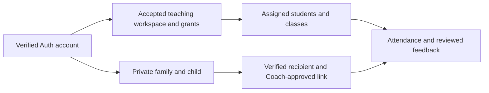

# Consolidated database direction

Status: recommended target and migration design, 17 November 2026. This document does not apply SQL. Evidence: metadata-only reads of AM project `fmavpazczahxeusqbxuh` and MM project `zcgcnycnanqkbdlwojln`, recorded under `ai-workspace/architecture/snapshots/`. Columns, nullability, constraints, RLS flags and function identities are captured; policies, function bodies, indexes, triggers and provider settings are not exhaustively audited by these snapshots.

## Owner direction — APVerse AM integration target, 17 November 2026

This instruction supersedes earlier recommendations in this document that placed MM's project at the database-consolidation target. Branch/database mapping: AM branches target APVerse (`fmavpazczahxeusqbxuh`); all non-AM branches stay on appsworld2027 MM (`zcgcnycnanqkbdlwojln`). Preserve APVerse workspace, membership, child/guardian, class-setup and recovery logic as architectural input. The MM project remains the current app/data compatibility baseline until AM feature adapters and complete acceptance are ready; keep its data and runtime contract intact.

**Owner data-direction update, 18 November 2026:** the owner now permits AM/source records to be deleted and prioritizes the database architecture, logic, relations, functions and procedures. This supersedes the 17 November instruction to keep the 3 workspaces, 2 children and 1 class usable. No live rows have been deleted or migrated. The changed data decision removes the identity-mapping/data-copy requirement; it does not complete schema or feature sync, authorize deleting the Source Git repository, or waive the retirement gates.

Port the MM product capabilities into APVerse through staged, reviewed, additive migrations and corresponding app adapters. No blind table/function copy: `batches` already has incompatible definitions, profile/family authority differs, and the two installed migration ledgers are independent. Reconcile schema objects and feature behavior by contract; never transfer the other project's migration versions. Validate on disposable PostgreSQL, then deploy only to APVerse. Keep MM unchanged until full acceptance and cutover are explicitly reached. Retiring the legacy Git or database requires evidence across all retirement gates; deleting AM fixture data does not satisfy those gates.

Current live inventory: APVerse has 41 public tables, all with RLS enabled, 101 public routines, 4 public policies, 4 public table triggers, 95 public indexes (72 unique), no public enums, no Storage buckets and no Edge Functions. MM has 25 public tables, all with RLS enabled, 39 public routines plus 16 `coach_private` routines, 27 public policies, 4 public table triggers, 68 public indexes (51 unique), no public enums, two private Storage buckets (`parentplus-class-media`, `parentplus-coach-photos`) and two active Edge Functions (`clever-processor`, `scan-roster`). Both have the same five installed extensions (`pg_stat_statements`, `pgcrypto`, `plpgsql`, `supabase_vault`, `uuid-ossp`).

18 November metadata refresh, excluding migration-registry tables from application counts: APVerse 41 public tables / 101 routines / 4 triggers / 95 indexes / 4 policies; MM 25 public plus 6 `coach_private` tables / 55 routines / 4 triggers / 75 indexes / 27 policies. Neither has business enums; both have the same five extensions. APVerse has no buckets or Edge Functions; MM has two buckets and two Edge Functions. Security advisors report 38 / 6 RLS-enabled tables without policies and 40 / 31 authenticated `SECURITY DEFINER` routine warnings (APVerse / MM); these findings require per-object authorization review and are not by themselves proof of exposure. No MM-to-APVerse schema migration has yet been applied. The MM standard migration registry has one record plus its separate `coach_private.schema_migrations` ledger; never treat its history as APVerse history.

Access design differs sharply: APVerse grants signed-in table reads on only `profiles`, `workspace_memberships` and `workspaces`; app operations are largely through RPCs. MM grants signed-in reads on all 25 tables and insert/update on 8, protected by RLS policies. APVerse has 58 `SECURITY DEFINER` functions, 40 executable by authenticated users; public/anonymous execution on `rls_auto_enable()` has been revoked by live migration `20261117180206` while the event trigger remains enabled. MM has 37/39 public functions and 15/16 private functions using `SECURITY DEFINER`; 31 public functions are executable by authenticated users. MM's private schema denies anonymous `USAGE` but permits authenticated `USAGE`; confirm the project API's exposed-schema setting before treating its functions as directly routable. These advisor flags are review items, not proof of exploitable defects. Keep the narrow RPC model or build tested, restricted compatibility views; do not widen table grants as a shortcut.

Supabase advisors report no health findings. After the APVerse migration, security findings are 38 RLS-enabled tables without policies, 40 authenticated `SECURITY DEFINER` warnings and leaked-password protection disabled; its anonymous-definer warning is cleared. MM has 6 no-policy findings for private `coach_private` tables, 31 authenticated-definer warnings and leaked-password protection disabled. The no-policy findings are consistent with denied direct table access but still need grant-path verification. MM's current app implements password sign-in; the Source Next.js app implements email OTP. Preserve the selected destination app's behavior during integration, then address leaked-password protection in Auth settings if password sign-in remains. Performance findings: APVerse 46 unindexed foreign keys and 10 unused indexes; MM 56 unindexed foreign keys, 3 unused indexes, 3 Auth RLS initialization-plan warnings and 2 multiple-permissive-policy warnings. Apply improvements only after measuring the corresponding query and preserving authorization semantics.

MM's `scan-roster` has `verify_jwt=false` but its handler validates the bearer token against Supabase Auth before privileged processing; `clever-processor` has JWT verification enabled. This behavior must be retained or strengthened when ported. The deployed functions must still be checked against the source tree before cutover.

## Current and target architecture

Use APVerse as the AM integration target and preserve its workspace, membership, guardian and workflow concepts. Bring MM's implemented product capabilities into that model while keeping its family/child and academic identities separate. Keep the MM project and its app data unchanged during this integration. The target contract remains `ai-workspace/architecture/MULTI_WORKSPACE_FOUNDATION.md`; acceptance remains `ai-workspace/validation/MULTI_WORKSPACE_VALIDATION.md`.

### Branch-scoped Supabase client configuration

`config/public-client.json` is the safe MM default and includes its expected project reference. An AM Vercel Preview must override `EXPO_PUBLIC_SUPABASE_URL`, `EXPO_PUBLIC_SUPABASE_PUBLISHABLE_KEY`, and `EXPO_PUBLIC_SUPABASE_PROJECT_REF` together, scoped only to the AM branch; the app fails closed if the configured reference does not match the URL host. Non-AM previews keep the MM defaults. Publishable keys are browser-visible by design; never put a service-role/secret key in an `EXPO_PUBLIC_` variable. This check prevents accidental URL/reference mismatch; Vercel branch scoping remains an operational setting and must be verified on the actual deployment.

**Applied AM schema slice, 19 November 2026:** APVerse migration `20261119014723_parent_private_family_records` adds private moments, todos and events bound to `children.created_by`, with FORCE RLS, authenticated-only direct grants and a narrow `parent_private.owns_created_child(uuid)` helper. It does not create a parallel academy/student identity or change workspace/guardian authority. Five isolated PGlite authorization/constraint scenarios passed before application; live grants/policies were read back afterward. The Parent application does not yet use these tables, so this schema alone is not a usable Parent feature and must not trigger AM Vercel routing. No data moved, and MM remains unchanged. See the current [progress tracker](../../PROGRESS.md#apverse-private-parent-records-schema--19-november-2026).

The main-branch consolidation also includes the tested private F2 kernel described in [WORKSPACE_AUTHORIZATION_QA.md](../validation/WORKSPACE_AUTHORIZATION_QA.md). The earlier standalone eligibility prototype is retired as a compatibility sentinel so it cannot overwrite the canonical helper. All production/API/storage integration and staging gates below remain; merging source code does not apply either candidate to Supabase.

Teaching grants permit academic work within their scope. An approved child/student link permits a separate Parent projection; staff membership never grants private family access. Account eligibility, link validity and consent are checked at execution time.

## Schema differences and decisions

The owner-direction section above controls the target. The table records how each domain differs and what behavior must be retained; it does not authorize copying database objects or data.

| Concept | AM current model | MM current model | Classification and target decision |
| --- | --- | --- | --- |
| Teaching boundary | `workspaces`, `workspace_memberships` | `academies`, owner-based authorization | Use the APVerse workspace/member model in AM; adapt MM feature contracts without changing MM's live model during integration. |
| Identity | `profiles`, `children`, `guardianships` | `profiles`, `parent_families`, `family_children`, `students`, `student_contacts` | Potentially incompatible. Preserve private family-child versus academy-student distinction. Contacts are not authenticated guardians. |
| Parent academic access | `guardianships` + `workspace_children` + `enrollments` + `app_parent_sessions` | `parent_families` + `family_children` + approved `parent_coach_links` + `get_parent_attendance_sessions` | Keep APVerse child/workspace/guardian authority canonical on AM branches. Port MM-only family tools as separate private capabilities; do not clone MM family identities into APVerse. AP attendance is workspace-scoped, so the client must merge pages across a child's approved workspaces before claiming parity. |
| Connection | `workspace_children`, `connection_requests`, `family_invites`, events/receipts | `parent_coach_links`, `parent_connection_requests`, private invites | Equivalent purpose, different authority/lifecycle. Keep MM verified intended email and explicit Coach approval. No automatic identity matching. |
| Learning | `courses`, `batches`, `batch_coach_assignments` | `batches`, `students`, candidate workspace assignments | Keep AM course/workspace assignment concepts; adapt MM batch/student behavior and UI contract without assuming equal IDs or columns. |
| Enrolment | `enrollments`, events and request receipts | `enrolments` | Conflicting spelling and lifecycle. Preserve existing rows; design pause/rejoin/history before expanding operations. |
| Scheduling | `schedule_sessions`, weekly setup series | `class_sessions` | Equivalent purpose, incompatible references. Preserve MM dates/attendance revision and explicitly design recurrence exceptions/time zones. |
| Attendance | sheets, records, events, request receipts | `attendance`, class attendance revision and checked save RPCs | Preserve atomic MM save, version and retry behavior in the AM model; port Parent projections through approved links. No guessed historical attendance. |
| Parent reports | `parent_signals`, signal receipts, typed `parent_items` | Reviewed `parent_feedback_handoffs` | Source-only signals and different feed semantics. Separate reports from attendance writes and reviewed feedback; use bounded versioned projections. |
| Observations/media | Not equivalent to MM's implemented reviewed journey | observations/versions/recipients, class media, consent events, private photos | Destination-only implemented capabilities. Preserve immutable recipients, revisions and current group-subject consent checks. |
| Finance | No equivalent implemented ledger in inspected source schema | invoice/payment/reversal tables | Destination-only. Preserve records and totals; payment collection remains shelved. |
| Family planning | No equivalent tables in inspected source schema | family events/todos/moments | Destination-only. Retain private owner scope. |
| OCR | No equivalent tables in inspected source schema | private imports, scan usage and monthly quota | Destination-only. Preserve idempotent import, provider-secret boundary and quotas. |
| Recovery controls | Numerous creation/setup fences, intents and receipts | Private import/review receipts and domain-specific revisions | Requires manual review per operation. Do not replace proven recovery with a generic wrapper or import source testing controls. |

The names `profiles` and `batches` overlap across projects, but their complete definitions and tenant references must not be treated as equal. Every captured table in both schemas has RLS enabled; enabled RLS alone does not prove correct policies or function authorization. Security-definer function identities are recorded for subsequent per-call review.

## Migration and compatibility sequence

1. Keep APVerse migration history independent from MM's 001–014 and the standalone Parent reader; never transplant either project's migration numbers.
2. Preserve the APVerse workspace foundation and map MM's capabilities by feature behavior, retaining authorship, consent, payment and attendance provenance.
3. Port each capability through additive, scoped AM migrations and app adapters. Cover RPCs, direct table grants, views, storage and account eligibility. Run negative and concurrent-revocation tests.
4. Add F3 explicit context selection, scoped cache/draft keys and legacy-client compatibility. A user owning multiple academies must never have one selected arbitrarily.
5. Rehearse on disposable PostgreSQL; then apply the validated AM migration to APVerse and compare feature outcomes, access rules, receipts, consent and feed visibility. Exercise interruption and twice-run behavior.
6. Keep MM unchanged until full AM acceptance. Before any cutover, verify a restorable backup, account mapping and final reconciliation procedure. No Git retirement is authorized by schema work alone.

Before new-model writes, an additive private candidate can be abandoned while the old app remains authoritative. After new-model writes, an old schema/client rollback can lose records or broaden access; use a tested forward repair unless an exact reversible data transition has been demonstrated. Never describe a Git revert as a database rollback.

## Acceptance still required

The repository presently has no complete destination implementation of F2–F5 or Parent attendance. Captured metadata is not migration compatibility evidence. Exact policy/index/trigger comparison, per-function authorization review, independent transaction races, staging Auth/Storage/schema-cache integration, restore rehearsal and device/provider acceptance remain open. Source testing-only OTP/control overrides are excluded from the target design.
