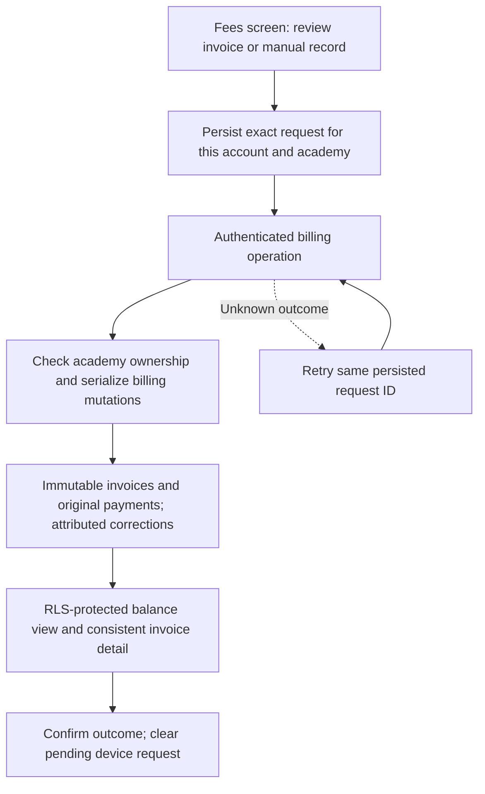

# Invoices and manual payments — Module 6

Candidate 0.5.0 implements FEE-01. Source and local test status are recorded in [progress](../../PROGRESS.md) and [validation](../validation/VALIDATION.md). This module records money received outside the app; it does not collect money, create payment links, send messages or verify manual receipts against a gateway.

[View the fictional paid-invoice screenshot](../validation/images/fees-paid.png).

## Coach workflow

1. Open **Fees**, choose a billing month (`YYYY-MM`), then **Show month**.
2. Choose **Create invoice**, select a student/batch enrolment, review the full current monthly fee and due date, then confirm. Enrolments overlapping any part of the month are eligible. Fees are not automatically prorated. Zero-fee batches cannot issue invoices. An existing active invoice blocks another for the same enrolment/month.
3. Open the invoice and choose **Record manual payment** only after receiving money outside the app. Enter rupees, received date, cash/bank/UPI/other, and an optional receipt reference. Review and confirm. A reference is a coach-entered label, not independent payment verification.
4. The invoice shows unpaid, partially paid, paid, or overdue using the academy's local date. The due date itself is not overdue. Outstanding is calculated from the payment ledger. Gateway test entries never settle the real balance; excess live receipts are flagged for review.

Invoices retain their original amount, student name and batch name when batch fees or roster names later change. Changing the batch fee affects future invoices only. Invoice dates and amounts cannot be edited in place.

## Corrections

Choose **Correct manual record**, enter a reason, and confirm. The original payment stays visible with an attributed reversal. Add the correct manual entry as a new record. This corrects bookkeeping only; it does not return money to anyone.

An invoice without active payments can be voided with a reason, then replaced for the same enrolment/month. Correct any mistaken manual payment records first. Gateway payments cannot be reversed through this manual workflow. Voided invoices remain visible. Financial adjustments, credits and actual refunds need a separately designed workflow; do not misrepresent a real payment as mistaken solely to change an invoice amount.

## Save recovery and device limits

Before any write, the app saves the complete request and its unique ID in device storage. If the result is uncertain, a **Resolve pending fee save** panel blocks another fee write. Retry the exact stored request; the database either confirms the original record or creates it once. The original payment's reversal is never undone by retrying its old request.

These pending records survive navigation/restart and sign-out for reconciliation on the same account and academy. They are isolated by account/academy and use native SecureStore via the shared chunk adapter; browser preview uses sessionStorage and therefore does not promise recovery after closing the browser session. They contain record IDs, dates, amounts and entered references/reasons, not student names or credentials. A resolved request is removed. Unsent form edits are in memory and prompt before navigation; they are not durable drafts. Clearing app data or uninstalling loses device recovery records, so check saved invoice history before entering a payment again.

If storage cannot save a request, no API write is sent. The in-memory pending request keeps the unsaved-navigation warning and is explicitly labelled as not yet durable. Unreadable recovery data blocks new writes rather than silently discarding it. Known transaction rejection returns to the retained form; network/unknown errors keep the exact pending request. If the saved-record refresh fails after a confirmed write, the app says that the write succeeded and asks for a refresh; it does not repeat the write with a new ID.

## One-time database update, when ready

Existing migrations 001–004 are owner-confirmed installed. Observation migration 005 is prepared but not yet owner-confirmed installed. Do not repeat initial setup.

For the fees module, apply the missing migrations in order: [005 observations](https://github.com/appsworld2027/Parent-plus-/blob/codex/coach-foundation/supabase/migrations/202611120005_observations.sql), then [006 fees](https://github.com/appsworld2027/Parent-plus-/blob/codex/coach-foundation/supabase/migrations/202611140006_fees.sql), using the existing [Supabase SQL editor](https://supabase.com/dashboard/project/zcgcnycnanqkbdlwojln/sql/new). The coding partner should guide one update at a time when the tested build is ready. Migration 006 checks that 005 exists and preserves existing tables, invoices and payment entries. Legacy invoice names can only be snapshotted from the roster at migration time; legacy actor/payment-date fields remain unknown.

The generated `setup_after_001.sql` is for the older 001-only checkpoint. The current owner should use only missing individual migrations. Generation/checking that file does not deploy it.

## Technical map and protection

- `src/fees/model.ts`: calendar/eligibility, amount validation and status labels.
- `src/fees/FeesScreen.tsx`: month/list/detail/forms, explicit review, navigation/busy guards and recovery UI.
- `src/fees/service.ts`: paged reads, safe failure mapping and four trusted write operations.
- `src/fees/pending.ts`: whitelisted account-scoped recovery snapshots. No financial content enters diagnostics.
- `supabase/migrations/202611140006_fees.sql`: trusted fee snapshots, active-month uniqueness, manual receipts, reversal ledger and voiding. Ownership is checked before locking an academy row; mutations serialize per academy to prevent simultaneous manual overpayments. Exact retries are checked before current balance/roster validation. Clients cannot write any financial table directly or submit a gateway-verification field.
- `fee_invoice_balances` uses `security_invoker=true` so the underlying tables' RLS still applies. `get_fee_invoice` reads invoice totals and payment history in one statement. Test payments are excluded from real totals, reversals excluded from active totals. Voided invoices are labelled void rather than collectible.
- `tests/fees-database.test.ts`, `tests/fees.test.ts`, `e2e/fees.spec.ts`: database authorization/integrity, model/recovery and fictional browser behavior. These do not establish deployed Supabase, native SecureStore or real-device acceptance.

## Owner acceptance after the update

With fictional records, issue a ₹2,500 invoice, record ₹1,000 manually, reopen and expect ₹1,500 outstanding; record the remaining ₹1,500 and expect Paid. Change the batch default and verify the old invoice stays ₹2,500. Correct a mistaken receipt, verify its original history, then verify void/replacement for an unpaid invoice. Separately check phone restart and lost-connection recovery without re-entering the same real receipt. The coding partner supplies one short check at a time. No real money is moved in these checks.
