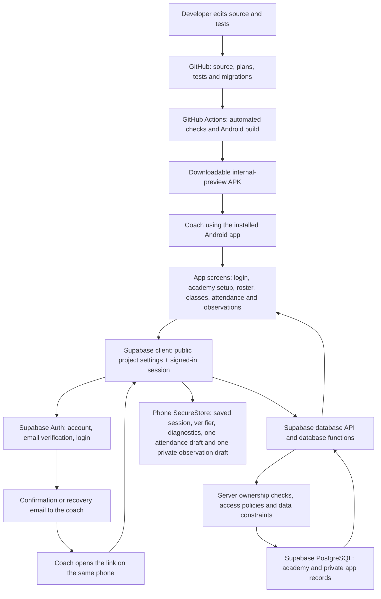
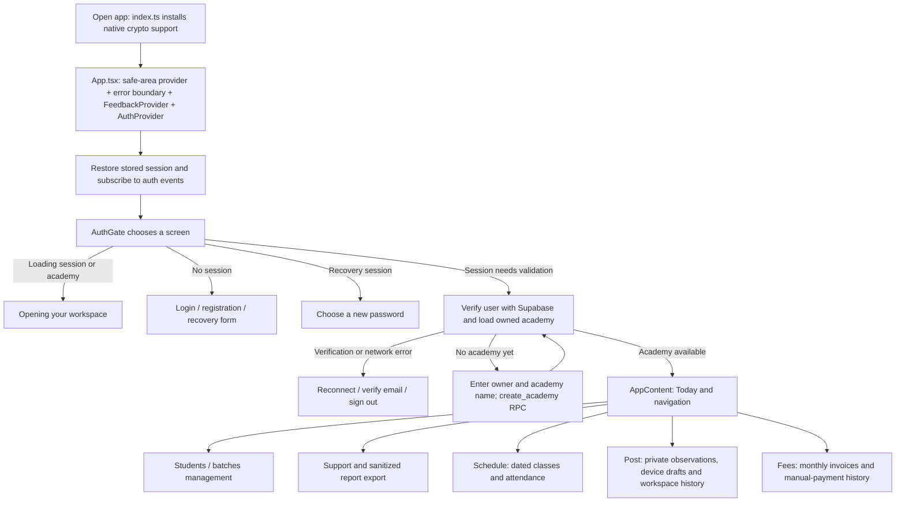
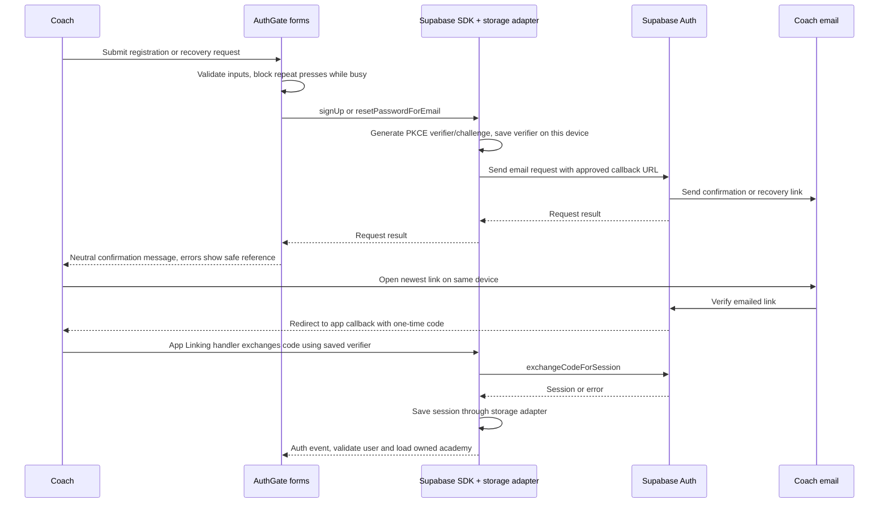
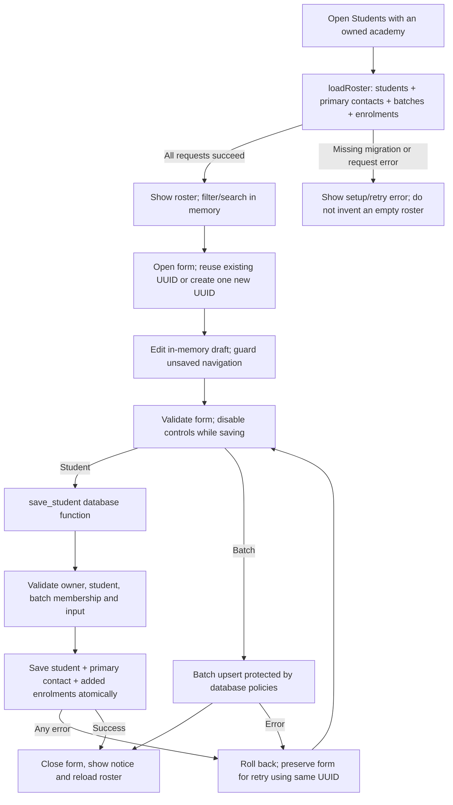
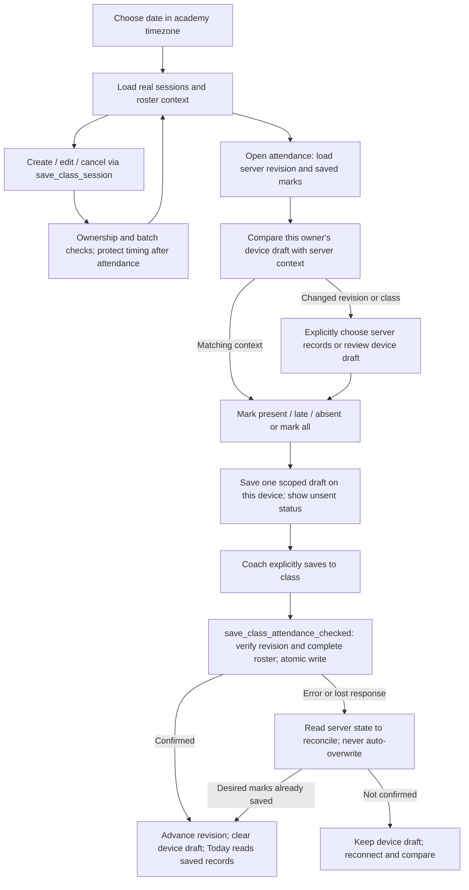
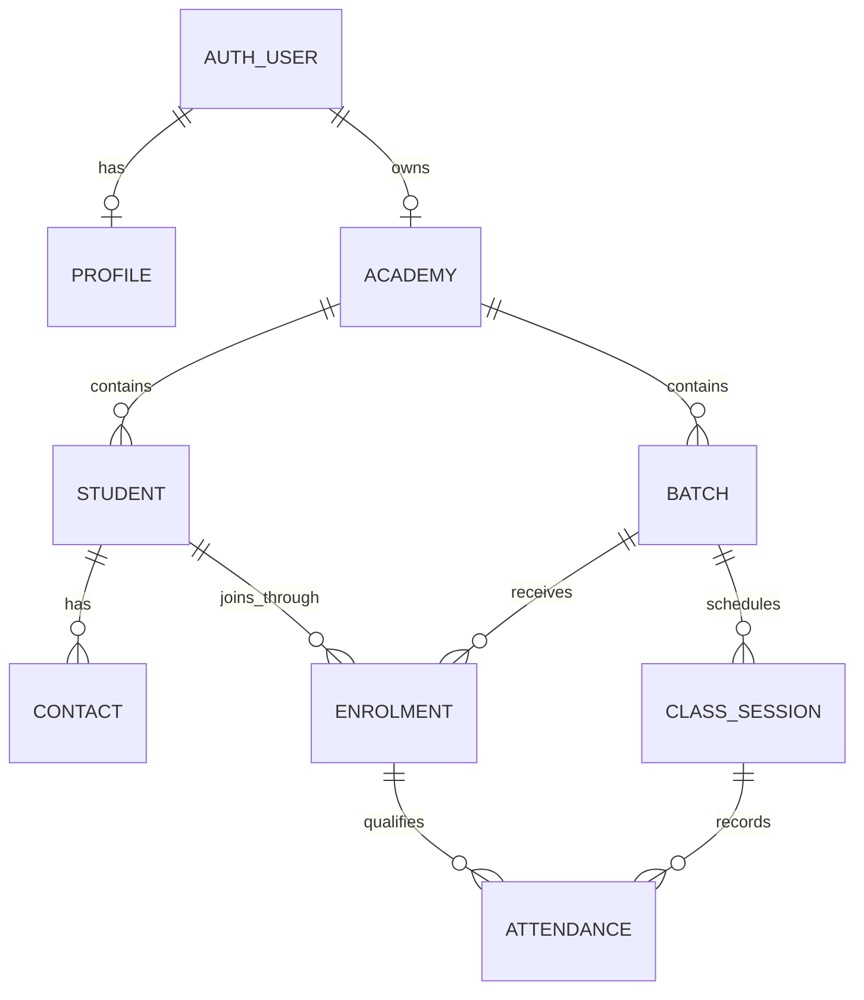
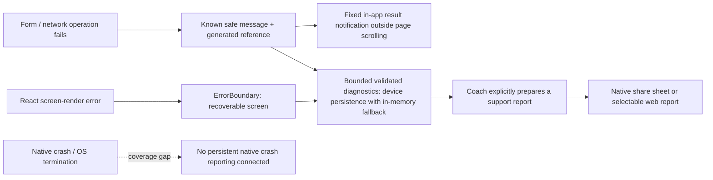
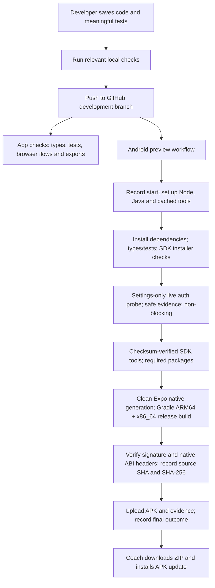

# How Parent Plus Coach works today

Reviewed: 14 November 2026. Applies to candidate app version 0.5.0. Feature development has resumed; this describes existing code, including work whose live deployment is still pending. [Progress and acceptance](../PROGRESS.md) is the status record; [PRD](../PRD.md) defines the intended product.

## 1. The whole system

The installed app talks directly to Supabase over HTTPS; it does not need a running laptop or Codex session. GitHub is used to develop and distribute builds. New GitHub source does not automatically update an installed APK. No custom application server or payment integration is deployed yet.

The roster paths require migration 002; classes/attendance require migrations 003/004. The owner has confirmed versions 001–004 installed through the filtered version query; app/API and device acceptance remain pending. Email receipt/login are owner-reported; the 0.2.1 crash repair is not yet phone-verified.

[Open the rendered system diagram](images/system-flow.png). It is a snapshot generated from the first Mermaid block above; refresh it when that flow changes.

## 2. What is stored where

| Location | Contents | Important limit |
| --- | --- | --- |
| GitHub development branch | App source, plans, SQL migrations, automated tests, fictional screenshots | Never store private student records or privileged credentials here |
| GitHub Actions artifacts | APK and safe build evidence | Download retention is 14 days; APKs are not committed to Git |
| GitHub `build-status` branch | Small per-source build reports | Reports are written at job start/end, not a live stream of each build step |
| Supabase Auth | User identities and authentication sessions managed by the provider | An academy contact record does not create a parent login |
| Supabase PostgreSQL | Academy, students, contacts, batches and enrolments; schema also exists for later modules | Table existence does not mean the feature is implemented |
| Android SecureStore | Session/verifier, bounded safe diagnostics, one attendance draft and one private observation draft through chunked adapters | Observation drafts include private note text; attendance drafts hold scoped IDs/statuses. No full offline roster cache |
| App memory | Current form entries, loaded records and current screen; diagnostic fallback when storage fails | Student/class-edit drafts are not durable; attendance is durable only after device-save confirmation |
| Web browser sessionStorage | Web sessions, diagnostics and private drafts through the same storage adapter | Reload tests do not validate Android SecureStore or persistence after closing the browser tab |

The public URL and publishable key in `config/public-client.json` are bundled client configuration. Database security depends on verified user identity, privileges, policies and constraints. A public key is not an owner/service-role credential. No service-role, SMTP, gateway or production-signing secret belongs in the client.

## 3. App startup and screen decisions

File responsibilities:

- `index.ts`: installs crypto support before the auth client is imported, then registers the app.
- `App.tsx`: wraps providers, displays the workspace/navigation, and guards leaving feature forms with pending edits or writes.
- `src/auth/AuthProvider.tsx`: owns session/academy state, validates the user, handles email links and native refresh lifecycle.
- `src/auth/AuthGate.tsx`: renders the appropriate form, loading/error state, onboarding or workspace. It is a UI gate, not the database security boundary.

Development/test builds also allow **Explore interface preview**. That branch renders the shell without loading a real academy/roster. It grants no database permissions. Unknown/unset app environments default to production, hiding developer controls.

## 4. Registration, login and recovery

PKCE binds the code exchange to the device that requested the link. The app accepts its own `parentplus-coach://auth/callback` and `/recovery` routes, or matching local web routes. It does not trust access tokens supplied in arbitrary URLs. The callback error path asks for a fresh link instead of logging codes/tokens.

Email/password sign-in uses `signInWithPassword` and then the same session/academy validation. Recovery displays a password-update form; it does not enter the normal workspace first. A registration success message is neutral so it does not reveal whether someone else's account exists.

Native session storage writes bounded ASCII chunks and commits a manifest after the new chunks exist. The previous committed session is retained if a write fails; old chunks are cleaned after commit. Writes are serialized. Device lock/storage failures remain possible and need real-device testing. Native foreground/background events start/stop token auto-refresh.

On sign-out, the app uses local-session sign-out, clears its loaded academy and diagnostics, and removes saved session state through the SDK. This action is not account deletion or a command to log out every other device.

Version 0.2.1 uses `role="status"` with a polite live region for success notices. `accessibilityRole="status"` is rejected by the installed Android implementation even though browser/type checks previously accepted it. See [ANDROID-001](ISSUES.md).

## 5. Loading and saving the roster

Code path: `RosterScreen.tsx` (forms/state) → `model.ts` (validation and money parsing) → `service.ts` (SDK queries/RPCs) → migration 002 (trusted transaction).

The service's academy filters narrow queries; server policies remain responsible for authorization. The four roster reads are not one database snapshot. A request error fails the combined load, rather than showing partial data as a trustworthy complete roster. On a failed refresh, previously loaded data may remain visible with the error; the new combined result is not committed. A version counter prevents an older request overwriting a newer result or writing after unmount.

A new student UUID is generated when opening the form and retained for retries. The database serializes writes for that UUID. If a response is lost after the commit, retry updates the same identity instead of creating a second student. This is retry protection, not an offline sync queue.

`save_student` validates ownership explicitly because it is a privileged database function with a restricted search path. The student, primary guardian contact and new enrolments commit together. Migration 002 revokes direct client inserts/updates to those three tables; batches still use ordinary policy-protected writes. Archiving uses a separate owner-checked function and retains history. It is not deletion.

Enrolment editing is additive. Existing memberships are retained; moving/ending/reactivating enrolments is deferred. A blank guardian name clears the primary contact if validation permits it; it does not delete unrelated contacts. Saving contact details sends no invitation or notification.

Money is parsed as integer paise from decimal text. For example, ₹2,500.50 becomes 250050 paise. A batch's default fee is not an invoice or a payment.

## Classes and attendance flow — migrations 003/004

Code: `ClassesScreen.tsx` owns screen/form state; `model.ts` converts academy wall time, validates classes and selects students enrolled on the local class date; `service.ts` calls Supabase; `drafts.ts` validates and serializes the device draft. `TodayClasses.tsx` queries current sessions rather than inventing figures.

Times are stored as UTC timestamps, entered/displayed in the academy IANA timezone. Invalid dates, non-positive durations, daylight-saving gaps and repeated ambiguous times are rejected. The current form supports years 2000–2100.

One active attendance draft is stored per device, scoped to owner/academy/session, with marks, server revision and a class fingerprint. No names or contacts are copied into that draft. A different class cannot silently replace it; explicit discard/resume is offered. It survives restart only if the write completed and storage remains available.

On reopen, the app verifies server context before restoration. Changed class/revision requires a choice. A save locks the class and checks its canonical date/batch/status fingerprint, expected attendance revision, all currently eligible students and the existing attendance constraints. A stale save is rejected; only uncertain network outcomes trigger a read-only comparison against the complete refreshed roster and an advanced revision. An explicit server rejection remains an error even if an older saved subset matches. Student/enrolment changes can require review; this is not a multi-device automatic merge.

Clients cannot directly insert/update classes or call the old attendance function after migrations 003/004. Trusted functions validate ownership. Cancelling retains history and blocks further attendance writes; recorded attendance prevents timing/batch edits. Room/status edits remain possible.

## 6. Current data relationships

Relationships below describe migration 001 plus the prepared 002/003/004 changes. The owner has now confirmed versions 001–004 installed; actual app/API acceptance remains pending.

One academy is owned per account in this version. Migration 002 permits at most one primary contact per student. Composite foreign keys prevent a child, batch and enrolment being connected across academies. Current enrolment uniqueness is per academy/student/batch pair, not a history of repeat enrolment periods.

Migration 003 adds attendance revisions and trusted class/attendance writes to `class_sessions` and `attendance`; the corresponding app workflows are implemented and their installed versions are owner-confirmed; real app/API acceptance is pending. `observations` and `observation_recipients` now have Module 5 workflows, with private `observation_versions` added in migration 005 (deployment pending). `fee_invoices` and `fee_payments` now have Module 6 invoice/manual-payment workflows, requiring migration 006 (deployment pending). Gateway webhook/event processing is not implemented.

## 7. Errors and diagnostics

Raw exceptions, form contents, email links and tokens are not added to reports. Reports retain only allowed codes/references/time/build/action. Reports now persist through the device adapter when available. On restoration, unknown fields and events older than 14 days are discarded; the buffer is bounded to 30 records. Sign-out clears reports and the attendance/observation device drafts. Storage failures keep diagnostics in memory and expose an unavailable-storage status. Writes are best-effort and an abrupt termination can interrupt a pending write. Error boundaries cover React rendering, not every native failure or asynchronous rejection. They must not be represented as comprehensive crash monitoring.

UI guards preserve edits during handled failures and block navigation while saves are pending. Student and class-edit forms are in memory. Attendance marks persist only after the device draft confirmation. A restart needs network access to validate the class before restoring attendance; full offline roster/schedule editing and automatic sync are not implemented.

See [action feedback](ACTION_FEEDBACK.md) for the 0.3.1 notification path. Success/info/error notices reserve a fixed row outside scrolling; device-draft messages explicitly do not assert a class save. Notice text remains in UI memory, separate from persisted enumerated diagnostic metadata.

## 8. Code-to-APK delivery

The build installs Java 17 as a compilation toolchain and runs Gradle on Java 21. Command-line tools 20 avoid the secondary bootstrap download that failed earlier. SDK/Gradle archives are verified. Preview builds have a separate app ID and development signing; production keys and Google Play distribution remain separate.

The branch-specific `android-preview-sdk20-v2` concurrency group isolates previews from unfinished legacy diagnostics. A newer source run supersedes an older run in this group. Native success, browser success and phone acceptance are separate facts. App checks are viewed in Actions; `build-status` is the explicit native start/end report branch.

The live probe checks settings/key acceptance and denial of anonymous profile reads. It does not create users, send emails or read private records. Its failure does not automatically stop APK compilation (`continue-on-error`); inspect its booleans separately. Build reports describe start/end and can themselves fail to publish; missing/stale evidence requires investigation, not a guessed outcome.

GitHub builds provide the working preview route without Expo login. `eas.json` is an alternative profile configuration, not evidence that an Expo project is linked or a production release exists. There is no continuous monitor or automatic APK update service running.

## 9. What is deliberately outside the current working flow

Post implements private observations and drafts; see [its flow and recovery rules](OBSERVATIONS.md). Migration 005 is prepared but not deployed. Fees implements monthly invoices and manual payment records; see [its workflow](FEES.md). Schedule now manages classes and attendance; Today queries actual dated sessions and counts classes with an attendance save. It does not claim every later roster change has been reconciled, and fee/observation dashboard figures are not implemented. There is no payment checkout, verified-payment backend, parent login/invitation, WhatsApp login, or parent-notification delivery. The larger parent app is deferred. Refer to [PROGRESS.md](../PROGRESS.md) before planning new work.

## Module 5: observations

See [the complete observation flow](OBSERVATIONS.md#data-flow-and-recovery). The screen validates inputs and persists one scoped device snapshot, then explicitly calls `save_observation`. The function checks academy ownership, revision, batch/class and enrolments; one transaction writes the note, fixed recipient set and private version. Recorded scope cannot be changed. Exact retries return the existing version. Restart compares the snapshot with server state; conflicting text is copied only by an explicit new-draft action. Sign-out invalidates queued observation writers before removing device copies. No parent delivery exists.

## Monthly invoices and manual-payment ledger — 0.5.0

Fees now implements FEE-01; see [workflow, recovery and owner update](FEES.md). The screen calls trusted operations to create an invoice from a reviewed current batch fee, record a manual receipt, reverse a mistaken manual record, or void an invoice without active payments. Invoice amounts, names and original payment rows are retained; corrections add attributable history. Only one active invoice exists per enrolment/month. Voiding permits a replacement while preserving the old record.

The app persists an immutable, account/academy-scoped pending request before calling the API. Unknown outcomes freeze that request until an exact retry confirms it; failed device persistence prevents sending it. Resolved requests are cleared. These recovery records intentionally survive sign-out for the same account; ordinary unsent fee form edits remain in memory with navigation guards. Financial references/reasons never enter diagnostics.

Migration 006 serializes billing mutations per owned academy. The RLS-protected invoker view computes real received, test, outstanding and excess amounts from unreversed ledger entries; `get_fee_invoice` returns a consistent detail snapshot. Test gateway money cannot settle a real invoice. No payment-link service, provider credentials, webhook verification, online collection or refunds are implemented. Migrations 005/006 are prepared, not confirmed deployed. The parent app and native/live acceptance remain separate gates.

## Coach workflow correction —0.6.0

[The workflow review](COACH_WORKFLOW_REVIEW.md) maps the owner-required journeys. Roster pages now expose current batch membership and create/add students from either entry point. `add_batch_students` mutates only membership, leaving profile/contact data intact. Fees computes the full month's eligible and issued-charge summaries from paged RLS reads before batch/student drilldown. `collect_student_fee` creates a trusted missing charge and receipt in one academy-serialized transaction; exact-request recovery is shared with the existing ledger. Invoice history/corrections remain secondary.

Private profile and observation media use `coach_photos` metadata and the private parentplus-coach-photos bucket. Storage policies validate the owned academy/entity path; metadata references storage.objects by foreign key. `attach_coach_photo` locks its entity and storage reference, compares the prior path, and forbids changing recorded media. The client uses short-lived signed URLs and image-only selection. Updates007/008 are prepared, not deployed; existing001–006 must not be repeated.

## 0.7.0 register onboarding

The scanner is the first custom server feature: authenticated app → Supabase Edge Function → Auth/owner check → service-only quota reservation → OpenAI image extraction → editable client review → owner-scoped atomic import RPC. AI never writes student records. Vercel continues serving the web bundle; scans call Supabase directly so protected Vercel previews do not obstruct Android. No server credentials enter the bundle. This server is prepared but not deployed; [activation and limits](PHOTO_ONBOARDING.md) are explicit. The earlier statement that no custom server exists describes deployed0.6 behavior.
