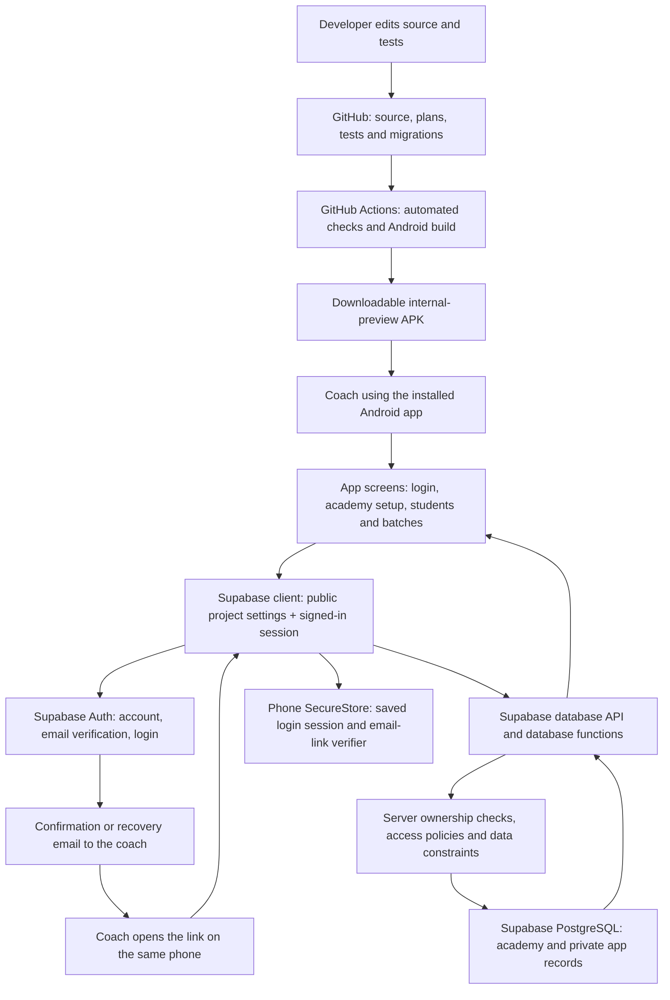
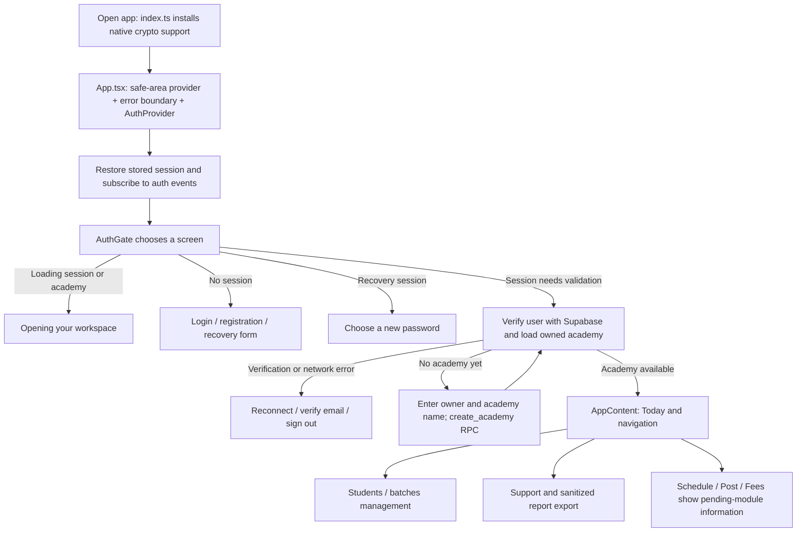
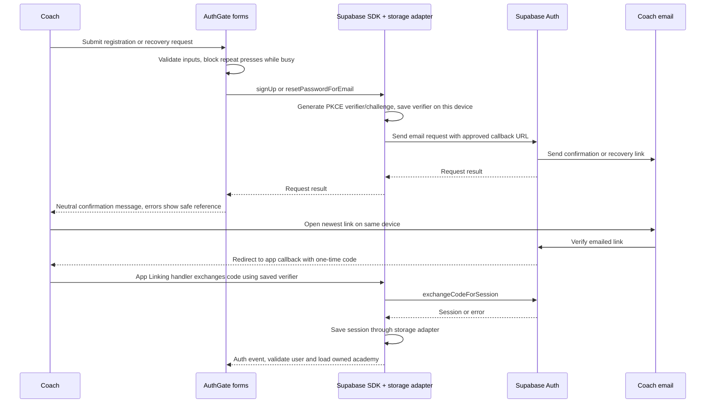
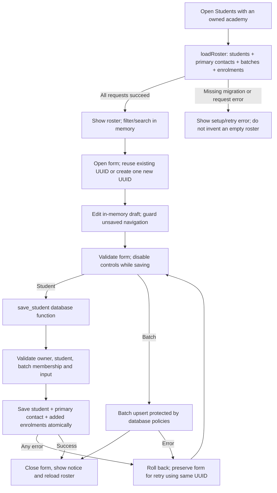
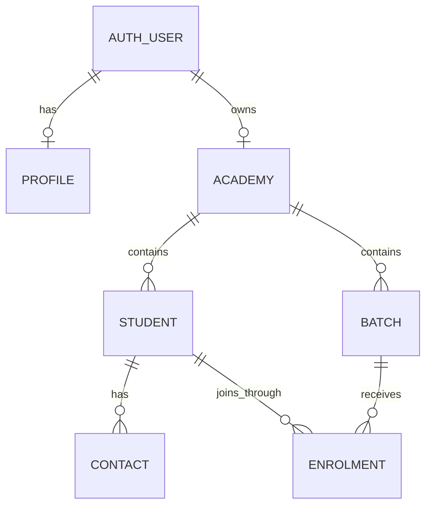
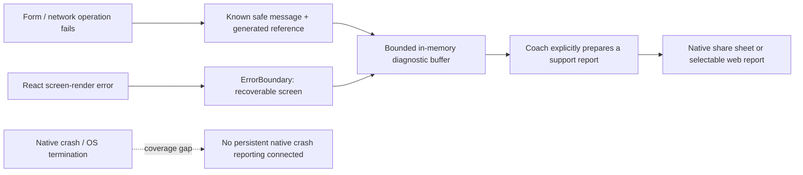
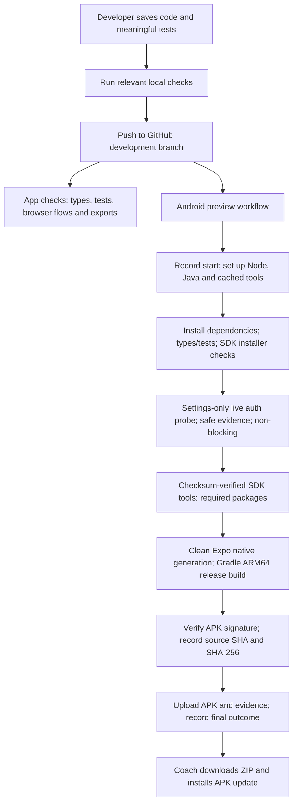

# How Parent Plus Coach works today

Reviewed: 12 November 2026. Applies to app version 0.2.1. Feature development is paused; this describes existing code, including work whose live deployment is still pending. [Progress and acceptance](../PROGRESS.md) is the status record; [PRD](../PRD.md) defines the intended product.

## 1. The whole system

The installed app talks directly to Supabase over HTTPS; it does not need a running laptop or Codex session. GitHub is used to develop and distribute builds. New GitHub source does not automatically update an installed APK. No custom application server or payment integration is deployed yet.

The diagram's roster paths exist in code but require migration 002. Its deployment and live roster acceptance are not confirmed. Email receipt/login are owner-reported; the 0.2.1 crash repair is not yet phone-verified.

[Open the rendered system diagram](images/system-flow.png). It is a snapshot generated from the first Mermaid block above; refresh it when that flow changes.

## 2. What is stored where

| Location | Contents | Important limit |
| --- | --- | --- |
| GitHub development branch | App source, plans, SQL migrations, automated tests, fictional screenshots | Never store private student records or privileged credentials here |
| GitHub Actions artifacts | APK and safe build evidence | Download retention is 14 days; APKs are not committed to Git |
| GitHub `build-status` branch | Small per-source build reports | Reports are written at job start/end, not a live stream of each build step |
| Supabase Auth | User identities and authentication sessions managed by the provider | An academy contact record does not create a parent login |
| Supabase PostgreSQL | Academy, students, contacts, batches and enrolments; schema also exists for later modules | Table existence does not mean the feature is implemented |
| Android SecureStore | Session/verifier storage through a chunked adapter | This is not offline storage for the student roster |
| App memory | Current form entries, loaded roster, current screen, bounded diagnostics | Unsaved forms and diagnostics do not survive app termination |
| Web browser sessionStorage | Test/web auth session through the same storage adapter | Browser checks do not validate Android SecureStore |

The public URL and publishable key in `config/public-client.json` are bundled client configuration. Database security depends on verified user identity, privileges, policies and constraints. A public key is not an owner/service-role credential. No service-role, SMTP, gateway or production-signing secret belongs in the client.

## 3. App startup and screen decisions

File responsibilities:

- `index.ts`: installs crypto support before the auth client is imported, then registers the app.
- `App.tsx`: wraps providers, displays the workspace/navigation, and guards leaving a student form.
- `src/auth/AuthProvider.tsx`: owns session/academy state, validates the user, handles email links and native refresh lifecycle.
- `src/auth/AuthGate.tsx`: renders the appropriate form, loading/error state, onboarding or workspace. It is a UI gate, not the database security boundary.

Development/test builds also allow **Explore interface preview**. That branch renders the shell without loading a real academy/roster. It grants no database permissions. Unknown/unset app environments default to production, hiding developer controls.

## 4. Registration, login and recovery

PKCE binds the code exchange to the device that requested the link. The app accepts its own `parentplus-coach://auth/callback` and `/recovery` routes, or matching local web routes. It does not trust access tokens supplied in arbitrary URLs. The callback error path asks for a fresh link instead of logging codes/tokens.

Email/password sign-in uses `signInWithPassword` and then the same session/academy validation. Recovery displays a password-update form; it does not enter the normal workspace first. A registration success message is neutral so it does not reveal whether someone else's account exists.

Native session storage writes bounded ASCII chunks and commits a manifest after the new chunks exist. The previous committed session is retained if a write fails; old chunks are cleaned after commit. Writes are serialized. Device lock/storage failures remain possible and need real-device testing. Native foreground/background events start/stop token auto-refresh.

On sign-out, the app uses local-session sign-out, clears its loaded academy and diagnostics, and removes saved session state through the SDK. This action is not account deletion or a command to log out every other device.

Version 0.2.1 uses `role="status"` with a polite live region for success notices. `accessibilityRole="status"` is rejected by the installed Android implementation even though browser/type checks previously accepted it. See [ANDROID-001](ISSUES.md).

## 5. Loading and saving the roster

Code path: `RosterScreen.tsx` (forms/state) → `model.ts` (validation and money parsing) → `service.ts` (SDK queries/RPCs) → migration 002 (trusted transaction).

The service's academy filters narrow queries; server policies remain responsible for authorization. The four roster reads are not one database snapshot. A request error fails the combined load, rather than showing partial data as a trustworthy complete roster. On a failed refresh, previously loaded data may remain visible with the error; the new combined result is not committed. A version counter prevents an older request overwriting a newer result or writing after unmount.

A new student UUID is generated when opening the form and retained for retries. The database serializes writes for that UUID. If a response is lost after the commit, retry updates the same identity instead of creating a second student. This is retry protection, not an offline sync queue.

`save_student` validates ownership explicitly because it is a privileged database function with a restricted search path. The student, primary guardian contact and new enrolments commit together. Migration 002 revokes direct client inserts/updates to those three tables; batches still use ordinary policy-protected writes. Archiving uses a separate owner-checked function and retains history. It is not deletion.

Enrolment editing is additive. Existing memberships are retained; moving/ending/reactivating enrolments is deferred. A blank guardian name clears the primary contact if validation permits it; it does not delete unrelated contacts. Saving contact details sends no invitation or notification.

Money is parsed as integer paise from decimal text. For example, ₹2,500.50 becomes 250050 paise. A batch's default fee is not an invoice or a payment.

## 6. Current data relationships

Solid relationships below describe deployed migration 001 plus the prepared migration 002 changes. Migration 002 deployment remains unconfirmed.

One academy is owned per account in this version. Migration 002 permits at most one primary contact per student. Composite foreign keys prevent a child, batch and enrolment being connected across academies. Current enrolment uniqueness is per academy/student/batch pair, not a history of repeat enrolment periods.

The later-module tables are `class_sessions`, `attendance`, `observations`, `observation_recipients`, `fee_invoices`, and `fee_payments`. The attendance-save function exists, but its app UI is pending. Observations and financial tables do not yet provide complete user workflows. Gateway webhook/event processing is not implemented.

## 7. Errors and diagnostics

Raw exceptions, form contents, email links and tokens are not added to reports. Reports retain only allowed codes/references/time/build/action. Reports currently disappear on restart and clear at sign-out. Error boundaries cover React rendering, not every native failure or asynchronous rejection. They must not be represented as comprehensive crash monitoring.

UI guards preserve edits during handled failures and block navigation while saves are pending. They do not make unsaved drafts durable if the OS terminates the app. Full offline editing/sync and persistent draft recovery remain future work.

## 8. Code-to-APK delivery

The build installs Java 17 as a compilation toolchain and runs Gradle on Java 21. Command-line tools 20 avoid the secondary bootstrap download that failed earlier. SDK/Gradle archives are verified. Preview builds have a separate app ID and development signing; production keys and Google Play distribution remain separate.

The branch-specific `android-preview-sdk20-v2` concurrency group isolates previews from unfinished legacy diagnostics. A newer source run supersedes an older run in this group. Native success, browser success and phone acceptance are separate facts. App checks are viewed in Actions; `build-status` is the explicit native start/end report branch.

The live probe checks settings/key acceptance and denial of anonymous profile reads. It does not create users, send emails or read private records. Its failure does not automatically stop APK compilation (`continue-on-error`); inspect its booleans separately. Build reports describe start/end and can themselves fail to publish; missing/stale evidence requires investigation, not a guessed outcome.

GitHub builds provide the working preview route without Expo login. `eas.json` is an alternative profile configuration, not evidence that an Expo project is linked or a production release exists. There is no continuous monitor or automatic APK update service running.

## 9. What is deliberately outside the current working flow

Schedule, Post and Fees are pending-module screens. The home screen is a workspace/navigation shell, not a calculated live dashboard. There is no payment checkout, verified-payment backend, parent login/invitation, WhatsApp login, or parent-notification delivery. The larger parent app is deferred. Refer to [PROGRESS.md](../PROGRESS.md) before planning new work.
