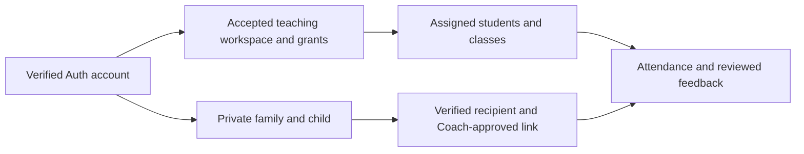

# Consolidated database direction

Status: recommended target and migration design, 17 November 2026. This document does not apply SQL. Evidence: metadata-only reads of AM project `fmavpazczahxeusqbxuh` and MM project `zcgcnycnanqkbdlwojln`, recorded under `docs/consolidation/`. Columns, nullability, constraints, RLS flags and function identities are captured; policies, function bodies, indexes, triggers and provider settings are not exhaustively audited by these snapshots.

## Owner direction — APVerse AM integration target, 17 November 2026

This instruction supersedes earlier recommendations in this document that placed MM's project at the database-consolidation target. APVerse (`fmavpazczahxeusqbxuh`) is now the AM schema-integration target. Preserve its workspace, membership, child/guardian, class-setup and recovery logic as architectural input. Its existing records are not required and may be removed only if a validated rebuild needs that. The appsworld2027 project (`zcgcnycnanqkbdlwojln`) remains the MM app's compatibility and data baseline while integration is developed; do not alter its data or break its current runtime contract.

Port the MM product capabilities into APVerse through staged, reviewed, additive migrations and corresponding app adapters. No blind table/function copy: `batches` already has incompatible definitions, profile/family authority differs, and the two installed migration ledgers are independent. Reconcile schema objects and feature behavior by contract; never transfer the other project's migration versions. Validate on disposable PostgreSQL, then deploy only to APVerse. Keep MM unchanged until full acceptance and cutover are explicitly reached. Retiring the legacy Git or database requires evidence across all retirement gates; deleting AM fixture data does not satisfy those gates.

Current live inventory: APVerse has 41 public tables, all with RLS enabled, 101 public routines, 4 public policies, 4 public triggers and no public enums or edge functions. MM has 25 public tables, all with RLS enabled, 39 public routines plus 16 `coach_private` routines, 27 public policies, 6 public triggers, no public enums and two active Edge Functions (`clever-processor`, `scan-roster`). Both report the same five installed extensions (`pg_stat_statements`, `pgcrypto`, `plpgsql`, `supabase_vault`, `uuid-ossp`). These counts establish object coverage only: grants, policies and routine bodies still require security review before porting.

## Current and target architecture

Use APVerse as the AM integration target and preserve its workspace, membership, guardian and workflow concepts. Bring MM's implemented product capabilities into that model while keeping its family/child and academic identities separate. Keep the MM project and its app data unchanged during this integration. The target contract remains `MULTI_WORKSPACE_FOUNDATION.md`; acceptance remains `MULTI_WORKSPACE_VALIDATION.md`.

The main-branch consolidation also includes the tested private F2 kernel described in [WORKSPACE_AUTHORIZATION_QA.md](WORKSPACE_AUTHORIZATION_QA.md). The earlier standalone eligibility prototype is retired as a compatibility sentinel so it cannot overwrite the canonical helper. All production/API/storage integration and staging gates below remain; merging source code does not apply either candidate to Supabase.

Teaching grants permit academic work within their scope. An approved child/student link permits a separate Parent projection; staff membership never grants private family access. Account eligibility, link validity and consent are checked at execution time.

## Schema differences and decisions

The owner-direction section above controls the target. The table records how each domain differs and what behavior must be retained; it does not authorize copying database objects or data.

| Concept | AM current model | MM current model | Classification and target decision |
| --- | --- | --- | --- |
| Teaching boundary | `workspaces`, `workspace_memberships` | `academies`, owner-based authorization | Use the APVerse workspace/member model in AM; adapt MM feature contracts without changing MM's live model during integration. |
| Identity | `profiles`, `children`, `guardianships` | `profiles`, `parent_families`, `family_children`, `students`, `student_contacts` | Potentially incompatible. Preserve private family-child versus academy-student distinction. Contacts are not authenticated guardians. |
| Connection | `workspace_children`, `connection_requests`, `family_invites`, events/receipts | `parent_coach_links`, `parent_connection_requests`, private invites | Equivalent purpose, different authority/lifecycle. Keep MM verified intended email and explicit Coach approval. No automatic identity matching. |
| Learning | `courses`, `batches`, `batch_coach_assignments` | `batches`, `students`, candidate workspace assignments | Keep AM course/workspace assignment concepts; adapt MM batch/student behavior and UI contract without assuming equal IDs or columns. |
| Enrolment | `enrollments`, events and request receipts | `enrolments` | Conflicting spelling and lifecycle. Preserve existing rows; design pause/rejoin/history before expanding operations. |
| Scheduling | `schedule_sessions`, weekly setup series | `class_sessions` | Equivalent purpose, incompatible references. Preserve MM dates/attendance revision and explicitly design recurrence exceptions/time zones. |
| Attendance | sheets, records, events, request receipts | `attendance`, class attendance revision and checked save RPCs | Preserve atomic MM save, version and retry behavior in the AM model; port Parent projections through approved links. No guessed historical attendance. |
| Parent reports | `parent_signals`, signal receipts, typed `parent_items` | Reviewed `parent_feedback_handoffs` | Source-only signals and different feed semantics. Separate reports from attendance writes and reviewed feedback; use bounded versioned projections. |
| Observations/media | Not equivalent to MM's implemented reviewed journey | observations/versions/recipients, class media, consent events, private photos | Destination-only implemented capabilities. Preserve immutable recipients, revisions and current group-subject consent checks. |
| Finance | No equivalent implemented ledger in inspected source schema | invoice/payment/reversal tables | Destination-only. Preserve records and totals; payment collection remains shelved. |
| Family planning | No equivalent tables in inspected source schema | family events/todos/moments | Destination-only. Retain private owner scope. |
| OCR | No equivalent tables in inspected source schema | private imports, scan usage and monthly quota | Destination-only. Preserve idempotent import, provider-secret boundary and quotas. |
| Recovery controls | Numerous creation/setup fences, intents and receipts | Private import/review receipts and domain-specific revisions | Requires manual review per operation. Do not replace proven recovery with a generic wrapper or import source testing controls. |

The names `profiles` and `batches` overlap across projects, but their complete definitions and tenant references must not be treated as equal. Every captured table in both schemas has RLS enabled; enabled RLS alone does not prove correct policies or function authorization. Security-definer function identities are recorded for subsequent per-call review.

## Migration and compatibility sequence

1. Keep APVerse migration history independent from MM's 001–014 and the standalone Parent reader; never transplant either project's migration numbers.
2. Preserve the APVerse workspace foundation and map MM's capabilities by feature behavior, retaining authorship, consent, payment and attendance provenance.
3. Port each capability through additive, scoped AM migrations and app adapters. Cover RPCs, direct table grants, views, storage and account eligibility. Run negative and concurrent-revocation tests.
4. Add F3 explicit context selection, scoped cache/draft keys and legacy-client compatibility. A user owning multiple academies must never have one selected arbitrarily.
5. Rehearse on disposable PostgreSQL; then apply the validated AM migration to APVerse and compare feature outcomes, access rules, receipts, consent and feed visibility. Exercise interruption and twice-run behavior.
6. Keep MM unchanged until full AM acceptance. Before any cutover, verify a restorable backup, account mapping and final reconciliation procedure. No Git retirement is authorized by schema work alone.

Before new-model writes, an additive private candidate can be abandoned while the old app remains authoritative. After new-model writes, an old schema/client rollback can lose records or broaden access; use a tested forward repair unless an exact reversible data transition has been demonstrated. Never describe a Git revert as a database rollback.

## Acceptance still required

The repository presently has no complete destination implementation of F2–F5 or Parent attendance. Captured metadata is not migration compatibility evidence. Exact policy/index/trigger comparison, per-function authorization review, independent transaction races, staging Auth/Storage/schema-cache integration, restore rehearsal and device/provider acceptance remain open. Source testing-only OTP/control overrides are excluded from the target design.
