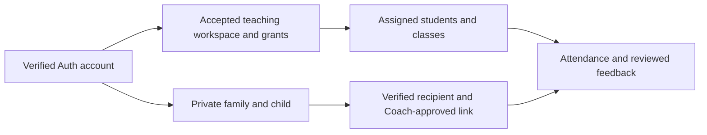

# Consolidated database direction

Status: recommended target and migration design, 17 November 2026. This document does not apply SQL. Evidence: metadata-only reads of AM project `fmavpazczahxeusqbxuh` and MM project `zcgcnycnanqkbdlwojln`, recorded under `docs/consolidation/`. Columns, nullability, constraints, RLS flags and function identities are captured; policies, function bodies, indexes, triggers and provider settings are not exhaustively audited by these snapshots.

## Current and target architecture

Keep MM's project and account/resource UUIDs. Keep separate family and academy identities. Evolve academy ownership into accepted workspace memberships, scoped grants and assignments using the existing private F1 candidate as a starting point. Its mere existence does not enable runtime permissions. The target contract remains `MULTI_WORKSPACE_FOUNDATION.md`; acceptance remains `MULTI_WORKSPACE_VALIDATION.md`.

Teaching grants permit academic work within their scope. An approved child/student link permits a separate Parent projection; staff membership never grants private family access. Account eligibility, link validity and consent are checked at execution time.

## Schema differences and decisions

| Concept | AM current model | MM current model | Classification and target decision |
| --- | --- | --- | --- |
| Teaching boundary | `workspaces`, `workspace_memberships` | `academies`, owner-based authorization | Conflicting scopes. Evolve MM with staged memberships; retain academy/resource IDs. |
| Identity | `profiles`, `children`, `guardianships` | `profiles`, `parent_families`, `family_children`, `students`, `student_contacts` | Potentially incompatible. Preserve private family-child versus academy-student distinction. Contacts are not authenticated guardians. |
| Connection | `workspace_children`, `connection_requests`, `family_invites`, events/receipts | `parent_coach_links`, `parent_connection_requests`, private invites | Equivalent purpose, different authority/lifecycle. Keep MM verified intended email and explicit Coach approval. No automatic identity matching. |
| Learning | `courses`, `batches`, `batch_coach_assignments` | `batches`, `students`, candidate workspace assignments | Source-only course/assignment concepts. Adopt via future destination-native contracts, not copied FKs or migration numbers. |
| Enrolment | `enrollments`, events and request receipts | `enrolments` | Conflicting spelling and lifecycle. Preserve existing rows; design pause/rejoin/history before expanding operations. |
| Scheduling | `schedule_sessions`, weekly setup series | `class_sessions` | Equivalent purpose, incompatible references. Preserve MM dates/attendance revision and explicitly design recurrence exceptions/time zones. |
| Attendance | sheets, records, events, request receipts | `attendance`, class attendance revision and checked save RPCs | Conflicting write/recovery model. Retain atomic MM saves; port Parent projection/report semantics through approved links. No guessed historical attendance. |
| Parent reports | `parent_signals`, signal receipts, typed `parent_items` | Reviewed `parent_feedback_handoffs` | Source-only signals and different feed semantics. Separate reports from attendance writes and reviewed feedback; use bounded versioned projections. |
| Observations/media | Not equivalent to MM's implemented reviewed journey | observations/versions/recipients, class media, consent events, private photos | Destination-only implemented capabilities. Preserve immutable recipients, revisions and current group-subject consent checks. |
| Finance | No equivalent implemented ledger in inspected source schema | invoice/payment/reversal tables | Destination-only. Preserve records and totals; payment collection remains shelved. |
| Family planning | No equivalent tables in inspected source schema | family events/todos/moments | Destination-only. Retain private owner scope. |
| OCR | No equivalent tables in inspected source schema | private imports, scan usage and monthly quota | Destination-only. Preserve idempotent import, provider-secret boundary and quotas. |
| Recovery controls | Numerous creation/setup fences, intents and receipts | Private import/review receipts and domain-specific revisions | Requires manual review per operation. Do not replace proven recovery with a generic wrapper or import source testing controls. |

The names `profiles` and `batches` overlap across projects, but their complete definitions and tenant references must not be treated as equal. Every captured table in both schemas has RLS enabled; enabled RLS alone does not prove correct policies or function authorization. Security-definer function identities are recorded for subsequent per-call review.

## Migration and compatibility sequence

1. Preserve installed 001–014; record the live custom `coach_private.schema_migrations` ledger before a future activation. Never import source history 001–053.
2. Review F1 private candidate, map existing academy IDs without fabricating teachers, preserve authorship and keep new structures inaccessible to clients.
3. Complete F2 across RPCs, direct table grants, views, storage and account eligibility. Changing only helper functions would leave direct-access paths inconsistent. Run negative and concurrent-revocation tests.
4. Add F3 explicit context selection, scoped cache/draft keys and legacy-client compatibility. A user owning multiple academies must never have one selected arbitrarily.
5. Rehearse on disposable PostgreSQL, then an authorized Supabase staging environment with synthetic/sanitized records. Compare IDs, row counts, links, monetary totals, receipts, consent and feed visibility. Exercise interruption and twice-run behavior.
6. Verify a restorable backup and write-pause/final reconciliation procedure before any live migration proposal. Live changes require the separate infrastructure approval specified in the Master Mission.

Before new-model writes, an additive private candidate can be abandoned while the old app remains authoritative. After new-model writes, an old schema/client rollback can lose records or broaden access; use a tested forward repair unless an exact reversible data transition has been demonstrated. Never describe a Git revert as a database rollback.

## Acceptance still required

The repository presently has no complete destination implementation of F2–F5 or Parent attendance. Captured metadata is not migration compatibility evidence. Exact policy/index/trigger comparison, per-function authorization review, independent transaction races, staging Auth/Storage/schema-cache integration, restore rehearsal and device/provider acceptance remain open. Source testing-only OTP/control overrides are excluded from the target design.
