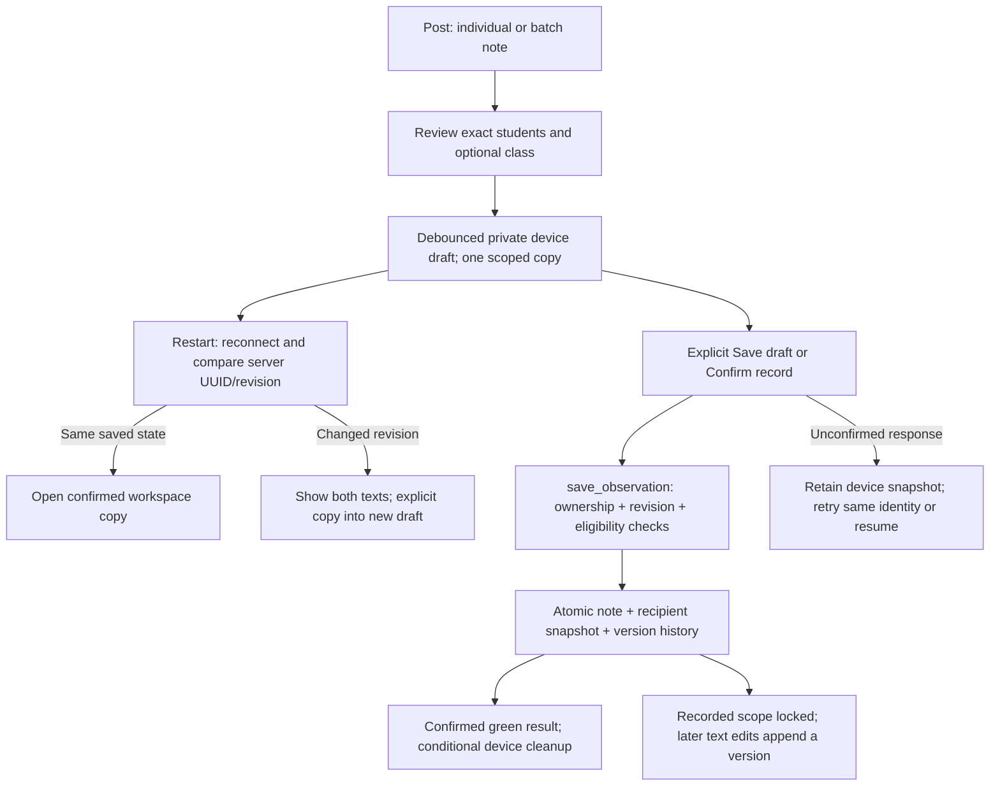

# Private observations — Module 5

Version 0.4.0 candidate. Implements PRD OBS-01. Local/browser evidence and native build status are in [validation](VALIDATION.md) and [progress](../PROGRESS.md). Deployment of migration 005 and native acceptance are separate checks.

[View the fictional recorded-note screenshot](images/observation-recorded.png).

## Owner setup when ready

No action is needed while Codex completes the build. Existing login, roster and attendance use the already-installed migrations 001–004.

For observations, apply **only the new 005 update** once the build is ready:

1. Open [the new SQL file on GitHub](https://github.com/appsworld2027/Parent-plus-/blob/codex/coach-foundation/supabase/migrations/202611120005_observations.sql). Use **Raw → Copy** (or the file's Copy control) to copy the entire file.
2. Open [your Supabase SQL editor](https://supabase.com/dashboard/project/zcgcnycnanqkbdlwojln/sql/new). Create a new query, paste the complete file and press **Run**. Do not append it to old SQL or rerun initial setup. The update preserves current records and enables RLS on the new history table. It also replaces access policies/functions, which can cause a generic SQL warning.
3. Expected result: **Success. No rows returned**. If an error appears, stop and share the error text; do not keep rerunning unrelated scripts.
4. After installing the new APK, open **Post**. Choose **Write an observation**, **Individual student**, a batch, one fictional student, and write a fictional note. A plain message confirms **saved on this device**, not saved to the workspace.
5. Use **Save draft to workspace** for an unfinished note, or **Record observation → Confirm save**. Expect a fixed green result notice. Recording fixes the selected students; later edits change text only. No email, WhatsApp or parent notification is sent.
6. Reopen history, close/reopen the app and verify the same record. Repeat a device-only draft restart separately. Keep actual family information out of test screenshots.

Do not sign out with work you need to retain only on this device: the app warns before removing unsent observation/attendance drafts. Workspace records are preserved. A device-only draft is not transferred between phone and emulator.

## Data flow and recovery

The native storage driver is Expo SecureStore with chunking; browser development uses sessionStorage. Autosave waits 600 ms after edits and also attempts persistence when the native app backgrounds. Abrupt process termination before a successful write can lose the latest keystrokes. Inline text reports local persistence; only an explicit successful server response (or exact reconciliation after restart) confirms workspace storage. No full offline roster cache or background server sync is implemented.

Only one device observation draft is allowed. A new note or another saved record cannot silently replace it. Unreadable drafts block writing until explicit removal. If the storage index itself is corrupt, explicit removal clears that index so writing can resume; SecureStore cannot enumerate unknown orphan chunks. A complete wipe of such unindexed encrypted app data requires Android app-storage removal. This recovery path is tested separately from ordinary complete-draft deletion. Delayed writers are invalidated on sign-out/discard; a successful old request cannot remove a newer draft. Local cleanup or history-refresh failure does not mislabel a confirmed server save as failed.

After a response is lost, the snapshot retains the exact requested status and UUID. Resume loads the server record: exact state means already saved, matching revision restores editable work, and a changed revision shows a comparison. The explicit copy action generates a new draft UUID; it does not overwrite the other device's note. A requested recorded state alone is never treated as server confirmation.

## Code map and rules

| File | Responsibility |
| --- | --- |
| `src/observations/ObservationsScreen.tsx` | Editor, audience confirmation, device persistence, explicit saves, recovery comparison, paged history |
| `src/observations/model.ts` | Types, eligible enrolments by academy local date, input checks and complete-state comparison |
| `src/observations/service.ts` | Shared Supabase client requests, paged roster reads, history cursor, private detail and sanitized failure references |
| `src/observations/drafts.ts` | Validated scoped snapshots, serialized/coalesced writes, epoch invalidation and conditional cleanup |
| `src/observations/localDrafts.ts` | The single native/browser storage instance |
| `src/auth/SignOutButton.tsx` | Warn before explicit sign-out removes unsent drafts |
| `supabase/migrations/202611120005_observations.sql` | Trusted write transaction, immutable recorded scope, RLS-protected append-only client history |

Server limits: one batch per note, optional matching non-cancelled class, at most 500 explicitly selected recipients, at most 10,000 text characters, and one recipient maximum in individual mode. Drafts can have incomplete text/selection once a batch is selected. Recording needs nonblank text and at least one eligible student. Without a linked class, eligibility uses today's date in the academy timezone. With a class, it uses that class's local date. Batch selection snapshots currently loaded eligible students; it does not silently add newly enrolled students later. Server validation rejects unavailable selections.

A recorded note may be corrected after a student is archived or an enrolment ends, retaining its original students, class, creator and recording time. Each meaningful correction appends a private version. Identical retry requests do not append versions or change timestamps. Changed stale revisions fail. Direct authenticated writes to notes, recipients and history are revoked; the trusted function verifies the owning academy. User content is never copied into diagnostics.

History loads 30 notes at a time with a timestamp/UUID cursor; detail displays up to five recent text versions. Roster reads are paged independently of Supabase's default response cap. Optional class choices show the latest 100 academy classes and are labelled accordingly. Photos, structured skill fields, parent delivery and observation dashboard summaries remain deferred.
