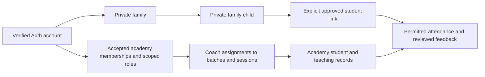

# ParentPlus: login, relationships and consolidation recommendation

Review date: 17 November 2026. Source snapshot `380adba9f73b3021a787dff72074df57f2a53634`; destination AM snapshot `614e1b2dbaea3c522fc7d223cb7ee6d02aa028f4`. This report is documentary/code review, not a new live deployment or test execution. `consolidation/documentation-inventory.json` indexes103source and62destination tracked Markdown files outside skills, with hashes. Inventory is not a claim that every historical proposal was validated. Detailed review prioritized the canonical product/decision/auth/schema/security/progress documents and the relevant executable contracts; historical entries must be interpreted by date and supersession.

## 1. Product and login differences

| Area | AM source | Destination current / recommendation |
| --- | --- | --- |
| Product framing | Parent companion across providers; academy/independent Coach workspaces; source pilot kit centers a post-class Parent update | Destination started Coach/Android-first and now has private Aurora Parent. Keep Expo and combine these into one Coach-to-Parent product loop. |
| Pilot target | Source founder PRD proposes updates within1hour for80%of sessions and under2minutes of Coach effort | Retain these as pilot hypotheses to validate, not measured results or contractual guarantees. Define safe analytics before collecting events. |
| Login | Email OTP helpers; live OTP and signup flags; separate founder dummy-OTP testing path | Email/password with verified email, recovery, PKCE callbacks and SecureStore on native. Retain this working provider/account model now. A later passwordless option must use the same Auth users and a deliberate delivery/abuse/recovery design. Never port dummy OTP controls to real use. |
| Onboarding | Workspace and role concepts precede class management | Current Coach loads its owned academy through owner_id/maybeSingle; Parent loads private family separately. Replace academy-only onboarding only when membership authority and context APIs are ready. |
| Child identity | Shared platform child plus guardianships and workspace-child links | Separate academy students and private family children connected explicitly. Keep destination IDs and boundaries; no global child matching/deduplication. |
| Connection initiation | Product intends both guardian requests and Coach invitations; connection separate from enrolment | Verified intended email plus explicit Coach approval is implemented in014. Keep it. Guardian-initiated discovery/request remains a deliberate future workflow; do not infer parity. |
| Teaching roles | Multi-workspace owner/admin/coach model and assignments in source schema | Live destination remains one academy owner; private F1/F2 candidates introduce roles/assignments but are not live authority. Complete every affected path before activation. |
| Scheduling/enrolment | Courses and recurring weekly setup; stronger enrolment lifecycle including pause/resume/complete/withdraw | Destination dated sessions and additive enrolments are implemented. Port lifecycle/recurrence through destination-native versioned contracts and failure/race tests. |
| Parent attendance/signals | Saved child attendance, weekly facts and report-only signals in PR7 | Destination has Coach attendance; AM branch has isolated Parent read and decoder only. Public API/UI, signals and weekly facts remain unfinished. |
| Feedback/media | Source diary/AI/media mainly remains planned at its latest checkpoint | Destination observations, immutable reviewed snapshots, private media and consent are implemented. Retain these. Source signals must not bypass reviewed feedback or change attendance. |
| Family/OCR/finance | No equivalent implemented tables in inspected source schema for destination family tools/OCR/manual ledger | Retain destination plans/memories, reviewed OCR imports, quotas and manual records. Fee collection/gateway work remains shelved. |
| Language/delivery | Source has EN/HI copy and typed-item fallback; founder kit PWA/push direction | Expo native/web stays target. Language parity needs a deliberate port; no push/read-receipt claim from stored records or opening WhatsApp. |

Primary evidence: source `docs/PROJECT_CONTEXT.md`, `DECISION_LOG.md` DEC005–019/024, `DEVELOPMENT_ROADMAP.md`, `BUILD_PROGRESS.md`, founder pilot PRD/data model and parent-feed/auth code; destination `PRD.md`, `PARENT_PRD.md`, `PARENT_IDENTITY.md`, `DATABASE_RELATIONSHIP_REVIEW.md`, `MULTI_WORKSPACE_FOUNDATION.md`, `WORKSPACE_AUTHORIZATION_QA.md`, `PROGRESS.md`, AuthProvider and migrations001–014.

## 2. Recommended relationships and workflow

One account can eventually be a Parent, independent Coach, academy instructor and owner in several contexts. Roles belong to accepted workspace memberships; they are not global flags on login. Academy ownership does not imply actual teaching, and a stored contact does not imply authenticated guardian access. A Parent links a private child to the relevant academy's student record without exposing family memories or other academy affiliations.

Current destination limits remain one owned academy/account, one private family/account, many siblings, many batches/student, and one active family per academy student. Migration013 also prevents two active student mappings for one family child inside the same academy. Do not remove these unique constraints until replacement permissions/lifecycles are tested. Multiple authenticated guardians need explicit private-family/consent/dispute policy; legal custody is not proved by verified email or Coach approval.

Target flow: verified login → choose an accepted context → Coach sets up/enrols/schedules → intended Parent requests a link → authorised match review approves → Coach records attendance and reviews a per-child update → linked Parent reads permitted facts. A new update should reuse the valid child/academy link, not require a new identity approval each time. Same-login testing still follows explicit approval; it is not permission to auto-link users.

## 3. Documentation conflicts that must be reconciled

- Source archived founder kit describes a19-table organizations/org_members design; actual source metadata has41public tables using workspaces. Treat the kit as requirements/reference, not deployment SQL.
- Source generic scenario register contains November4status rows superseded by later class/enrolment/attendance implementations and November16publication notes.
- Destination `PRODUCT_PLAN.md` and older `PROGRESS.md` sections defer Parent and prioritize payments; newer owner corrections and Parent PRD supersede these.
- Destination `PARENT_MODULE.md`, `AUTH_SETUP.md`, relationship/identity documents contain historical activation/APK statements. Later progress and014activation follow-ups supersede them. Preserve history but add a clear current-state entrypoint before handover; do not rerun old setup instructions.
- Private SQL candidates and main-branch Git merges do not establish live Supabase activation. Read-only catalog snapshots do not establish policies, function bodies, race safety or provider behavior.

## 4. Recommended execution order

1. Establish one current product/feature acceptance baseline with every source capability disposition and destination feature preserved. Resolve stale activation instructions and measure the Coach-to-Parent loop against the pilot hypotheses.
2. Keep destination email/password/verified-email Auth and existing account UUIDs. Validate real distinct-account signup, verification, recovery, expired links, cold restart, logout and wrong-account denial; add passwordless later if evidence warrants it.
3. Finish destination F2 conversion across public functions, direct table access, views, Storage and OCR; add staff invitations/delegation/ownership transfer, account eligibility and revocation tests. Preserve014guardian controls and source-only concepts through destination-native contracts.
4. Complete F3 context picker/onboarding and account/workspace-scoped in-flight requests, caches and drafts. Support admin-only owners and independent Coaches without fabricating teachers or leaking affiliations.
5. Finish Parent attendance API/UI, weekly facts and report-only signals, then enrolment lifecycle and recurrence parity. Keep destination reviewed-media/feedback workflows intact. Test full positive, denial, lost-response and concurrent-change journeys.
6. Rehearse migrations/backfill on disposable PostgreSQL and real Supabase staging, verify counts/IDs/links/receipts/financial totals/media, restore a backup and demonstrate legacy-client behavior. Present the exact activation/forward-repair plan for separate live approval.
7. Accept the destination release and execute the closure ledger. Vercel/GitLab remain deferred, so full Master Mission completion is not possible until those items return to scope or are explicitly waived.

No technical choice about migration strategy is delegated to the founder by this report. Founder decisions still required before affected release: guardian expansion/consent disputes, real data retention/deletion policy, paid service/infrastructure authorization and live activation acceptance.
