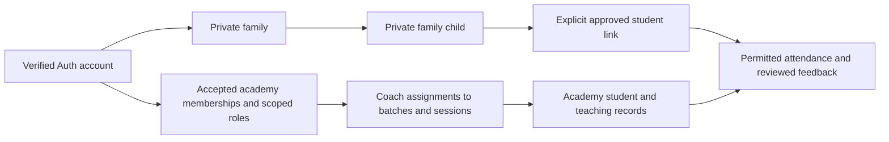

# ParentPlus: login, relationships and consolidation recommendation

Review date: 17 November 2026. Source snapshot `380adba9f73b3021a787dff72074df57f2a53634`; destination AM snapshot `614e1b2dbaea3c522fc7d223cb7ee6d02aa028f4`. This report is documentary/code review, not a new live deployment or test execution. `consolidation/documentation-inventory.json` indexes103source and62destination tracked Markdown files outside skills, with hashes. Inventory is not a claim that every historical proposal was validated. Detailed review prioritized the canonical product/decision/auth/schema/security/progress documents and the relevant executable contracts; historical entries must be interpreted by date and supersession.

## 1. Product and login differences

| Area | AM source | Destination current / recommendation |
| --- | --- | --- |
| Product framing | Parent companion across providers; academy/independent Coach workspaces; source pilot kit centers a post-class Parent update | Destination started Coach/Android-first and now has private Aurora Parent. Keep Expo and combine these into one Coach-to-Parent product loop. |
| Pilot target | Source founder PRD proposes updates within1hour for80%of sessions and under2minutes of Coach effort | Retain these as pilot hypotheses to validate, not measured results or contractual guarantees. Define safe analytics before collecting events. |
| Login | Email OTP helpers; live OTP and signup flags; separate founder dummy-OTP testing path | Email/password with verified email, recovery, PKCE callbacks and SecureStore on native. Retain this working provider/account model now. A later passwordless option must use the same Auth users and a deliberate delivery/abuse/recovery design. Never port dummy OTP controls to real use. |
| Onboarding | Workspace and role concepts precede class management | Current Coach loads its owned academy through owner_id/maybeSingle; Parent loads private family separately. Replace academy-only onboarding only when membership authority and context APIs are ready. |
| Child identity | Shared platform child plus guardianships and workspace-child links | Separate academy students and private family children connected explicitly. Keep destination IDs and boundaries; no global child matching/deduplication. |
| Connection initiation | Product intends both guardian requests and Coach invitations; connection separate from enrolment | Verified intended email plus explicit Coach approval is implemented in014. Keep it. Guardian-initiated discovery/request remains a deliberate future workflow; do not infer parity. |
| Teaching roles | Multi-workspace owner/admin/coach model and assignments in source schema | Live destination remains one academy owner; private F1/F2 candidates introduce roles/assignments but are not live authority. Complete every affected path before activation. |
| Scheduling/enrolment | Courses and recurring weekly setup; stronger enrolment lifecycle including pause/resume/complete/withdraw | Destination dated sessions and additive enrolments are implemented. Port lifecycle/recurrence through destination-native versioned contracts and failure/race tests. |
| Parent attendance/signals | Saved child attendance, weekly facts and report-only signals in PR7 | Destination has Coach attendance; AM has an isolated Parent projection/API/native preview, disabled in production and not installed live. Signals and weekly facts remain unfinished. |
| Feedback/media | Source diary/AI/media mainly remains planned at its latest checkpoint | Destination observations, immutable reviewed snapshots, private media and consent are implemented. Retain these. Source signals must not bypass reviewed feedback or change attendance. |
| Family/OCR/finance | No equivalent implemented tables in inspected source schema for destination family tools/OCR/manual ledger | Retain destination plans/memories, reviewed OCR imports, quotas and manual records. Fee collection/gateway work remains shelved. |
| Language/delivery | Source has EN/HI copy and typed-item fallback; founder kit PWA/push direction | Expo native/web stays target. Language parity needs a deliberate port; no push/read-receipt claim from stored records or opening WhatsApp. |

Primary evidence: source `docs/PROJECT_CONTEXT.md`, `DECISION_LOG.md` DEC005–019/024, `DEVELOPMENT_ROADMAP.md`, `BUILD_PROGRESS.md`, founder pilot PRD/data model and parent-feed/auth code; destination `PRD.md`, `PARENT_PRD.md`, `PARENT_IDENTITY.md`, `DATABASE_RELATIONSHIP_REVIEW.md`, `MULTI_WORKSPACE_FOUNDATION.md`, `WORKSPACE_AUTHORIZATION_QA.md`, `PROGRESS.md`, AuthProvider and migrations001–014.

## 2. Recommended relationships and workflow

One account can eventually be a Parent, independent Coach, academy instructor and owner in several contexts. Roles belong to accepted workspace memberships; they are not global flags on login. Academy ownership does not imply actual teaching, and a stored contact does not imply authenticated guardian access. A Parent links a private child to the relevant academy's student record without exposing family memories or other academy affiliations.

Current destination limits remain one owned academy/account, one private family/account, many siblings, many batches/student, and one active family per academy student. Migration013 also prevents two active student mappings for one family child inside the same academy. Do not remove these unique constraints until replacement permissions/lifecycles are tested. Multiple authenticated guardians need explicit private-family/consent/dispute policy; legal custody is not proved by verified email or Coach approval.

Target flow: verified login → choose an accepted context → Coach sets up/enrols/schedules → intended Parent requests a link → authorised match review approves → Coach records attendance and reviews a per-child update → linked Parent reads permitted facts. A new update should reuse the valid child/academy link, not require a new identity approval each time. Same-login testing still follows explicit approval; it is not permission to auto-link users.

## 3. Documentation conflicts that must be reconciled

- Source archived founder kit describes a19-table organizations/org_members design; actual source metadata has41public tables using workspaces. Treat the kit as requirements/reference, not deployment SQL.
- Source generic scenario register contains November4status rows superseded by later class/enrolment/attendance implementations and November16publication notes.
- Destination `PRODUCT_PLAN.md` and older `PROGRESS.md` sections defer Parent and prioritize payments; newer owner corrections and Parent PRD supersede these.
- Destination `PARENT_MODULE.md`, `AUTH_SETUP.md`, relationship/identity documents contain historical activation/APK statements. Later progress and014activation follow-ups supersede them. Preserve history but add a clear current-state entrypoint before handover; do not rerun old setup instructions.
- Private SQL candidates and main-branch Git merges do not establish live Supabase activation. Read-only catalog snapshots do not establish policies, function bodies, race safety or provider behavior.

## 4. Recommended execution order

1. Establish one current product/feature acceptance baseline with every source capability disposition and destination feature preserved. Resolve stale activation instructions and measure the Coach-to-Parent loop against the pilot hypotheses.
2. Keep destination email/password/verified-email Auth and existing account UUIDs. Validate real distinct-account signup, verification, recovery, expired links, cold restart, logout and wrong-account denial; add passwordless later if evidence warrants it.
3. Finish destination F2 conversion across public functions, direct table access, views, Storage and OCR; add staff invitations/delegation/ownership transfer, account eligibility and revocation tests. Preserve014guardian controls and source-only concepts through destination-native contracts.
4. Complete F3 context picker/onboarding and account/workspace-scoped in-flight requests, caches and drafts. Support admin-only owners and independent Coaches without fabricating teachers or leaking affiliations.
5. Finish Parent attendance API/UI, weekly facts and report-only signals, then enrolment lifecycle and recurrence parity. Keep destination reviewed-media/feedback workflows intact. Test full positive, denial, lost-response and concurrent-change journeys.
6. Rehearse migrations/backfill on disposable PostgreSQL and real Supabase staging, verify counts/IDs/links/receipts/financial totals/media, restore a backup and demonstrate legacy-client behavior. Present the exact activation/forward-repair plan for separate live approval.
7. Accept the destination release and execute the closure ledger. Vercel/GitLab remain deferred, so full Master Mission completion is not possible until those items return to scope or are explicitly waived.

No technical choice about migration strategy is delegated to the founder by this report. Founder decisions still required before affected release: guardian expansion/consent disputes, real data retention/deletion policy, paid service/infrastructure authorization and live activation acceptance.

## 5. Code gap audit — refreshed 17 November 2026

This section supersedes older implementation-status wording above. Compared fetched Source `main@380adba9f73b3021a787dff72074df57f2a53634` with Destination `AM/consolidated@3e237f558c65ad2c886a1c6e40eff140dcca0597` (the preparation baseline, before this documentation update). Destination `main@a1888f2` and `codex/coach-foundation@b6c9006` are different snapshots: AM-only candidates and previews must not be described as merged there. All six fetched historical MM feature-branch tips are ancestors of the AM baseline; their branch names do not establish additional missing work.

Scope: static review of application entrypoints/modules, service/API boundaries, candidate and installed SQL contracts, configuration names, test harnesses, CI and quality instructions, plus fresh checks recorded below. This is a domain/contract gap analysis, not line-by-line proof of every execution path or an independent security review. No source tracked files, live services or other destination branches were changed. Runtime Supabase state is covered separately in [the live comparison](LIVE_DATABASE_COMPARISON.md).

A feature is a user outcome across the complete flow: action → screen → service/API → authorization → saved data → response → reopen/recovery. A matching screen/table/function name is insufficient. Classifications below distinguish implemented code, isolated candidates, disabled previews and future catalogue intent. Audit IDs are manual comparison references; they are not an installed automated requirement registry.

| ID / capability and Source evidence | Destination gap, disposition and executable evidence |
| --- | --- |
| C01 Login and profile lifecycle: `apps/web/src/lib/auth/`, `app/login/page.tsx`; email OTP and separate founder controls | **KEEP Destination; reconcile lifecycle.** `src/auth/` has password signup/verification, PKCE recovery, refresh, SecureStore chunking and neutral errors. OTP absence is a deliberate different login contract, not broken Auth. Preserve accounts; never copy dummy OTP or privileged founder controls into production. `tests/auth.test.ts`, `tests/crypto.test.ts`, `e2e/auth.spec.ts` do not establish real email delivery. Source profile hook is incompatible unchanged; see live comparison. |
| C02 Accepted multi-academy contexts: Source `lib/scheduling/list-class-workspaces.ts`, `modules/today/today-panel.tsx`, workspace SQL | **ADOPT behavior, incomplete Destination integration.** `AuthProvider.tsx` still selects one owned academy using owner_id/maybeSingle. F1/F2 private membership candidates and roster projection exist, but public service/UI/Storage/OCR conversion does not. Source workspace first-use/resume/fence recovery in lib/workspace/first-use.ts and workspace-form.tsx has no equivalent complete Destination multi-workspace creation journey; current create_academy onboarding must retain its existing retry behavior. `tests/workspace-foundation.test.ts` and `workspace-roster-projection.test.ts` verify isolated parts, not end-to-end staff usage. |
| C03 Owner/admin/assigned-Coach authority: Source scheduling/attendance SQL and authorization/race tests | **REDESIGN through Destination F2.** Private decision kernel, grants and revocations have tests, but all 36 legacy public RPCs/direct grants/Storage paths still need conversion. Source also does not supply a complete staff invitation/ownership-transfer product. `tests/workspace-authorization.test.ts`, `workspace-account-eligibility.test.ts`, `scripts/test-workspace-concurrency.mjs`. Do not activate membership access from private tests alone. |
| C04 Context switching and private in-flight state: Source `modules/attendance/session-boundary.ts` and Today/Parent selectors | **PARTIAL.** Destination protects session changes and preview child/date requests, but has no accepted multi-academy context picker. `WorkspaceSwitcher.tsx` is web-only; native chooses Coach/Parent through build-time EXPO_PUBLIC_APP_MODULE. A single installed mobile app with runtime role/context switching is not delivered. `e2e/workspace-entry.spec.ts`, `e2e/parent-attendance.spec.ts` cover web behavior only. |
| C05 Course → batch → class relationship: Source `lib/scheduling/` plus courses/batches/session SQL | **ADOPT missing course semantics.** Destination `src/roster/`, `src/classes/` implement batches, students and dated classes but no course entity/management journey. Keep IDs, room, default fee and archived history. Source schedule page also retains explicitly labelled example sessions; do not port its example list as real classes. |
| C06 Weekly recurrence and multi-step setup recovery: Source `occurrences.ts`, `class-setup-operations.ts`, recovery panels | **MISSING recurrence; preserve existing Destination time handling.** Destination saves one dated occurrence at a time and already rejects ambiguous/nonexistent DST wall times in `classes/model.ts`. Source adds bounded weekly expansion (104), atomic setup, generation/intents and retry recovery. Reimplement outcomes in Expo; test gaps/folds, timezone changes, partial/lost responses and duplicate submissions. Source `occurrences.test.ts` / `tests/database/test_scheduling_foundation.py`; Destination `tests/classes.test.ts` / `classes-database.test.ts`. |
| C07 Enrolment lifecycle: Source `modules/enrollments/`, `lib/enrollments/actions.ts` and lifecycle SQL | **MISSING explicit state/version/event model.** Destination `roster/model.ts` / service use starts_on/ends_on and additive batch membership. Add pending/active/paused/completed/withdrawn/cancelled through compatible contracts and UI, protecting attendance/finance history. Trial is catalogue intent, not an observed Source implemented lifecycle state. Source journey tests and Destination `coach-workflows-database.test.ts` cover different contracts. |
| C08 Coach attendance status vocabulary: Source `modules/attendance/contracts.ts` | **PARTIAL parity.** Destination `classes/model.ts` supports present/late/absent; Source also supports excused/make_up. Destination already requires complete marks and preserves null/unrecorded separately. Extend schema, decoders, UI, summaries and Parent interpretation together; tests must prove all allowed/forbidden transitions. `tests/classes.test.ts`, `classes-database.test.ts`, `e2e/classes.spec.ts`. |
| C09 Attendance commit/retry/correction: Source `attendance/actions.ts`, `pending.ts`, sheet/receipt SQL | **COMBINE guarantees, not duplicate implementation.** Destination has revision/context checks, scoped persisted drafts and lost-response read reconciliation. It lacks Source's dedicated actor/full-payload request-status receipt contract for this domain. Preserve the existing protection; test same request/same payload, changed payload, commit-with-lost-response, roster/session changes and corrupted recovery state. Source `recovery.integration.test.tsx`; Destination `e2e/classes.spec.ts` and database tests. |
| C10 Coach Today with academy selector and Parent reports: Source `modules/today/`, `listSessionSignals` | **PARTIAL.** Destination `TodayClasses.tsx` displays real classes and roster/attendance facts for its owned academy, but lacks multi-academy selector and session signal inbox. `e2e/coach-priority.spec.ts` protects existing setup/feedback routes. Do not replace working Today with Source demos or a planned “Needs you” product. |
| C11 Parent child/academy/class/date agenda: Source `modules/parent-feed/parent-home.tsx` and scoped list actions | **DEVELOPMENT PREVIEW ONLY.** AM has `ParentAttendance.tsx`, strict decoder/service and private/API SQL candidates; panel requires non-production plus flag, approved links and identity readiness. It is not installed live. Current preview lacks Source's full academy/batch filtering and displays class timestamps explicitly in UTC. `tests/parent-attendance-projection.test.ts`, `parent-attendance-contract.test.ts`, `e2e/parent-attendance.spec.ts`. |
| C12 Parent weekly attendance facts: Source `loadParentWeek`, `decodeParentWeek`, weekly RPC | **MISSING.** Destination has a Monday utility, not the weekly aggregate/API/UI. Define counts from saved Coach marks, academy timezone, correction/history, pagination and enrolled-date rules. A family calendar week strip or stored event is not this feature. Add positive, sibling/other-family denial, cross-year/DST and >50-row cases. |
| C13 Parent quick signals and Coach reading: Source `signal-center.tsx`, send/status actions, signal SQL | **MISSING.** Source implements running_late, missing_today with reasons, dropped_off and picked_up as reports, with same-request recovery and current-day/session-version checks. Destination has no equivalent UI/API/store. Reports must not mutate attendance, certify physical handover or become reviewed feedback automatically. Test revoked link/account, expired local day, cancelled session, changed payload and both revocation race orders. |
| C14 Versioned typed Parent delivery and safe unknown fallback: Source `parent-item-card.tsx`, `safeParentAction`, item decoder/SQL | **MISSING generic contract.** Destination's approved feedback feed is implemented but is a different reviewed snapshot contract. Add only necessary typed attendance/item delivery, bounded payloads, version fallback and allowlisted internal actions without bypassing approval/consent. Source `parent-item-card.test.tsx` / `contracts.test.ts`; Destination `reviewed-feedback-database.test.ts`, `e2e/parent-feedback.spec.ts` preserve reviewed delivery. |
| C15 Guardian connection/invites: Source `families/actions.ts`, `join-panel.tsx` | **KEEP stronger Destination matching, selectively combine recovery.** Destination verified intended-email claim + explicit Coach approval + disconnect is implemented in 014 and `src/parent/identity.ts` / `ParentConnectionApprovals.tsx`. Source invite acceptance and separate enrolment are useful comparisons, not authority to weaken matching. `tests/parent-identity-database.test.ts`, `e2e/parent-identity.spec.ts`. Full guardian-initiated discovery and multi-guardian access are not completed products in either repo. |
| C16 Child creation and historical retry recovery: Source `lib/parent/child-creation-*.ts` and creation fences/history | **PARTIAL equivalent, redesign only if required.** Destination family child writes use UUID upserts and family scope rather than the Source intent/fence protocol. Do not equate a different protocol with a defect; test duplicates, changed retry, archived links and account switch before deciding which extra history is needed. `tests/parent-database.test.ts`, `e2e/parent-workspace.spec.ts`. |
| C17 English/Hindi user copy: Source attendance/Parent copy providers and `messages/en.json`, `hi.json` | **MISSING equivalent locale selection/translation coverage.** Destination has mostly inline English strings; bilingual attendance/Parent copy is not transferred. Source localization is also surface-specific, not proof that all its screens are translated. Port current accepted copy and date/status/unknown-item semantics; test both languages and accessible names. |
| C18 Browser install experience: Source `app/manifest.ts` and icons | **DIFFERENT target; assess web requirement.** Destination native Expo/Android build is retained; no equivalent installable-web manifest was found in its app configuration. Source manifest does not prove offline sync or push delivery; no service-worker/push implementation was found in inspected runtime paths. Do not replace native architecture to copy this shell. |
| C19 API response and pagination contracts: Source bounded decoders, actor checks and ordered cursors in attendance/Parent actions | **PARTIAL, broaden selectively.** Destination Parent attendance and OCR have explicit validation; several other services cast API data to TypeScript shapes. `loadClasses` sends unpaged class/student/enrolment reads; configured API row limits can truncate them at scale. `loadRoster` and family reads page in blocks of 500 but materialize the whole result. Add wrong-scope/malformed/unordered/large-data tests and explicit paging bounds where outcomes require them. This is a code risk, not a reproduced live truncation defect. |
| C20 Test/review evidence system: Source `quality/`, `scripts/quality/quality_gate.py`, local-provider browser suites | **ADOPT mechanisms through an Expo-native implementation.** Destination has real SQL/fixture-browser tests and JUnit validation but no requirement registry, deterministic impact selector or source-bound execution receipts. Source scripts assume Next.js/Python DB layout and are not drop-in Destination commands. See quality findings below. |

### Destination implementations that must survive consolidation

| Capability | Code and preservation evidence |
| --- | --- |
| Student profiles, proficiency, batch rosters, inline setup | `src/roster/`, `src/onboarding/CoachSetupCard.tsx`; `e2e/roster.spec.ts`, `coach-workflows.spec.ts`, `coach-priority.spec.ts`. Source has real family/enrolment screens, but not this full profile/roster UX. |
| Private observations and immutable reviewed Parent feedback | `src/observations/`, reviewed snapshot/handoff SQL; `observations-database.test.ts`, `reviewed-feedback-database.test.ts`, `e2e/coach-parent-journey.spec.ts`. Source Post route is explicitly “Coming soon”. |
| Class media, purpose-specific consent, private signed previews | `src/class-media/`, `src/photos/`; `class-media.test.ts`, `photos.test.ts`, Parent/media SQL tests. Source planned media/AI does not replace these controls. Actual Storage bytes/provider/device acceptance remains distinct. |
| Private Aurora family children/plans/reminders/moments | `src/parent/ParentApp.tsx`, `model.ts`, `service.ts`; `parent-model.test.ts`, `parent-database.test.ts`, `e2e/parent-workspace.spec.ts`. A saved reminder is not a delivered notification. |
| Manual fee ledger, immutable charges/receipts/reversals, exact pending recovery | `src/fees/`; `fees-database.test.ts`, `fees.test.ts`, `e2e/fees.spec.ts` / coach workflow cases. Source Fees route is “Coming soon”; keep gateway/collection scope shelved. |
| Reviewed OCR import and server-side quota | `src/onboarding/`, `supabase/functions/scan-roster/`; handler, vision mapping, scan-model/import/quota tests and `e2e/roster-scan.spec.ts`. Provider-backed OCR is a separate acceptance gate. |
| Native session persistence, diagnostics and Android build guards | `src/auth/storage.ts`, crypto adapters, diagnostics/ErrorBoundary; native-accessibility test, installer/APK architecture scripts and Android workflow. Source web architecture does not replace mobile lifecycle obligations. |

### Planned in Source is not transferable implemented code

The existing [58-item consolidated catalogue](CONSOLIDATED_PRODUCT_ROADMAP.md) remains the requirement inventory; this audit does not claim those 58 outcomes exist in Source. Source still lacks complete diary/publish, AI drafting/polish/voice, delivered reminders/notification channels, messaging, payments/UPI collection, discovery/trial marketplace, progress intelligence, offline synchronization and formal multi-guardian/dispute/retention workflows. Some related partial Destination features are listed above. Do not infer parity gaps from prototype buttons, a catalogue row, message JSON or a database concept.

In particular Source `app/(coach)/post/page.tsx` and `fees/page.tsx` are placeholders, while `students/page.tsx` now mounts real family/enrolment panels. Its old feature register still labels all three placeholder; this is one concrete reason current code outranks stale prose.

## 6. Engineering quality comparison and remaining enforcement gaps

| Quality mechanism | What exists and what remains |
| --- | --- |
| Durable AI instructions | Both have AGENTS and 15 repository Superpowers skills. Source additionally routes to engineering standards, delivery workflow, context map and handoff. Destination's existing Developer Guide is its canonical place to strengthen that operating procedure; no duplicate standards document is needed. Skill files are guidance, not proof every client loaded them. |
| Requirement → scenario → exact test | Source registry has 1,012 rows (998 implemented, 12 planned, 2 deferred). Many IDs are test-derived scenarios, not 998 complete features. Several broad attendance/learning rows remain planned despite narrow implemented code/tests. Adopt traceability and reconciliation, not these statuses wholesale. Destination has PRD/scenario prose but no comparable executable registry/coverage gate. |
| Impact-aware test selection | Source gate defaults unknown/auth/security/dependency changes to broad suites and validates its own rules. Fresh self-test and plan validation passed. Destination normally runs a broad suite but lacks a machine-validated selection/traceability system. Start conservatively with broad required checks; optimize only after coverage mapping is trustworthy. |
| Fresh source/report linkage | Source receipts bind source fingerprints, collected identities and report/run identity. Destination JUnit validation rejects empty/failing/skipped unit evidence, but does not establish complete acceptance coverage or source-bound browser/race evidence. An artifact upload is not a final acceptance gate. |
| Automated branch coverage | Destination checks.yml push triggers cover main and codex/coach-foundation; AM/consolidated push is excluded. Pull requests trigger it, but current AM work is not thereby proven checked. Android auto-build is only on the legacy Coach branch, with manual dispatch available. Extend AM/MM branch coverage deliberately; do not claim workflows ran because files exist. |
| Test-runner integrity | Source browser configs set forbidOnly and maintain scenario/action reports. Destination Playwright config has no forbidOnly guard or success JUnit reporter; unit JUnit validation exists in CI. Static search found no current only/skip markers in Destination tests/e2e, but future accidental focus/skip needs enforcement. |
| Static code checks | Source has ESLint plus types/tests/build. Destination check means TypeScript + Vitest; no lint script/configured ESLint gate was found. Add a deliberate Expo-compatible lint setup rather than copy Next.js ESLint configuration. |
| Real database and provider depth | Source has isolated PostgreSQL authorization/concurrency tests and synthetic plus real-local Supabase browser harnesses. Destination has PGlite integration, eight real PostgreSQL private-kernel race cases and fictional browser transport; no equivalent full local Supabase/Auth/Storage/OCR journey gate was found. Neither proves current production email/provider behavior from mocks. |
| Device and accessibility | Source browser QA defines desktop/mobile viewports. Destination browser suite uses one phone-size viewport; its Android role-source and APK guards are useful but not actual assistive-technology, app background/restart or device E2E proof. Keep web and native acceptance distinct; iOS acceptance was not executed here. |
| Independent review and branch protection | Instructions/templates cannot force a human approval or make self-review independent. Required checks, protected branches and two-founder enforcement remain unverified/unconfigured in this consolidation; founder previously deferred their setup. No independent reviewer was invoked for this audit. |
| Shared context freshness | Destination Developer Guide and shared workflow contain older checkpoint language (including Parent deferral/main promotion) superseded by later owner instructions. The updated entrypoints must state AM-only work, current authority and latest progress before historical notes. A new Codex session must prove it can operate from Destination alone. |

## 7. Scenario-level closure requirements

For each affected audit ID, map its accepted outcomes to exact test identities in the existing feature QA/spec and a future executable registry. A filename alone is not full coverage. Minimum scenario families:

- Success, empty/loading, invalid/malformed response and accessible error/retry.
- Anonymous, unverified, wrong account, sibling/other family, other academy, suspended/revoked/expired membership, changed intended email and denied direct RPC/table/Storage bypass.
- Double click/retry, same key changed payload, server commits but response is lost, app/tab restart, corrupt/unavailable local storage and explicit reconciliation.
- Roster/session/enrolment/link/consent changes while an operation is open; delayed replies after child/context/account switch; both commit orderings of concurrent revocation/write.
- Dates/timezones/DST and year boundaries, archived/history behavior, bounded/large-result pagination and migration compatibility.
- Ordinary verified Coach → approved Parent → correct child facts/reviewed media, reopen and disconnect; include actual provider/device checks where the feature uses them.

These are required scenario families to tailor, not a claim every family is automated today. Preserve Destination-only outcomes with their existing regressions. Full source retirement still requires the [acceptance ledger](CONSOLIDATION_ACCEPTANCE_LEDGER.md), data disposition and destination-only rehearsal.

## 8. Recommended implementation order

1. Adapt the existing Developer Guide/AGENTS/PR checklist now (this documentation change). Next implement executable Expo quality enforcement: AM/MM CI triggers, focus/skip guards, browser evidence, lint and requirement mapping. Review actual hosted outcomes at the relevant code commit. No CI workflow or repository setting was changed in this audit.
2. Complete F2 public/direct/Storage/OCR authorization and account eligibility; then accepted workspace/context selection, scoped private state and native module navigation.
3. Finish the AM Parent attendance preview's projection/API/UI and weekly facts, signals/recovery and typed delivery under approved links. Keep production disabled until staging acceptance.
4. Add courses/weekly recurrence, explicit enrolment lifecycle and extended attendance statuses with compatible migration and history/retry behavior.
5. Port bilingual copy and optional web-install requirements as deliberate product slices; keep speculative AI/notifications/marketplace work explicitly deferred.
6. Run real Supabase staging/Auth/Storage/provider checks, native acceptance, migration/restore and destination-only rehearsal. Seek live activation/merge approval only for a concrete tested package; no other-branch merge is authorized now.

The agent owns implementation/verification within approved scope. Founder action is unnecessary for this audit. Later paid-provider, unresolved guardian/retention policy and live release decisions remain explicit boundaries.

## 9. Fresh execution evidence — 17 November 2026

Code snapshots tested: Source `380adba9f73b3021a787dff72074df57f2a53634`; Destination `3e237f558c65ad2c886a1c6e40eff140dcca0597`. Only existing Markdown/instruction/template files changed after these baselines; no application, SQL, package or workflow implementation changed in this audit.

| Check | Actual outcome and limits |
| --- | --- |
| Source frontend Vitest | 528/528 tests, 55 files passed (109.67s). First attempt lacked Vitest; locked dependencies were installed, tests ran, then temporary dependencies/cache were removed for disk capacity. No tracked Source changes. This was not a fresh Source lint/type/build/browser run. |
| Source quality engine | 58/58 self-tests passed (11.807s); plan/registry validation succeeded with full frontend+DB selection. A selection plan is not an executed full quality gate. |
| Source full PostgreSQL gate | **NOT GREEN.** Second full attempt executed 598 unittest cases: 594 passed, 1 failure + 3 errors, zero skips. All four unsuccessful cases stopped starting additional disposable containers during disk pressure (exit 125); cleanup audit passed. Standalone concurrency report was not produced and full gate exited 1. |
| Source focused container-case retest | All four affected upgrade/cutover tests subsequently passed sequentially in 71.592s after releasing the outer container. This resolves their isolated reproduction but does not retroactively make the full DB gate green or supply its missing concurrency report. |
| Destination TypeScript + Vitest | `npm run check` passed: 338/338 unit/database cases, 35 files (Vitest 58.20s). SQL tests use PGlite/emulated identities, not live Supabase. |
| Destination independent-connection PostgreSQL | 8/8 private-kernel transaction cases passed in a labeled, network-isolated disposable PostgreSQL 17 container, removed afterward. First creation failed due disk space; this successful rerun is separate. It does not verify complete F2 public API or Parent API concurrency. |
| Destination browser | 89/89 Playwright cases passed (3.9 minutes), using installed Chromium, phone-size viewport and fictional SDK transport. The first broad run stopped at disk exhaustion; the successful full rerun includes the previously affected unreadable fee-recovery case. This does not validate real provider or native device behavior. |
| Documentation/instruction validation | Existing-file-only scope, 20 unique code audit IDs, 58 unique catalogue IDs, local Markdown target checks and git diff --check passed. Final diff reviewed by the author. No independent reviewer invoked. |
| Unrun/separate acceptance | Source real-local Supabase/browser/lint/type/build gate; current hosted CI; real email/Storage/OCR; staging activation; native device/iOS/accessibility; performance/load; backup restore; independent review and branch protection. Exports were not repeated for this documentation-only change. |

Initial broad Source DB and Destination browser runs hit ENOSPC disk exhaustion; temporary dependency/download caches were removed. Original DB failure reports remain distinct from focused passing retests. No test was weakened/skipped or production service used to obtain passing output. Raw task logs are local scratch evidence; the durable outcome is this table, not a claimed hosted artifact.

This audit documents gaps and strengthens instructions. It does not implement the missing features, install a new automatic quality gate, activate candidates or complete the consolidation.
